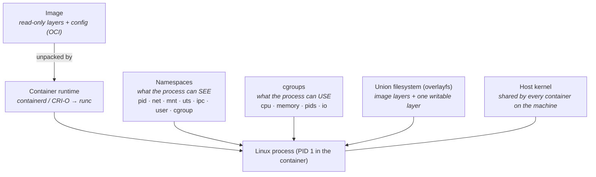

# 00-01 — Containers, and why orchestration exists

> **Module type:** Foundation
> **Time:** ~2 hours (60 reading, 60 lab)
> **Prerequisites:** basic Linux shell; the Ubuntu lab machine with Docker Engine (`00-02` step 2)
> **Maps to:** CKA/CKAD assume all of it silently — exit codes, image references, the runtime stack and resource limits all reappear in troubleshooting questions

---

## 1. Why this module exists

Kubernetes is a system for running **containers** across many machines. Almost every confusing
Kubernetes symptom — `OOMKilled`, exit code 137, `ImagePullBackOff`, "it works locally but not in
the Pod", a Pod that ignores `kubectl delete` for 30 seconds — is a **container** behaviour, not a
Kubernetes behaviour. If the layer underneath is fuzzy, those symptoms look like magic.

This module rebuilds that layer: what a container really is on Linux, what an image is, who
actually runs containers in a Kubernetes cluster, and what problem orchestration solves that a
single `docker run` cannot.

---

## 2. The object model — what a container is made of



**A container is a normal Linux process** with three things applied to it:

| Ingredient | Controls | Analogy |
|---|---|---|
| **Namespaces** | What the process can **see** — its own PID tree, network stack, hostname, mounts | Blinkers on a horse |
| **cgroups** (control groups) | What the process can **use** — CPU time, memory, number of PIDs, disk I/O | A fuse box |
| **A layered root filesystem** | What files it sees as `/` | A stack of transparent sheets |

There is **no guest kernel**. Every container on a node uses the node's kernel. That is why
containers start in milliseconds, and also why a container is a weaker isolation boundary than a VM.

---

## 3. Concepts

### 3.1 Namespaces — isolation of *view*

| Namespace | Isolates | What you notice inside the container |
|---|---|---|
| `pid` | Process IDs | Your app is PID 1; you cannot see host processes |
| `net` | Network interfaces, IPs, routes, ports, iptables | Its own `eth0`, its own IP, port 80 free even if the host uses it |
| `mnt` | Mount points | Its own `/` |
| `uts` | Hostname | `hostname` returns the container ID (or the Pod name, in Kubernetes) |
| `ipc` | Shared memory, semaphores | — |
| `user` | UID/GID mapping | root inside can map to an unprivileged UID outside (not default in Docker) |
| `cgroup` | The view of `/sys/fs/cgroup` | Sees only its own cgroup |

> **Kubernetes link:** all containers in one **Pod share the `net` namespace** (and optionally
> `pid`). That is why two containers in a Pod reach each other on `localhost`, and why they cannot
> both bind port 8080. The Pod *is* a set of shared namespaces. More in `01-02`.

### 3.2 cgroups — limits on *use*

**cgroups** (control groups) are a Linux kernel feature that **limits and measures** how much of
the machine's resources a group of processes can use: CPU, memory, number of processes, disk I/O.
Namespaces decide what a process can *see*; cgroups decide what it can *use*. Modern systems
(including Ubuntu 22.04+ and every current Kubernetes node) use **cgroup v2**.

**How they work.** The kernel organises processes into a tree of groups under `/sys/fs/cgroup/`.
Each group is a directory of small files holding its limits and its current usage; the kernel
enforces the limits for every process in the group.

```
/sys/fs/cgroup/<some group>/
├── memory.max      → 67108864        64 MiB limit
├── memory.current  → 23412736        what the group uses right now
├── cpu.max         → 50000 100000    50 ms of CPU per 100 ms period = half a core
├── cpu.weight      → 100             relative share when CPUs are contended
├── cpu.stat        → … nr_throttled, throttled_usec   how often and how long it was throttled
└── pids.max        → max number of processes (fork-bomb protection)
```

`docker run --memory 64m --cpus 0.5` does nothing more than write those files. You read them
yourself in lab step 9.3.

The two limits that matter most, and that behave **completely differently**:

| Resource | When the limit is reached | Symptom |
|---|---|---|
| **Memory** | The kernel's OOM killer **kills** the process (`SIGKILL`) | Exit code **137**; in Kubernetes, `OOMKilled` |
| **CPU** | The process is **throttled** — it waits for its next time slice | Slow, high latency; *no* error, *no* restart |

Memory is **incompressible** (you cannot take memory back gradually, so the only enforcement is a
kill), CPU is **compressible** (time can simply be handed out more slowly). Memorise this pair —
it is the basis of Kubernetes requests, limits and QoS in `01-09`. Lab step 9.4 triggers an OOM
kill on purpose.

**Why cgroups matter in Kubernetes:**

| Kubernetes setting | What it becomes in the cgroup |
|---|---|
| `resources.limits.memory` | `memory.max` — exceed it and the container is OOMKilled |
| `resources.limits.cpu` | `cpu.max` — exceed it and the container is throttled |
| `resources.requests.cpu` | `cpu.weight` — its share of CPU when the node is busy |
| `resources.requests` (CPU and memory) | Not a cgroup limit for memory: the **scheduler** uses requests to decide which node has room (`00-03`, Domain 5) |

- Every Pod gets its own cgroup, with one child cgroup per container; the kubelet creates them
  through the container runtime.
- The kubelet and the runtime must use the **same cgroup driver**. On systemd-based nodes that
  means `cgroupDriver: systemd` in the kubelet config and `SystemdCgroup = true` in containerd's
  `config.toml`. A mismatch is a classic broken-node fault (containerd card in [`reference/component-cards.md`](../reference/component-cards.md)).

> **CKA symptom pair:** *"the app is slow but never restarts"* → a CPU limit is throttling it
> (`cpu.stat` shows `nr_throttled` climbing). *"It keeps restarting with exit code 137"* → the
> memory limit and `OOMKilled`.

### 3.3 Images — the package

An **image** is a set of read-only filesystem **layers** plus a **config** (default command,
environment, working directory, user, exposed ports). The format is standardised by the **OCI**
(Open Container Initiative) image spec, so an image built by Docker, Podman, Buildah or BuildKit
runs on any OCI runtime.

```
nginx:1.27
├── config            ← Entrypoint, Cmd, Env, User, WorkingDir, ExposedPorts
└── layers (bottom → top)
    ├── sha256:aaa…   debian base filesystem
    ├── sha256:bbb…   apt-get install nginx
    └── sha256:ccc…   copy default config
            +
        [writable layer]  ← created per container, discarded when the container is removed
```

- Each Dockerfile instruction that changes files creates a layer. Layers are **shared** between
  images and cached, so pulling a second image built on the same base is fast.
- A running container gets one **thin writable layer** on top (copy-on-write via **overlayfs**).
  Anything written there **disappears when the container is removed**. This is why containers are
  treated as disposable, and why Kubernetes needs volumes (Domain 4).

### 3.4 Image references: tag vs digest

```
registry.k8s.io/pause:3.10
└──────┬──────┘└─┬─┘ └┬─┘
    registry   repo   tag          ← mutable: someone can push a new image to the same tag

docker.io/library/nginx@sha256:4c0fdaa8b634…   (64 hex characters in full)
                        └──────── digest ────────┘
                                                   ← immutable: content-addressed hash
```

| Part | Default if omitted |
|---|---|
| Registry | `docker.io` |
| Namespace on Docker Hub | `library/` for official images (`nginx` = `docker.io/library/nginx`) |
| Tag | `latest` — which is just a tag name, **not** "the newest version" |

> **Kubernetes link:** the default `imagePullPolicy` is `Always` when the tag is `:latest` (or
> missing), and `IfNotPresent` otherwise. A typo anywhere in the reference produces
> `ErrImagePull` → `ImagePullBackOff`. Production manifests pin a **digest** or at least an
> immutable version tag.

### 3.5 Exit codes and signals

When you stop a container, the runtime sends **`SIGTERM`** to PID 1, waits a grace period, then
sends **`SIGKILL`**. Docker waits 10 s; Kubernetes waits `terminationGracePeriodSeconds`
(default **30 s**).

| Exit code | Meaning | Typical cause |
|---|---|---|
| `0` | Success | Process finished normally (a Job's happy ending) |
| `1` | Generic application error | Crash, bad config, uncaught exception |
| `126` / `127` | Command not executable / not found | Wrong `command:` in the manifest, missing binary in the image |
| `137` | 128 + 9 = **SIGKILL** | **OOM kill**, or killed after the grace period expired |
| `143` | 128 + 15 = **SIGTERM** | Graceful stop — the app exited when asked |

**The PID 1 trap:** PID 1 gets no default signal handlers from the kernel. If your image's command
is a shell (`CMD node server.js` in *shell form* runs `/bin/sh -c "node server.js"`), the shell is
PID 1, may not forward `SIGTERM`, and the app is killed hard after the grace period. Symptom in
Kubernetes: **every Pod deletion takes exactly 30 seconds**. Fix: exec form
(`CMD ["node","server.js"]`), `exec` in entrypoint scripts, or a tiny init like `tini`.

### 3.6 The runtime stack — who actually runs containers

```mermaid
graph LR
    KL["kubelet"] -->|CRI gRPC| CD["containerd<br/>or CRI-O<br/><i>high-level runtime</i>"]
    CD -->|OCI runtime spec| RC["runc<br/><i>low-level runtime</i>"]
    RC -->|clone() + cgroups| PR["container process"]
    DK["docker CLI"] --> DD["dockerd"] --> CD
```

| Layer | Job | Examples |
|---|---|---|
| **CRI** (Container Runtime Interface) | gRPC API the kubelet uses to ask for Pods and containers | — (an interface) |
| **High-level runtime** | Pulls images, manages snapshots, implements CRI | **containerd**, **CRI-O** |
| **Low-level (OCI) runtime** | Actually creates namespaces/cgroups and starts the process | **runc**, crun, gVisor `runsc`, Kata |

**"Kubernetes removed Docker"** — what really happened: until v1.24 the kubelet contained an
adapter called **dockershim** to talk to Docker Engine (which does not implement CRI). v1.24
deleted dockershim. Nodes now run containerd or CRI-O directly. **Images built with Docker are OCI
images and run unchanged.** Docker remains a perfectly good tool for *building* images.

On a Kubernetes node the debugging CLI is **`crictl`** (talks CRI), not `docker`. You will use it
in `00-03`.

### 3.7 What orchestration adds

`docker run` on one machine answers "run this process". Production needs answers to:

| Question | Without an orchestrator | Kubernetes object that answers it |
|---|---|---|
| Which machine should this run on? | You choose, by hand | **Scheduler** (`00-03`, Domain 5) |
| It crashed at 3 a.m. — restart it | A cron script, or you | **kubelet** restart policy; **ReplicaSet** replaces lost Pods |
| The machine died | Rebuild by hand | Controllers recreate Pods on other nodes |
| Run 10 copies; now 30 | Script it | **Deployment** `replicas`, **HPA** |
| How do clients find the copies, whose IPs keep changing? | Config files, a load balancer you maintain | **Service** + **DNS** (Domain 3) |
| Ship v2 without downtime; undo if bad | Careful manual choreography | **Rolling update** + **rollback** (`01-04`) |
| Config and passwords | Baked into images or files on hosts | **ConfigMap**, **Secret** (Domain 2) |
| Disks that follow the workload | NFS mounts by hand | **PersistentVolumeClaim** (Domain 4) |
| Who may do what | SSH keys and sudo | **RBAC** (Domain 6) |

**The core idea:** you do not tell Kubernetes *what to do*; you tell it **what you want to exist**
(desired state), and a set of **controllers** work continuously to make reality match. This is
called **declarative configuration** with **reconciliation**, and it is the single most important
idea in the course. `00-03` shows the machinery.

### 3.8 What Kubernetes is **not**

- **Not a PaaS.** It does not build your code, provide databases, or do CI. (Things built on it do.)
- **Not a VM manager.** It runs containers; the nodes are VMs or physical servers someone else
  provides.
- **Not a security boundary by default.** A fresh cluster lets any Pod talk to any Pod and runs
  containers as root if the image says so. Domain 6 fixes that.
- **Not one product.** It is an API plus pluggable parts: runtime (CRI), networking (CNI), storage
  (CSI), ingress/gateways, DNS. Two "Kubernetes" clusters can behave differently because of
  different plugins.

---

## 4. Declarative form — a Dockerfile, read properly

You will not write many Dockerfiles in this course, but you must be able to *read* one, because
its `ENTRYPOINT`/`CMD`/`USER` decide how the container behaves in a Pod.

```dockerfile
# ---- build stage: has compilers, is thrown away ----
FROM golang:1.24 AS build
WORKDIR /src
COPY . .
RUN CGO_ENABLED=0 go build -o /app ./cmd/server

# ---- runtime stage: only what runs ----
FROM gcr.io/distroless/static:nonroot     # no shell, no package manager
COPY --from=build /app /app
USER 65532:65532                          # non-root — matters for Pod Security (06-05)
EXPOSE 8080                               # documentation only; publishes nothing
ENTRYPOINT ["/app"]                       # exec form → /app is PID 1 and receives SIGTERM
CMD ["--port=8080"]                       # default arguments
```

The last two lines decide what process runs, how it can be overridden, and whether it shuts down
cleanly. They are worth understanding completely.

### 4.1 What ENTRYPOINT and CMD are

Neither line runs anything at build time. Each writes a field into the image's **config**
(`Entrypoint` and `Cmd`), and the runtime reads those fields when it creates a container.

- **`ENTRYPOINT ["/app"]`** — the **executable**: the program this image *is*.
- **`CMD ["--port=8080"]`** — the **default arguments**: the part callers are expected to change.
  When an ENTRYPOINT exists, CMD is not a command of its own; it is appended to the ENTRYPOINT.

The runtime concatenates them into the new process's argument list (`argv`):

```
argv = ENTRYPOINT + CMD = ["/app", "--port=8080"]      ≡   /app --port=8080
```

Inside the program, `argv[0]` is `/app` and `argv[1]` is `--port=8080`. Check the stored fields on
any image with:

```bash
docker image inspect <image> --format 'Entrypoint={{json .Config.Entrypoint}} Cmd={{json .Config.Cmd}}'
```

### 4.2 Why split it in two: a fixed part and an overridable part

The split encodes intent: *this image is the `/app` program* (hard to change) and *by default, run
it on port 8080* (easy to change).

| You run | What runs | Why |
|---|---|---|
| `docker run img` | `/app --port=8080` | Both defaults |
| `docker run img --port=9090` | `/app --port=9090` | Everything after the image name **replaces CMD** |
| `docker run img --debug` | `/app --debug` | **All** of CMD is replaced — `--port=8080` is gone too |
| `docker run --entrypoint /bin/sh img` | `/bin/sh` | `--entrypoint` replaces ENTRYPOINT **and clears CMD** |

The last row surprises people: overriding the program discards the image's default arguments,
because they belonged to the old program.

### 4.3 Exec form vs shell form — the brackets matter

Both instructions have two syntaxes.

**Exec form** (a JSON array), as used here: `ENTRYPOINT ["/app"]`. The runtime calls the kernel's
`execve("/app", ["/app", "--port=8080"], env)` directly. No shell is involved; `/app` itself
becomes the container's first process.

**Shell form** (a plain string): `ENTRYPOINT /app --port=8080`. Docker silently rewrites it to
`["/bin/sh", "-c", "/app --port=8080"]`, so a **shell** is started first and runs your command.

| | Exec form `["/app"]` | Shell form `/app` |
|---|---|---|
| First process (PID 1) | `/app` | `/bin/sh` (usually — see the note below) |
| Receives SIGTERM directly | Yes | No — the shell receives it and does not forward it |
| `$VAR` expansion, pipes, `&&`, `\|\|` | No (no shell to do them) | Yes |
| Needs a shell in the image | No — works in distroless and `scratch` images | Yes — fails if there is no `/bin/sh` |
| CMD appended as arguments | Yes | **No — a shell-form ENTRYPOINT ignores CMD and `docker run` arguments** |

Two syntax traps:

- The exec form must be **valid JSON**, so it needs **double quotes**. `ENTRYPOINT ['/app']` is not
  valid JSON, and Docker quietly treats it as shell form.
- `CMD ["--port=$PORT"]` passes the literal text `$PORT`, because no shell exists to expand it.

> Note: for a single simple command, some shells replace themselves with it (`sh -c "/app"` may
> end with `/app` as PID 1). Do not rely on it — as soon as the string contains `;`, `&&`, `||` or
> a pipe, the shell has to stay alive to finish the job, and it stays PID 1.

### 4.4 Why "PID 1 receives SIGTERM" matters

Inside the container's PID namespace (§3.1) the first process is **PID 1**. When a container is
stopped — `docker stop`, or deleting a Pod — the runtime sends **SIGTERM to PID 1 only**, waits a
grace period (10 s in Docker, `terminationGracePeriodSeconds` = 30 s in Kubernetes), then sends
**SIGKILL** (§3.5).

PID 1 is special to the kernel in two ways:

1. **No default signal behaviour.** An ordinary process dies on SIGTERM by default. PID 1 ignores
   every signal it has not installed a handler for, so the program must handle SIGTERM explicitly
   (Go: `signal.Notify`; Node: `process.on('SIGTERM', …)`; Python: `signal.signal(…)`).
2. **It must reap zombies.** Processes whose parent died are adopted by PID 1, which must collect
   their exit status. A PID 1 that never does accumulates zombie processes.

```
exec form                                   shell form
PID 1  /app   ← SIGTERM arrives here        PID 1  /bin/sh -c "…"   ← SIGTERM arrives here, not forwarded
       closes connections, exits 0/143        └─ PID 7  /app        ← never told to stop
                                            … grace period expires → SIGKILL → exit 137, requests cut off
```

In Kubernetes the shell-form symptom is unmistakable: **every Pod deletion takes the full 30
seconds**, and in-flight requests fail during rollouts.

When a shell genuinely is needed — an entrypoint script that prepares configuration — end the
script with **`exec`**, which replaces the shell with the application so the application becomes
PID 1:

```sh
#!/bin/sh
# docker-entrypoint.sh
echo "preparing config…"
exec "$@"            # "$@" = the arguments the script received (the CMD); the app takes over PID 1
```

```dockerfile
ENTRYPOINT ["/docker-entrypoint.sh"]
CMD ["/app", "--port=8080"]
```

The alternative is a tiny init as PID 1 that forwards signals and reaps zombies: `tini`,
`docker run --init`, or in Kubernetes `shareProcessNamespace: true` (the Pod's pause container
becomes PID 1).

### 4.5 How this maps to Kubernetes

How the image config maps onto a Kubernetes container spec — **learn this table, it is asked
constantly**:

| Image (Dockerfile) | Kubernetes container field | Rule |
|---|---|---|
| `ENTRYPOINT` | `command` | `command` **replaces** ENTRYPOINT |
| `CMD` | `args` | `args` **replaces** CMD |
| `ENV` | `env` | Merged; Pod spec wins |
| `WORKDIR` | `workingDir` | Pod spec wins |
| `USER` | `securityContext.runAsUser` | Pod spec wins |
| `EXPOSE` | `ports[].containerPort` | Both are informational |

Watch the naming: Kubernetes **`command` is Docker's ENTRYPOINT**, not Docker's `CMD`.

The four combinations, for the image above:

| The Pod sets | What runs |
|---|---|
| neither | `/app --port=8080` — both from the image |
| `args: ["--port=9090"]` | `/app --port=9090` |
| `command: ["/app", "--verbose"]` | `/app --verbose` — **the image's CMD is dropped**, same rule as `--entrypoint` |
| `command: ["/app"]` and `args: ["--port=9090"]` | `/app --port=9090` |

```yaml
containers:
- name: app
  image: registry.example.com/app:1.4.2
  args: ["--port=9090"]                 # keeps ENTRYPOINT /app, replaces CMD
```

```bash
kubectl run a --image= -- --port=9090                  # words after -- become args
kubectl run b --image= --command -- /app --verbose     # --command: they become command
```

Kubernetes `command`/`args` are exec form too — no shell. For shell features, call a shell
explicitly (`command: ["sh", "-c", "echo $HOSTNAME && exec /app"]`), which works only if the image
contains one. Kubernetes does its own expansion of **`$(VAR_NAME)`** for variables defined in the
container's `env` — used in `00-06` as `-text=v1 served by $(POD_NAME)`.

### 4.6 Why this Dockerfile pairs them this way

- The base image is **distroless: there is no shell at all**. Exec form is not just better here, it
  is required — a shell-form line would fail at start with `/bin/sh: no such file or directory`.
- The binary goes in ENTRYPOINT so that `docker run img --port=9090` or a Pod's `args` changes only
  the flags; nobody replaces the program by accident.
- The port goes in CMD: a sensible default that each environment can override without a rebuild.

| Question | Answer |
|---|---|
| What runs? | ENTRYPOINT + CMD → `/app --port=8080` |
| Change only the flags? | `docker run img <flags>`, or `args:` in a Pod |
| Change the program? | `--entrypoint`, or `command:` in a Pod — both also drop CMD |
| Why the brackets? | Exec form: no shell, so the app is PID 1 and receives SIGTERM directly |
| Without the brackets? | A shell is PID 1, SIGTERM is lost, stops take the full grace period (exit 137), and CMD is ignored |
| Entrypoint is a script? | End it with `exec "$@"` |

---

## 5. Imperative form — the Docker commands you need

```bash
docker pull nginx:1.27                      # fetch an image
docker image ls                             # local images
docker image history nginx:1.27             # its layers and the instruction that made each
docker image inspect nginx:1.27             # full config (Entrypoint, Cmd, Env, digests…)

docker run -d --name web -p 8080:80 nginx:1.27   # run detached, publish host 8080 → container 80
docker ps                                   # running containers (-a for all)
docker logs -f web                          # stdout/stderr — exactly what `kubectl logs` shows
docker exec -it web sh                      # a shell inside the same namespaces
docker stop web                             # SIGTERM, wait 10s, SIGKILL
docker rm web                               # remove — the writable layer is gone
docker inspect web --format '{{.State.ExitCode}} {{.State.OOMKilled}}'
```

| Docker | Kubernetes equivalent (Domain 0 onward) |
|---|---|
| `docker run` | `kubectl run` / a Pod or Deployment |
| `docker ps` | `kubectl get pods` |
| `docker logs` | `kubectl logs` |
| `docker exec -it` | `kubectl exec -it` |
| `docker inspect` | `kubectl describe` / `kubectl get -o yaml` |
| `-p 8080:80` | a Service, or `kubectl port-forward` |
| `--memory`, `--cpus` | `resources.limits` |
| On a node: `docker ps` | On a node: **`crictl ps`** |

---

## 6. Under the hood — what `docker run` actually did

1. The CLI asked `dockerd` to create a container from `nginx:1.27`.
2. containerd checked its content store for the image's layers; pulled any missing ones by
   **digest** and unpacked them as **snapshots**.
3. It stacked the layers with **overlayfs** and added an empty writable layer.
4. It wrote an **OCI runtime spec** (`config.json`): the process to run, its env, mounts,
   namespaces to create, cgroup limits.
5. **runc** read the spec, called `clone()` with new namespace flags, placed the process into a
   new cgroup with the limits written into `/sys/fs/cgroup/…`, `pivot_root`-ed into the merged
   filesystem, dropped capabilities, and `exec`-ed the entrypoint. Then runc **exited** — the
   container process is not its child afterwards (a small `containerd-shim` keeps stdio and the
   exit status).

In Kubernetes, steps 2–5 are identical. Only step 1 changes: the **kubelet** asks containerd via
**CRI**, and first creates a **sandbox** (the "pause" container that holds the Pod's shared network
namespace).

---

## 7. Decision table — container or VM?

| Requirement | Choose |
|---|---|
| Many small services, fast start, dense packing, same OS kernel | **Containers** |
| A different kernel or OS (Windows app on Linux host) | **VM** (or Windows nodes in K8s) |
| Hostile multi-tenant code (customers' code on your hardware) | **VM**, or sandboxed runtimes (gVisor, Kata) — `06-09` |
| Kernel modules, custom kernel parameters | **VM** |
| Legacy app that expects to be a whole server (systemd, many daemons) | **VM** first; containerise later |

---

## 8. Gotchas and exam traps

1. **Exit code 137** means SIGKILL. In Kubernetes check `lastState.terminated.reason`: `OOMKilled`
   vs `Error`. Not every 137 is an OOM — exceeding the grace period also ends in SIGKILL.
2. **CPU limits throttle, memory limits kill.** "My app is slow but never restarts" → look at CPU
   throttling, not memory.
3. **`latest` is not a version** and changes `imagePullPolicy` to `Always`.
4. **`command` replaces `ENTRYPOINT`, `args` replaces `CMD`.** Setting `command` alone discards
   the image's CMD too.
5. **Writes inside the container are lost** when it is recreated. A Pod restart = a new
   container = a fresh writable layer.
6. **`docker` is not on Kubernetes nodes** (usually). Use `crictl`.
7. **`EXPOSE` publishes nothing.** Neither does `containerPort` — it is informational. A Service
   or `port-forward` is what makes traffic arrive.
8. **Shell-form CMD swallows SIGTERM.** Symptom: every graceful shutdown takes the full grace
   period.
9. **Overriding the program drops the default arguments.** `docker run --entrypoint` and a Pod's
   `command` both discard the image's CMD.
10. **Exec form needs double quotes.** `ENTRYPOINT ['/app']` is not JSON, so Docker silently uses shell
    form. And a shell-form ENTRYPOINT ignores CMD and `docker run` arguments entirely.

---

## 9. Lab — see that a container is just a process

**Cost:** €0. **Needs:** Docker Engine on the Ubuntu lab machine — if it is not installed yet, do `00-02` steps 1–2 first, then come back. Run in bash.

### 9.1 Same kernel as the host

```bash
uname -r                                       # the host's kernel
docker run --rm alpine:3.20 uname -r           # identical: containers have no kernel of their own
```

✅ **Verify:** both print the same version.

### 9.2 Namespaces: what the process can see

```bash
docker run --rm alpine:3.20 ps aux              # only PID 1 (ps itself) — pid namespace
docker run --rm --pid=host alpine:3.20 ps aux   # now you see the host's processes — namespace NOT applied
docker run --rm alpine:3.20 hostname            # random container ID — uts namespace
docker run --rm alpine:3.20 ip addr             # its own eth0 with its own IP — net namespace
docker run --rm --network host alpine:3.20 ip addr   # the host's interfaces
```

✅ **Verify:** you can explain each difference by naming the namespace that was or was not applied.

> **Kubernetes link:** `hostPID: true` and `hostNetwork: true` in a Pod spec do exactly what
> `--pid=host` and `--network host` did here. That is why Pod Security (`06-05`) forbids them.

### 9.3 cgroups: what the process can use

```bash
docker run --rm --memory 64m alpine:3.20 cat /sys/fs/cgroup/memory.max
docker run --rm --cpus 0.5   alpine:3.20 cat /sys/fs/cgroup/cpu.max
```

✅ **Verify:** `memory.max` is `67108864` (64 × 1024 × 1024). `cpu.max` is `50000 100000` — 50 ms
of CPU per 100 ms period = half a core. Kubernetes writes these same files from `resources.limits`.

Now watch a CPU limit throttle instead of kill. The container spins a busy loop for 3 seconds on a
fifth of a core, then prints its own throttling counters:

```bash
docker run --rm --cpus 0.2 alpine:3.20 sh -c 'timeout 3 sh -c "while :; do :; done"; grep throttled /sys/fs/cgroup/cpu.stat'
```

✅ **Verify:** `nr_throttled` is well above zero and `throttled_usec` is close to 2.4 s (80% of the
3 s), yet the container exited normally. This is the "slow but never restarts" symptom.

### 9.4 Break it: an OOM kill

```bash
docker run --name oom --memory 32m --memory-swap 32m python:3.13-alpine \
  python -c "x = b'x' * (200 * 1024 * 1024); print('allocated')"
docker inspect oom --format 'exit={{.State.ExitCode}} oomkilled={{.State.OOMKilled}}'
docker rm oom
```

**Before reading on, predict the output.**

✅ **Verify:** `allocated` is never printed; `exit=137 oomkilled=true`. You will see exactly this
pair again in a Pod as `Last State: Terminated, Reason: OOMKilled, Exit Code: 137`.

### 9.5 Signals: graceful vs hard stop

```bash
# sleep is PID 1 and installs no SIGTERM handler → the kernel ignores SIGTERM for PID 1…
docker run -d --name s1 alpine:3.20 sleep 3600
time docker stop s1                                                 # ~10 s: waited, then SIGKILL
docker inspect s1 --format '{{.State.ExitCode}}'                      # 137

# …unless something handles it. A shell trap exits on SIGTERM:
docker run -d --name s2 alpine:3.20 sh -c 'trap "exit 0" TERM; while true; do sleep 1; done'
time docker stop s2                                                 # ~1 s
docker inspect s2 --format '{{.State.ExitCode}}'                      # 0
docker rm s1 s2
```

✅ **Verify:** you can explain why `s1` took ~10 s and exited 137 while `s2` stopped in about a
second. (PID 1 ignores signals it has no handler for; `s2` installed one.) In Kubernetes the
same `s1` would take **30 s** to delete.

### 9.6 Layers and digests

```bash
docker pull nginx:1.27
docker image history nginx:1.27
docker image inspect nginx:1.27 --format '{{json .RootFS.Layers}}'
docker image inspect nginx:1.27 --format '{{index .RepoDigests 0}}'
docker image inspect nginx:1.27 --format 'Entrypoint={{json .Config.Entrypoint}} Cmd={{json .Config.Cmd}}'
```

✅ **Verify:** write down nginx's `Entrypoint` and `Cmd`. Now answer: if a Pod sets
`args: ["nginx", "-g", "daemon off;"]` but no `command`, what runs? (Answer in the self-check.)

### 9.7 ENTRYPOINT and CMD, hands-on (§4)

You will build the same tiny "app" three ways — exec form, shell form, and an entrypoint script
with `exec` — and watch argument handling and shutdown behave differently.

**The app.** A shell script stands in for a real binary. It prints its PID and arguments, exits
immediately if given `--once`, and otherwise runs until it receives SIGTERM, which it handles:

```bash
mkdir -p ~/ep-lab && cd ~/ep-lab

cat > app.sh <<'EOF'
#!/bin/sh
trap 'echo "app: got SIGTERM, shutting down cleanly"; exit 0' TERM
echo "app: PID $$, args: $*"
case " $* " in *" --once "*) exit 0 ;; esac
while :; do sleep 1 & wait $!; done
EOF

cat > Dockerfile.exec <<'EOF'
FROM alpine:3.20
COPY app.sh /app
RUN chmod +x /app
ENTRYPOINT ["/app"]
CMD ["--port=8080"]
EOF

# shell form. The "||" forces the shell to stay alive (it must check /app's exit status),
# exactly like real-world lines such as "ENTRYPOINT /app --port=8080 || echo failed"
cat > Dockerfile.shell <<'EOF'
FROM alpine:3.20
COPY app.sh /app
RUN chmod +x /app
ENTRYPOINT /app --port=8080 || echo "app exited with an error"
CMD ["--ignored"]
EOF

cat > entrypoint.sh <<'EOF'
#!/bin/sh
echo "entrypoint: preparing config..."
exec "$@"
EOF

cat > Dockerfile.wrapper <<'EOF'
FROM alpine:3.20
COPY app.sh /app
COPY entrypoint.sh /entrypoint.sh
RUN chmod +x /app /entrypoint.sh
ENTRYPOINT ["/entrypoint.sh"]
CMD ["/app", "--port=8080"]
EOF

docker build -q -t ep:exec    -f Dockerfile.exec .
docker build -q -t ep:shell   -f Dockerfile.shell .
docker build -q -t ep:wrapper -f Dockerfile.wrapper .
```

**a) What the config stores.**

```bash
for t in exec shell wrapper; do
  docker image inspect ep:$t --format "$t: Entrypoint={{json .Config.Entrypoint}} Cmd={{json .Config.Cmd}}"
done
```

✅ **Verify:** the shell-form image's Entrypoint is `["/bin/sh","-c","/app --port=8080 || …"]` —
the rewrite from §4.3 happened at build time.

**b) Overrides (exec form).** Predict each output before running it.

```bash
docker run --rm ep:exec --once                          # args: --once           (all of CMD replaced)
docker run --rm ep:exec --port=9090 --once              # args: --port=9090 --once
docker run --rm --entrypoint /bin/echo ep:exec hello    # hello                  (program replaced)
docker run --rm --entrypoint /bin/echo ep:exec          # (empty line)           (CMD cleared too)
```

✅ **Verify:** every line matches §4.2. Note `PID 1` in the app's output: in exec form the app *is*
PID 1.

**c) Overrides (shell form).**

```bash
docker run -d --name s-args ep:shell --once
sleep 2; docker logs s-args                             # args: --port=8080  — "--once" and CMD both ignored
docker rm -f s-args
```

✅ **Verify:** the shell-form ENTRYPOINT ignored both the image's CMD (`--ignored`) and your
`--once`, so the container did not exit.

**d) Who is PID 1, and who gets SIGTERM.**

```bash
docker run -d --name e1 ep:exec
docker run -d --name s1 ep:shell
docker run -d --name w1 ep:wrapper

docker exec e1 ps          # PID 1 = /bin/sh /app --port=8080   (the app script itself)
docker exec s1 ps          # PID 1 = /bin/sh -c /app --port=8080 || …,  the app is a child
docker exec w1 ps          # PID 1 = /bin/sh /app --port=8080   (exec replaced the entrypoint script)

time docker stop e1; docker logs e1 | tail -1; docker inspect e1 --format 'exit={{.State.ExitCode}}'
time docker stop s1; docker logs s1 | tail -1; docker inspect s1 --format 'exit={{.State.ExitCode}}'
time docker stop w1; docker logs w1 | tail -1; docker inspect w1 --format 'exit={{.State.ExitCode}}'
docker rm e1 s1 w1
```

✅ **Verify:**

| Image | Stop time | Last log line | Exit code |
|---|---|---|---|
| `ep:exec` | ~1 s | `app: got SIGTERM, shutting down cleanly` | 0 |
| `ep:shell` | ~10 s | `app: PID <not 1>, args: --port=8080` — the app never heard about the stop | 137 |
| `ep:wrapper` | ~1 s | `app: got SIGTERM, shutting down cleanly` | 0 |

Explain the shell-form row in one sentence using the words *PID 1*, *handler* and *forward*.

**e) The same rules in Kubernetes** (needs the `k8s-lab` cluster from `00-02`). kind nodes cannot
see images built on the host, so load them first:

```bash
cd ~/k8s-course && ./labs/new-lab.sh lab-00-01
kind load docker-image ep:exec ep:shell --name k8s-lab

kubectl run k-default --image=ep:exec
kubectl run k-args    --image=ep:exec -- --port=9090                 # sets args
kubectl run k-cmd     --image=ep:exec --command -- /app --verbose    # sets command → CMD dropped
kubectl run k-shell   --image=ep:shell
kubectl wait --for=condition=Ready pod --all --timeout=60s
for p in k-default k-args k-cmd; do echo "$p → $(kubectl logs $p | head -1)"; done
kubectl get pod k-args -o jsonpath='{.spec.containers[0].args}{"\n"}'

time kubectl delete pod k-default        # ~1–2 s: SIGTERM handled
time kubectl delete pod k-shell          # ~30 s: SIGTERM lost, SIGKILL after terminationGracePeriodSeconds
```

✅ **Verify:** `k-args` printed `args: --port=9090`, `k-cmd` printed `args: --verbose` (no
`--port=8080`), and `k-shell` took the full 30-second grace period to delete — the Kubernetes face
of the same PID 1 problem.

### 9.8 Clean up

```bash
docker container prune -f
docker rmi ep:exec ep:shell ep:wrapper
rm -rf ~/ep-lab
cd ~/k8s-course && ./labs/clean-labs.sh       # only if you did step 9.7 e)
```

---

## 10. Self-check

1. Name the three ingredients that turn a process into a container, and what each controls.
2. A container exceeds its CPU limit. What happens? Its memory limit?
3. A Pod restarts with exit code 137. List two possible causes and the field that distinguishes them.
4. Does Kubernetes v1.36 run Docker images? Does it run Docker Engine? Explain the difference.
5. What does `crictl` talk to, and why use it instead of `docker` on a node?
6. An image has `ENTRYPOINT ["/docker-entrypoint.sh"]` and `CMD ["nginx","-g","daemon off;"]` (nginx's real config). A Pod sets `command: ["sleep","3600"]` only. What runs?
7. Same image; a Pod sets `args: ["nginx","-g","daemon off;"]` only. What runs?
8. Every `kubectl delete pod` in a team takes 30 seconds. What is the most likely cause in the image, and two fixes?
9. Why is `nginx:latest` a bad choice in a production manifest — two reasons?
10. Two containers in the same Pod both try to listen on port 8080. What happens and why?
11. Where on a Linux node do cgroup limits live, and which file does `resources.limits.memory` become? Which one does `resources.limits.cpu` become?
12. Why must the kubelet and containerd agree on the cgroup driver, and where is each one set?
13. An image has `ENTRYPOINT ["/app"]` and `CMD ["--port=8080"]`. What runs for: `docker run img --debug`; `docker run --entrypoint /bin/sh img`; a Pod with only `command: ["/app", "--verbose"]`?
14. A Dockerfile ends with `ENTRYPOINT /app --port=8080 || echo failed`. Which process is PID 1, what happens on `docker stop`, and what exit code do you expect?
15. Your image needs a startup script before the app. How do you keep graceful shutdown working?

<details>
<summary>Answers</summary>

1. **Namespaces** (what it can see), **cgroups** (what it can use), a **layered root filesystem** (what files it sees as `/`). All running on the shared host kernel.
2. CPU: **throttled** — slower, no restart. Memory: **killed** by the OOM killer (SIGKILL, exit 137, `OOMKilled`).
3. An **OOM kill**, or **SIGKILL after the termination grace period** expired (or any other SIGKILL). `status.containerStatuses[].lastState.terminated.reason` says `OOMKilled` vs `Error`.
4. Yes to images — they are **OCI images**, runtime-independent. No to Docker Engine — **dockershim** was removed in v1.24; nodes use a CRI runtime such as **containerd** or **CRI-O**.
5. The **CRI** endpoint of the node's runtime (containerd/CRI-O). Docker usually is not installed on nodes, and even if it were, it would not see the kubelet's containers.
6. `sleep 3600`. `command` replaces ENTRYPOINT, and when `command` is set without `args`, the image's CMD is **ignored** too.
7. `/docker-entrypoint.sh nginx -g "daemon off;"` — ENTRYPOINT kept, CMD replaced by `args` (here with the same value).
8. PID 1 does not handle **SIGTERM** — typically a **shell-form** CMD/ENTRYPOINT, so `/bin/sh` is PID 1. Fixes: use **exec form**, `exec` the app at the end of an entrypoint script, or an init such as **tini** (or handle SIGTERM in the app). Lowering `terminationGracePeriodSeconds` hides the symptom but loses graceful shutdown.
9. It is **mutable** (you cannot tell which version is running, and nodes may run different ones), and it forces **`imagePullPolicy: Always`**, coupling every Pod start to registry availability. Pin a version tag or digest.
10. The second fails to bind (`address already in use`) and crashes. Containers in a Pod **share the network namespace** — one set of ports.
11. Under `/sys/fs/cgroup/` (cgroup v2), one directory per group. `limits.memory` → **`memory.max`**; `limits.cpu` → **`cpu.max`** (quota per period). CPU requests become `cpu.weight`.
12. Both create and manage the same Pod cgroups; with different drivers (`systemd` vs `cgroupfs`) they build conflicting cgroup trees and the node misbehaves or goes NotReady. Kubelet: `cgroupDriver` in `/var/lib/kubelet/config.yaml`. containerd: `SystemdCgroup = true` in `/etc/containerd/config.toml`.
13. `/app --debug` (all of CMD replaced, so `--port=8080` is gone); `/bin/sh` (ENTRYPOINT replaced **and** CMD cleared); `/app --verbose` (`command` replaces ENTRYPOINT and drops CMD).
14. `/bin/sh -c "/app --port=8080 || echo failed"` is PID 1, because shell form wraps the string in a shell, which must stay alive to evaluate `||`. SIGTERM reaches the shell, which has no handler and does not forward it; after the grace period SIGKILL ends everything: exit **137**, after 10 s in Docker or 30 s in Kubernetes.
15. Use an exec-form ENTRYPOINT pointing at the script, end the script with **`exec "$@"`**, and put the app command in CMD. `exec` replaces the shell with the app, which becomes PID 1 and receives SIGTERM. (Alternatively: `tini` / `docker run --init` as PID 1.)

</details>

---

**Next:** [`00-02` — Lab environment: kind, kubectl and the tooling](00-02-lab-environment-kind.md)
