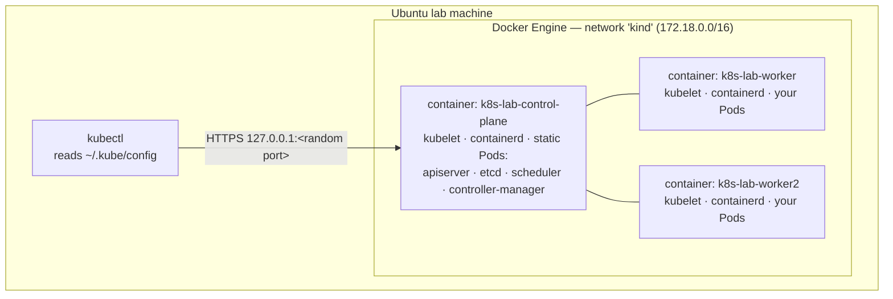

# 00-02 — Lab environment: Ubuntu, Docker Engine, kind and kubectl

> **Module type:** Foundation — hands-on setup
> **Time:** ~60 minutes
> **Prerequisites:** an **Ubuntu 22.04 or 24.04** machine (physical or VM) with sudo; `00-01` can be read before or after
> **Cost:** €0 — everything runs locally
> **Maps to:** CKA — the exam is a bash terminal on Linux with `kubectl`, `vim`, and SSH to nodes. This setup reproduces that

---

## 1. Why this module exists

Every module from here on ends in a lab. You need a cluster that is **multi-node** (scheduling,
DaemonSets, draining and affinity are meaningless on one node), **disposable** (you will break it on
purpose), **inspectable** (you need to get "onto" a node and see the kubelet and static Pods), and
**free**. And because the CKA is taken in a Linux bash terminal, you should practise in one.

---

## 2. The object model — what kind builds

**kind** = **K**ubernetes **in** **D**ocker. Each Kubernetes **node is a Docker container** that
runs systemd, containerd and the kubelet inside it. kind uses **kubeadm** (the official installer,
Domain 7) to bootstrap the cluster inside those containers. It is what the Kubernetes project
itself uses to test Kubernetes.



Because nodes are containers, `docker exec -it k8s-lab-worker bash` is the equivalent of
**SSH-ing into a node** — which you will do in every CKA troubleshooting task (the exam uses real
`ssh`; the commands you run once there are identical).

### Why kind and not the alternatives

| Option | Multi-node | Node access | Closeness to the CKA (kubeadm) | Verdict |
|---|---|---|---|---|
| **kind** | ✅ | `docker exec` | ✅ kubeadm under the hood, static Pods, `/etc/kubernetes` | **Used in this course** |
| minikube | ✅ (less natural) | `minikube ssh` | Partial | Fine, more add-on magic |
| k3d / k3s | ✅ | `docker exec` | ❌ different layout (no static Pods, embedded datastore) | Great for dev, wrong for CKA |
| Managed (AKS/EKS/GKE) | ✅ | Limited — control plane hidden | ❌ you cannot touch the control plane | Not for CKA practice |
| kubeadm on VMs | ✅ | SSH | ✅ the real thing | Domain 7 (later) |

---

## 3. Concepts

| Term | Meaning |
|---|---|
| **kubeconfig** | A YAML file telling clients **which clusters exist**, **which credentials to use**, and **which pairing (context) is current**. Default `~/.kube/config`. Detailed in `00-05` |
| **context** | A named triple: *cluster + user + default namespace*. kind names its context `kind-<cluster-name>` → `kind-k8s-lab` |
| **version skew** | `kubectl` is supported within **one minor version** of the API server (v1.36 kubectl ↔ v1.35–v1.37 server) |
| **node image** | The Docker image used for each kind node, `kindest/node:vX.Y.Z` — it decides the Kubernetes version |
| **lab namespace** | Every lab in this course creates its own namespace labelled `course=k8s` so cleanup is one command |

---

## 4. Declarative form — the cluster definition

The cluster is described in [`labs/kind-cluster.yaml`](../labs/kind-cluster.yaml):

```yaml
kind: Cluster
apiVersion: kind.x-k8s.io/v1alpha4
name: k8s-lab
nodes:
  - role: control-plane
    labels:
      ingress-ready: "true"          # used by the ingress/gateway labs in Domain 3
    extraPortMappings:               # lab-machine port → node container port
      - containerPort: 80            # ingress HTTP   → http://localhost:8080
        hostPort: 8080
      - containerPort: 443           # ingress HTTPS  → https://localhost:8443
        hostPort: 8443
      - containerPort: 30080         # a NodePort used in 00-06 → http://localhost:30080
        hostPort: 30080
  - role: worker
  - role: worker
```

Read it as: one control-plane node, two workers, and three ports on the lab machine forwarded into
the control-plane container so that later labs can reach Services with `curl` or a browser.

---

## 5. Step by step

### Step 1 — Prepare the machine

| Resource | Minimum | Comfortable |
|---|---|---|
| CPU | 2 | **4** |
| RAM | 6 GB | **8 GB+** |
| Disk | 20 GB free | 40 GB free |

```bash
sudo apt-get update && sudo apt-get upgrade -y
sudo apt-get install -y ca-certificates curl gpg git jq vim bash-completion binutils
```

kind runs several kubelets on one kernel, which exhausts the default inotify limits (symptom:
Pods failing with *too many open files*). Raise them permanently:

```bash
sudo tee /etc/sysctl.d/99-kind.conf >/dev/null <<'EOF'
fs.inotify.max_user_watches = 524288
fs.inotify.max_user_instances = 512
EOF
sudo sysctl --system | grep inotify
```

### Step 2 — Install Docker Engine

From Docker's official apt repository (Ubuntu's own `docker.io` package works too, but lags):

```bash
sudo install -m 0755 -d /etc/apt/keyrings
sudo curl -fsSL https://download.docker.com/linux/ubuntu/gpg -o /etc/apt/keyrings/docker.asc
sudo chmod a+r /etc/apt/keyrings/docker.asc
echo "deb [arch=$(dpkg --print-architecture) signed-by=/etc/apt/keyrings/docker.asc] \
https://download.docker.com/linux/ubuntu $(. /etc/os-release && echo "$VERSION_CODENAME") stable" \
  | sudo tee /etc/apt/sources.list.d/docker.list >/dev/null
sudo apt-get update
sudo apt-get install -y docker-ce docker-ce-cli containerd.io docker-buildx-plugin

sudo usermod -aG docker "$USER"      # run docker without sudo…
newgrp docker                        # …in this shell now (or log out and in)
docker run --rm hello-world
```

> Membership of the `docker` group is equivalent to root on this machine. Fine for a lab box;
> remember it when you reach Domain 6.

### Step 3 — Install kubectl and kind

`kubectl` from the Kubernetes apt repository, pinned to the **v1.36** minor (change both `v1.36`
occurrences to move minors later):

```bash
curl -fsSL https://pkgs.k8s.io/core:/stable:/v1.36/deb/Release.key \
  | sudo gpg --dearmor -o /etc/apt/keyrings/kubernetes-apt-keyring.gpg
echo 'deb [signed-by=/etc/apt/keyrings/kubernetes-apt-keyring.gpg] https://pkgs.k8s.io/core:/stable:/v1.36/deb/ /' \
  | sudo tee /etc/apt/sources.list.d/kubernetes.list >/dev/null
sudo apt-get update && sudo apt-get install -y kubectl
```

`kind` is a single binary:

```bash
ARCH=$(dpkg --print-architecture)          # amd64 or arm64
curl -Lo ./kind "https://github.com/kubernetes-sigs/kind/releases/latest/download/kind-linux-${ARCH}"
sudo install -m 0755 kind /usr/local/bin/kind && rm kind
```

Verify:

```bash
docker version --format '{{.Server.Version}}'
kubectl version --client
kind version
```

(Helm is installed in Domain 2, when it is first needed.)

### Step 4 — Get the course onto the lab machine

The course is a git repository. Clone it (or copy it) to the lab machine:

```bash
git clone <your-repo-url> ~/k8s-course      # or: scp -r user@pc:path/kubernetes ~/k8s-course
cd ~/k8s-course
```

All lab commands assume you run them **from the course root** (`~/k8s-course`).

### Step 5 — Shell setup (exactly what you will want in the CKA)

Append to `~/.bashrc`:

```bash
cat >> ~/.bashrc <<'EOF'

# --- Kubernetes course ---
source <(kubectl completion bash)
alias k=kubectl
complete -o default -F __start_kubectl k
export do="--dry-run=client -o yaml"      # k create deploy x --image=nginx $do > x.yaml
export now="--force --grace-period=0"     # k delete pod x $now
export KUBE_EDITOR=vim
EOF
source ~/.bashrc
```

And make vim YAML-safe (two-space indent, spaces not tabs) — the single most useful exam setting:

```bash
cat >> ~/.vimrc <<'EOF'
set expandtab tabstop=2 shiftwidth=2 softtabstop=2 autoindent
set number ruler
syntax on
EOF
```

> **CKA exam environment:** `kubectl`, the `k` alias and bash completion are usually preconfigured;
> `vim`/`nano` are available; each task tells you which context to use and which host to `ssh` to.
> Practising with exactly the setup above means nothing in the exam terminal will feel foreign.

### Step 6 — Create the cluster

```bash
./labs/cluster-up.sh
```

The script runs `kind create cluster --config labs/kind-cluster.yaml`, waits until all nodes are
`Ready`, and switches your context to `kind-k8s-lab`. First run pulls the node image (~1 GB).

> **Pinning the Kubernetes version.** By default kind uses the node image its release was built
> for. To pin one, add `image: kindest/node:v1.36.x` (an exact tag from the kind release notes)
> to each node in `kind-cluster.yaml`. Keep it within one minor of your `kubectl`.

### Step 7 — Verify

```bash
kubectl config current-context        # kind-k8s-lab
kubectl cluster-info                  # API server URL: https://127.0.0.1:<port>
kubectl get nodes -o wide             # 3 nodes, Ready, INTERNAL-IP 172.18.0.x, CONTAINER-RUNTIME containerd://…
docker ps --filter "label=io.x-k8s.kind.cluster=k8s-lab"    # the same 3 nodes, as containers
```

✅ You should see `k8s-lab-control-plane`, `k8s-lab-worker`, `k8s-lab-worker2`, all `Ready`.

### Step 8 — Learn the lab workflow

Every lab begins with:

```bash
./labs/new-lab.sh lab-00-03         # creates namespace lab-00-03, labels it course=k8s, makes it your default
```

…and ends with:

```bash
./labs/clean-labs.sh                # deletes every namespace labelled course=k8s + labelled cluster-scoped objects
```

If the cluster is broken beyond repair:

```bash
./labs/cluster-down.sh && ./labs/cluster-up.sh     # ~1–2 minutes to a fresh cluster
```

---

## 6. Under the hood — what `kind create cluster` did

1. Pulled `kindest/node` and started **three containers** on a Docker network called `kind`
   (`172.18.0.0/16` typically).
2. Inside the control-plane container, ran **`kubeadm init`**: generated a CA and certificates
   (`/etc/kubernetes/pki`), wrote **static Pod manifests** for the API server, etcd, scheduler and
   controller manager to `/etc/kubernetes/manifests/`, and started the kubelet, which started them.
3. Inside each worker, ran **`kubeadm join`** with a bootstrap token, so each kubelet got a client
   certificate and registered a **Node** object.
4. Installed **kindnet** (kind's CNI plugin — gives each Pod an IP and routes between nodes),
   **CoreDNS** (cluster DNS), **kube-proxy** (Service routing) and a local-path **StorageClass**.
5. Published the API server port on `127.0.0.1:<random>` and **merged** a new cluster, user and
   context into `~/.kube/config`.

You will look at every one of these in `00-03`. And because the nodes are only containers sharing
the host's kernel (`00-01`), the host can see inside them: `ps -ef | grep [k]ubelet` on the lab
machine lists **three** kubelet processes.

---

## 7. Decision table — which environment for which lab

| Lab type | Environment |
|---|---|
| Workloads, config, Services, storage basics, RBAC, scheduling, troubleshooting | **kind** (this cluster) |
| NetworkPolicy enforcement, eBPF | kind **with Cilium or Calico** instead of kindnet (Domain 3 gives a second config) |
| kubeadm install, upgrade, etcd restore on real VMs | **VMs** — Domain 7, deferred |

---

## 8. Gotchas

1. **`permission denied … /var/run/docker.sock`** → you are not in the `docker` group yet in this
   shell. `newgrp docker`, or log out and in.
2. **Pods fail with `too many open files`** → the inotify limits from step 1 are missing.
3. **After a reboot**, kind node containers restart with Docker. Give them a minute; if nodes stay
   `NotReady`, recreate the cluster.
4. **Port 8080/8443/30080 already in use** → `kind create` fails. Change `hostPort` in the config.
5. **Wrong context.** If you add other clusters later, check `kubectl config current-context`
   before anything destructive. The scripts refuse to run against a context not named `kind-k8s-lab`.
6. **Images built locally are not visible to the cluster.** Nodes have their own containerd. Use
   `kind load docker-image  --name k8s-lab` (used in Domain 1).

---

## 9. Lab — first contact

```bash
./labs/new-lab.sh lab-00-02

kubectl get nodes --show-labels
kubectl get pods -A -o wide                 # everything running, in all namespaces, with node placement
kubectl get namespaces --show-labels        # lab-00-02 has course=k8s

# the nodes are processes on this machine
ps -ef | grep [k]ubelet | wc -l             # 3

# get "onto" a node
docker exec -it k8s-lab-worker bash
  crictl ps                                  # containers on this node (kube-proxy, kindnet…)
  crictl pods                                # Pod sandboxes on this node
  systemctl status kubelet --no-pager        # the kubelet is a systemd service, NOT a Pod
  exit

# run something
kubectl run hello --image=nginx:1.27
kubectl get pod hello -o wide -w             # Ctrl+C once Running; note the NODE column
```

### Break it

```bash
kubectl run broken --image=nginx:does-not-exist
kubectl get pod broken -w                    # ErrImagePull → ImagePullBackOff
kubectl describe pod broken                  # read the Events section at the bottom
```

✅ **Verify:** you can find, in the Events, the line that says *why* the pull failed. The fix is to
delete it (`kubectl delete pod broken`) — an image name in a Pod cannot be "repaired" by waiting.

### Clean up

```bash
./labs/clean-labs.sh
```

---

## 10. Self-check

1. In kind, what *is* a node, and how do you get a shell on one?
2. What is the name of the context kind creates for a cluster called `k8s-lab`?
3. `kubectl` is v1.36. Which API server versions are supported?
4. Is the kubelet a Pod? How did you check?
5. Which kind feature lets `curl` on the lab machine reach a Service inside the cluster?
6. You built `myapp:dev` with `docker build`. A Pod using it shows `ErrImagePull`. Why, and the fix?
7. Why did `ps -ef | grep kubelet` on the lab machine show three kubelets?

<details>
<summary>Answers</summary>

1. A **Docker container** running systemd, containerd and the kubelet. `docker exec -it <node-name> bash`.
2. `kind-k8s-lab`.
3. **v1.35, v1.36, v1.37** — kubectl is supported within one minor version of the API server.
4. **No.** It is a **systemd service** on the node (`systemctl status kubelet`). It *runs* Pods, including the static Pods of the control plane.
5. **`extraPortMappings`** in the cluster config (host port → node container port), combined with a NodePort Service or an ingress controller listening on that node port.
6. The image exists only in the host Docker's image store; each kind node has its **own containerd**, which tries to pull from Docker Hub. Fix: `kind load docker-image myapp:dev --name k8s-lab` and set `imagePullPolicy: IfNotPresent` (and do not use `:latest`, which forces `Always`).
7. Each node is a container, and a container is just processes on the host kernel (`00-01`). The host's PID namespace sees every node's kubelet.

</details>

---

**Previous:** [`00-01` — Containers, and why orchestration exists](00-01-containers-and-why-orchestration.md)
**Next:** [`00-03` — Cluster architecture](00-03-cluster-architecture.md)
