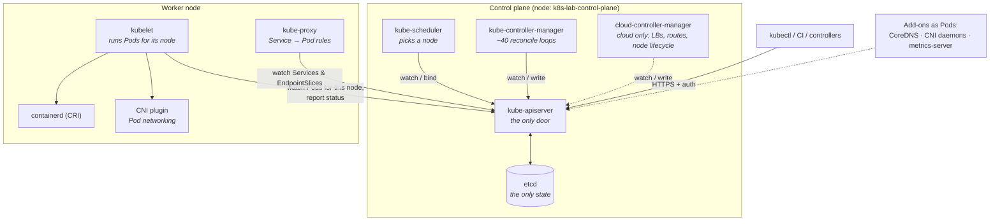
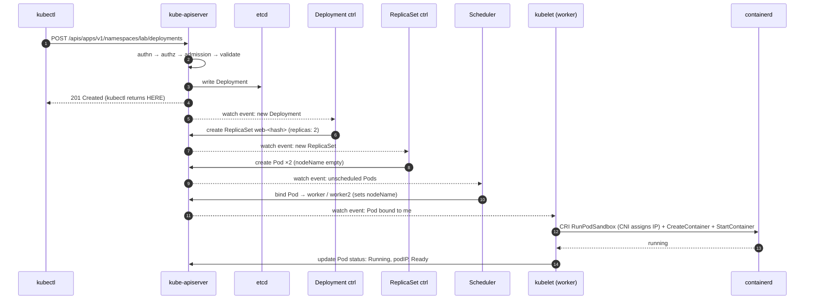

# 00-03 — Cluster architecture: every component, and what happens on `kubectl apply`

> **Module type:** Foundation — the most load-bearing module in the course. Do not skim it.
> **Time:** ~2 hours (60 reading, 60 lab)
> **Prerequisites:** `00-01`, `00-02` (a running `k8s-lab` cluster)
> **Maps to:** CKA *Cluster architecture, installation & configuration* (25%) and *Troubleshooting* (30%) — every "the control plane is broken, fix it" task assumes this module

---

## 1. Why this module exists

Kubernetes troubleshooting is a single skill: **knowing which component is responsible for the
step that did not happen.** A Pod stuck in `Pending` with no events is a scheduler problem. A
Deployment with no ReplicaSet is a controller-manager problem. A Pod scheduled but never started is
a kubelet or runtime problem. A Service that resolves but does not connect is kube-proxy or CNI.

If you know the chain of responsibility, you know where to look. That chain is this module.

---

## 2. The object model — the components



**The one rule that explains the picture: every component talks only to the API server.** No
component talks to another directly, and nothing except the API server touches etcd. Components
coordinate by **writing objects** and **watching objects**.

---

## 3. Concepts — the components one at a time

### 3.1 kube-apiserver — the front door and the only gate to state

A stateless REST server (horizontally scalable). Every request passes the same pipeline:

```
request ─► Authentication ─► Authorization ─► Mutating admission ─► Schema validation ─► Validating admission ─► etcd
            "who are you?"    "may you?"        (defaults, inject)     (is it a valid Pod?)   (policy: allowed?)     persist
             certs, tokens,    RBAC, Node        e.g. ServiceAccount,                         e.g. PodSecurity,
             OIDC              authorizer        LimitRanger, webhooks                        ResourceQuota, CEL policies
```

| Fact | Detail |
|---|---|
| Port | **6443** by default (kind maps it to a random port on 127.0.0.1) |
| State | **None** of its own — everything is in etcd |
| Watches | Clients can `GET ?watch=true` and receive a stream of changes. This is how every controller learns about work |
| Optimistic concurrency | Every object has a `resourceVersion`; an update based on a stale version is rejected with **409 Conflict** (`00-04`) |
| Health | `/livez`, `/readyz` (`kubectl get --raw='/readyz?verbose'`) |
| Steps 1–3 | Each one is a full module in Domain 6 |

### 3.2 etcd — the database

A distributed, strongly consistent key-value store using the **Raft** consensus algorithm. Every
object lives at a key such as `/registry/pods/<namespace>/<name>`.

| Fact | Detail |
|---|---|
| Port | **2379** (clients), **2380** (peers) |
| Quorum | A write commits when a **majority** (`⌊n/2⌋+1`) of members agree |
| Tolerated failures | 1 member: 0 · **3 members: 1** · **5 members: 2** · 4 members: still only 1 |
| Why odd numbers | An even count adds a member without adding failure tolerance |
| Lost etcd without backup | The cluster's **entire state is gone**. Running containers keep running, but nothing can be managed |
| Back up with | `etcdctl snapshot save` — Domain 7, `07-03` |

### 3.3 kube-scheduler — picks a node, and nothing else

Watches for Pods with an **empty `spec.nodeName`**. For each one:

1. **Filter** — remove nodes that cannot run it (insufficient CPU/memory *requests*, taints not
   tolerated, `nodeSelector`/affinity not matched, ports in use, volume zone mismatch…).
2. **Score** — rank the survivors (spread, resource balance, image already present…).
3. **Bind** — write the winner into the Pod's `spec.nodeName` via the `binding` subresource.

That is all. The scheduler **does not start containers** and never contacts the node. If no node
passes the filter, the Pod stays `Pending` with a `FailedScheduling` event explaining why.

> If the **scheduler itself is down**, Pods stay `Pending` with **no events at all** — nobody is
> there to write one. "Pending + no events" is the signature. You will produce it in the lab.

### 3.4 kube-controller-manager — the reconcile loops

One binary running many **controllers**. Each controller is a loop:

```
forever:
    desired  := read the spec of objects I own (from my watch cache)
    actual   := observe the world (other objects, nodes, …)
    if actual != desired:
        take ONE step toward desired (create/delete/update an object via the API server)
```

| Controller (a few of ~40) | Watches | Acts by |
|---|---|---|
| **Deployment** | Deployments | Creating/scaling **ReplicaSets** |
| **ReplicaSet** | ReplicaSets, Pods | Creating/deleting **Pods** to match `replicas` |
| **Node lifecycle** | Node heartbeats (Leases) | Marking nodes `NotReady`, adding taints → Pods evicted |
| **Job / CronJob** | Jobs, CronJobs | Creating Pods / Jobs |
| **EndpointSlice** | Services, Pods | Listing the ready Pod IPs behind each Service |
| **ServiceAccount / token** | Namespaces | Creating the `default` ServiceAccount in every namespace |
| **Namespace** | Terminating namespaces | Deleting everything inside before the namespace goes |
| **Garbage collector** | `ownerReferences` | Deleting dependents whose owner is gone (`00-04`) |

Two properties to internalise:

- **Level-triggered, not edge-triggered.** A controller does not react to "a Pod was deleted"
  (an event it might miss); it reacts to "there are 2 Pods and there should be 3" (a state it
  can always recompute). This is why Kubernetes self-heals after crashes, restarts and missed
  messages.
- **Controllers chain through the API.** The Deployment controller never creates Pods. It creates
  a ReplicaSet; the ReplicaSet controller sees *that* and creates Pods; the scheduler sees
  *those*; kubelets see *their* bound Pods. No component calls another.

### 3.5 cloud-controller-manager

Runs the controllers that need a cloud API: create a cloud **load balancer** for
`type: LoadBalancer` Services, set up **routes**, delete Node objects when the VM is gone. Not
present on kind (which is why LoadBalancer Services stay `<pending>` there until Domain 3 adds a
substitute).

### 3.6 kubelet — the node agent

A **systemd service on every node** (not a Pod). It:

1. Watches the API server for Pods **bound to its node**.
2. Asks the runtime over **CRI** to create the Pod sandbox (network namespace via **CNI**) and the
   containers; mounts volumes; injects Secrets/ConfigMaps.
3. Runs **probes** (liveness, readiness, startup) and applies the `restartPolicy`.
4. Reports Pod **status** and Node **status** back to the API server, and renews its **Lease**
   in the `kube-node-lease` namespace every ~10 s as a heartbeat.
5. Evicts Pods when the node runs low on memory/disk.
6. Runs **static Pods** — see 3.9.

> If the kubelet stops, the node goes `NotReady` after the node-monitor grace period
> (~40–50 s). After a further **300 s** (the default toleration for the `not-ready`/`unreachable`
> taints) its Pods are evicted and recreated elsewhere — *if* they are owned by a controller. A
> bare Pod is simply lost.

### 3.7 kube-proxy — Service routing on each node

Usually a **DaemonSet** (one Pod per node). Watches Services and EndpointSlices and programs the
node's kernel so that traffic to a Service's virtual IP is rewritten to one of its Pod IPs. Modes:
**iptables** (default on most clusters), **nftables** (modern replacement), **IPVS**. Some CNIs
(Cilium) replace kube-proxy entirely with eBPF. Deep dive in `03-03`.

### 3.8 Add-ons that are "just Pods"

| Add-on | Job | Runs as |
|---|---|---|
| **CNI plugin** (kindnet here; Calico, Cilium, Flannel elsewhere) | Give each Pod an IP, route Pod↔Pod across nodes, sometimes enforce NetworkPolicy | DaemonSet + a binary in `/opt/cni/bin` that the runtime calls |
| **CoreDNS** | Cluster DNS: `my-svc.my-ns.svc.cluster.local` → Service IP | Deployment (2 replicas) behind the `kube-dns` Service |
| **metrics-server** | CPU/memory for `kubectl top` and the HPA | Deployment — *not* installed on kind by default (Domain 5) |

### 3.9 Static Pods — how the control plane runs itself

Chicken-and-egg: the API server runs as a Pod, but Pods need the API server. Answer: the kubelet
can run Pods **directly from files** in its `staticPodPath` (with kubeadm and kind:
**`/etc/kubernetes/manifests/`**), without any API server.

| Fact | Detail |
|---|---|
| Created by | Dropping a manifest file into the directory. The kubelet checks it about every 20 s |
| Deleted by | **Removing the file.** `kubectl delete pod` only deletes the *mirror* — it comes straight back |
| Visible in the API as | A **mirror Pod** named `<name>-<node-name>`, e.g. `kube-scheduler-k8s-lab-control-plane` |
| Edited by | Editing the file; the kubelet recreates the Pod |
| Used for | `kube-apiserver`, `etcd`, `kube-scheduler`, `kube-controller-manager` on kubeadm clusters |

This is the single most important CKA troubleshooting fact: **a broken control plane is usually a
broken file in `/etc/kubernetes/manifests/`**, and you fix it on the node, not with `kubectl`.

---

## 4. Declarative form — a control-plane static Pod, read properly

Excerpt of `/etc/kubernetes/manifests/kube-scheduler.yaml` on the control-plane node:

```yaml
apiVersion: v1
kind: Pod
metadata:
  name: kube-scheduler                 # mirror Pod becomes kube-scheduler-<node-name>
  namespace: kube-system
  labels:
    component: kube-scheduler
    tier: control-plane
spec:
  hostNetwork: true                    # uses the node's network — no CNI needed to start
  priorityClassName: system-node-critical
  containers:
  - name: kube-scheduler
    image: registry.k8s.io/kube-scheduler:v1.xx.y
    command:                           # configuration is FLAGS — a typo here = scheduler down
    - kube-scheduler
    - --kubeconfig=/etc/kubernetes/scheduler.conf    # how it authenticates to the API server
    - --leader-elect=true                            # only one active scheduler in an HA control plane
    livenessProbe:
      httpGet: { host: 127.0.0.1, path: /livez, port: 10259, scheme: HTTPS }
    volumeMounts:
    - { name: kubeconfig, mountPath: /etc/kubernetes/scheduler.conf, readOnly: true }
  volumes:
  - name: kubeconfig
    hostPath: { path: /etc/kubernetes/scheduler.conf, type: FileOrCreate }
```

Note `hostNetwork: true`: the control plane cannot depend on the Pod network, because the Pod
network (CNI) itself depends on the control plane.

---

## 5. Imperative — inspecting the architecture with kubectl

```bash
kubectl get nodes -o wide                                # nodes, roles, internal IPs, runtime
kubectl get pods -n kube-system -o wide                  # control plane + add-ons, and where they run
kubectl get --raw='/readyz?verbose'                      # API server health, check by check
kubectl get leases -n kube-node-lease                    # one heartbeat lease per node
kubectl get leases -n kube-system                        # leader-election leases: scheduler, controller-manager
kubectl get ds,deploy -n kube-system                     # kube-proxy & kindnet = DaemonSets; coredns = Deployment
kubectl api-resources | grep -i binding                 # bindings subresource the scheduler uses
kubectl get events -A --sort-by=.lastTimestamp          # who did what, recently
kubectl run x --image=nginx -v=6                        # -v=6 prints every HTTP call kubectl makes
```

On the node (`docker exec -it k8s-lab-control-plane bash`):

```bash
ls /etc/kubernetes/manifests/                 # the four static Pod manifests
ls /etc/kubernetes/pki/                       # the cluster CA and component certificates
cat /var/lib/kubelet/config.yaml | grep -i staticPodPath
systemctl status kubelet --no-pager
journalctl -u kubelet --no-pager | tail -50   # kubelet logs — first stop for node problems
crictl ps                                      # containers, including the control plane
crictl logs <container-id>                     # logs when the API server is down and kubectl can't help
```

---

## 6. Under the hood — what happens on `kubectl create deployment web --image=nginx --replicas=2`



Things worth noticing:

- **`kubectl` returns at step 4.** "Created" means *stored*, not *running*. Everything after is
  asynchronous. That is why you `kubectl get -w` or `kubectl rollout status`.
- **Six independent actors**, none calling another. Kill any one and the chain stops at that
  step — *and resumes by itself* when it comes back, because each is level-triggered.
- **Each step leaves evidence**: the ReplicaSet object, Pod objects, the `nodeName` field, events
  (`Scheduled`, `Pulling`, `Pulled`, `Created`, `Started`). Troubleshooting = finding the first
  missing piece of evidence.

| Symptom | First missing evidence | Responsible component |
|---|---|---|
| Deployment exists, no ReplicaSet | ReplicaSet object | **controller-manager** |
| ReplicaSet exists, no Pods | Pod objects | controller-manager — or **admission** rejected them (check `kubectl describe rs`: quota, Pod Security) |
| Pod `Pending`, `FailedScheduling` event | `nodeName` | **scheduler** says no node fits — read the reason |
| Pod `Pending`, **no events** | `nodeName` | **scheduler is down** |
| Pod has `nodeName`, stuck `ContainerCreating` | `Started` event | **kubelet / CNI / volume** on that node — read the events |
| Pod `Running`, Service unreachable | Rules on the node | **kube-proxy / CNI / selector mismatch** (Domain 3) |
| `kubectl` itself: `connection refused` | Any response | **API server** down → go to the node, `crictl ps -a`, `crictl logs` |

---

## 7. Decision table — where do I look first?

| Situation | First place to look |
|---|---|
| `kubectl` cannot connect | kubeconfig/context (`00-05`), then API server static Pod on the control plane node: `crictl ps -a`, `crictl logs` |
| A control plane Pod is crash-looping | `/etc/kubernetes/manifests/<component>.yaml` — a bad flag, path or image |
| Node `NotReady` | On that node: `systemctl status kubelet`, `journalctl -u kubelet` |
| Pod `Pending` | `kubectl describe pod` → Events |
| Pod not starting on a node | `kubectl describe pod` → Events; then the kubelet log on that node |
| Data seems to have "reverted" or vanished | etcd — and your backups (`07-03`) |

---

## 8. Gotchas and exam traps

1. **The scheduler only sets `nodeName`.** The kubelet starts containers.
2. **Setting `spec.nodeName` yourself bypasses the scheduler entirely** — no filtering, no
   taints check. Useful when the scheduler is down; dangerous otherwise.
3. **You cannot `kubectl delete` a static Pod.** Its mirror comes back. Move/remove the file.
4. **The kubelet is not a Pod.** `systemctl`, not `kubectl`, restarts it.
5. **Only the API server talks to etcd.** Any answer where the scheduler or kubelet reads etcd is wrong.
6. **etcd with 4 members tolerates 1 failure — same as 3.**
7. **`kubectl apply` succeeding means stored, not running.**
8. **Bare Pods are not rescheduled** when their node dies. Only controller-owned Pods are replaced.
9. **When the API server is down, `kubectl` is useless.** Use `crictl` and logs on the node.
10. **When editing a static Pod manifest, never leave a backup copy in the manifests directory** —
    the kubelet runs *every* file there (`kube-apiserver.yaml.bak` would start a second API server
    fighting for the same port). Back up to `/tmp` or elsewhere.

---

## 9. Lab — dismantle the control plane, one piece at a time

**Cost:** €0. **Needs:** the `k8s-lab` cluster. Keep a second terminal open running
`kubectl get pods -w` where indicated.

```bash
./labs/new-lab.sh lab-00-03
```

### 9.1 Map the cluster

```bash
kubectl get pods -n kube-system -o wide
docker exec k8s-lab-control-plane ls /etc/kubernetes/manifests
docker exec k8s-lab-control-plane crictl ps
```

✅ **Verify:** write down, for each Pod in `kube-system`: which component it is, whether it is a
**static Pod** (name ends in `-k8s-lab-control-plane`), a **DaemonSet** Pod or a **Deployment** Pod,
and which node it runs on. Check with `kubectl get pod <name> -n kube-system -o jsonpath='{.metadata.ownerReferences[0].kind}'` —
static mirror Pods are owned by a `Node`.

### 9.2 Look inside etcd

```bash
ETCD=etcd-k8s-lab-control-plane
TLS="--cacert=/etc/kubernetes/pki/etcd/ca.crt --cert=/etc/kubernetes/pki/etcd/server.crt --key=/etc/kubernetes/pki/etcd/server.key"
kubectl -n kube-system exec $ETCD -- etcdctl $TLS member list -w table
kubectl -n kube-system exec $ETCD -- etcdctl $TLS get /registry/namespaces --prefix --keys-only
kubectl -n kube-system exec $ETCD -- etcdctl $TLS get /registry/namespaces/lab-00-03 --print-value-only | strings
```

✅ **Verify:** you see your namespace's key. The value is **protobuf**, mostly unreadable — but
notice that `course` and `k8s` appear in plain text. Anything in etcd is readable by whoever can
read etcd, which is why Secrets need encryption at rest (`06-07`).

### 9.3 Watch the chain of controllers

Terminal 2: `kubectl get deploy,rs,pods -w`

Terminal 1:

```bash
kubectl create deployment web --image=nginx:1.27 --replicas=2
kubectl get events --sort-by=.lastTimestamp
```

✅ **Verify:** in the events, find who emitted each step — `deployment-controller`
(`ScalingReplicaSet`), `replicaset-controller` (`SuccessfulCreate`), `default-scheduler`
(`Scheduled`), `kubelet` (`Pulling`, `Created`, `Started`). Map each to the sequence diagram in §6.

### 9.4 Break it: kill the controller manager

```bash
docker exec k8s-lab-control-plane mv /etc/kubernetes/manifests/kube-controller-manager.yaml /tmp/
# wait ~20–30 s, then:
kubectl get pods -n kube-system | grep controller-manager             # gone
kubectl create deployment api --image=nginx:1.27 --replicas=2
kubectl get deploy,rs,pods -l app=api
kubectl scale deployment web --replicas=4
kubectl get deploy web
```

**Before reading on, predict:** does `api` get a ReplicaSet? Does `web` get 4 Pods?

✅ **Verify:** `api` exists with `READY 0/2` and **no ReplicaSet**. `web` stays at 2 Pods although
`spec.replicas` is 4. The API accepted your desired state; nobody is reconciling it.

Now kill one of `web`'s Pods — `kubectl delete pod <one-web-pod>` — and observe: it is **not**
replaced.

Fix it:

```bash
docker exec k8s-lab-control-plane mv /tmp/kube-controller-manager.yaml /etc/kubernetes/manifests/
kubectl get deploy,rs,pods -w      # Ctrl+C when api is 2/2 and web is 4/4
```

✅ **Verify:** everything converges on its own — nothing re-submitted. That is level-triggered
reconciliation.

### 9.5 Break it: kill the scheduler

```bash
docker exec k8s-lab-control-plane mv /etc/kubernetes/manifests/kube-scheduler.yaml /tmp/
# wait ~20–30 s
kubectl run lonely --image=nginx:1.27
kubectl get pod lonely -o wide          # Pending, NODE <none>
kubectl describe pod lonely             # Events: <none>  ← the signature of a dead scheduler
```

Now schedule it **by hand**, as the scheduler would. `spec.nodeName` cannot be changed on an
existing Pod, so recreate it with the field set:

```bash
kubectl run manual --image=nginx:1.27 --overrides='{"spec":{"nodeName":"k8s-lab-worker2"}}'
kubectl get pod manual -o wide          # Running on worker2 — no scheduler involved
```

Restore the scheduler:

```bash
docker exec k8s-lab-control-plane mv /tmp/kube-scheduler.yaml /etc/kubernetes/manifests/
kubectl get pod lonely -o wide -w       # gets a node within seconds
```

### 9.6 Break it: a typo in a static Pod manifest (the classic CKA task)

```bash
docker exec k8s-lab-control-plane sh -c "cp /etc/kubernetes/manifests/kube-scheduler.yaml /tmp/kube-scheduler.yaml.good && sed -i 's/--leader-elect=true/--leader-elekt=true/' /etc/kubernetes/manifests/kube-scheduler.yaml"
```

Now pretend you did not see that. Diagnose it the way you would on an exam:

```bash
kubectl get pods -n kube-system -l component=kube-scheduler     # CrashLoopBackOff or Error
kubectl logs -n kube-system -l component=kube-scheduler        # read the error
docker exec k8s-lab-control-plane crictl ps -a --name kube-scheduler
```

✅ **Verify:** you found the unknown-flag error in the logs. Fix the file with
`docker exec -it k8s-lab-control-plane bash` → edit `/etc/kubernetes/manifests/kube-scheduler.yaml`
(or restore `/tmp/kube-scheduler.yaml.good`) and confirm the scheduler returns to `Running`.

### 9.7 Break it: stop a kubelet

```bash
docker exec k8s-lab-worker2 systemctl stop kubelet
kubectl get nodes -w                    # worker2 → NotReady after ~40–50 s. Ctrl+C
kubectl describe node k8s-lab-worker2 | grep -E 'Taints|Ready'
kubectl get pod manual -o wide          # still shows Running — status is now stale, not live
docker exec k8s-lab-worker2 systemctl start kubelet
kubectl get nodes -w                    # Ready again
```

✅ **Verify:** you saw the `node.kubernetes.io/unreachable` taint added to the node. Explain why
`manual` still says `Running` (the kubelet is the only thing that reports its status, and it was
stopped — the container itself never stopped).

### 9.8 Clean up

```bash
./labs/clean-labs.sh
docker exec k8s-lab-control-plane ls /etc/kubernetes/manifests   # must list all four .yaml files
kubectl get pods -n kube-system                                  # everything Running
```

If anything in `kube-system` is not healthy and you cannot fix it: `cluster-down.ps1`,
`cluster-up.ps1`.

---

## 10. Self-check

1. Which component is the only one that talks to etcd?
2. What exactly does the scheduler write, and where?
3. A Pod is `Pending` and `kubectl describe` shows `Events: <none>`. Most likely cause?
4. A Deployment shows `READY 0/3` and `kubectl get rs` returns nothing for it. Most likely cause?
5. You `kubectl delete pod kube-apiserver-cp1 -n kube-system`. What happens, and why?
6. Where do static Pod manifests live on a kubeadm (and kind) node, and how do you find the path if it is different?
7. An etcd cluster has 5 members. How many can fail before writes stop? What about 6 members?
8. The node `w3` loses power. Describe what happens to (a) the Node object, (b) a Pod owned by a ReplicaSet, (c) a bare Pod — with approximate timings.
9. What does "level-triggered" mean for a controller, and why does it make the system self-healing?
10. `kubectl apply` returned `deployment.apps/web created`. Is the application running?
11. The API server is down. Name two ways to get information on the control plane node.
12. Why do control plane static Pods use `hostNetwork: true`?

<details>
<summary>Answers</summary>

1. The **kube-apiserver**.
2. The chosen node name into the Pod's **`spec.nodeName`**, through the Pod's `binding` subresource.
3. The **scheduler is not running** — no component exists to emit a `FailedScheduling` or `Scheduled` event. (A scheduler that runs but cannot place the Pod *does* emit `FailedScheduling`.)
4. The **controller-manager** is not running (the Deployment controller creates ReplicaSets). Check `kube-controller-manager-*` in `kube-system` and its static Pod manifest.
5. It disappears briefly and comes back. It is a **mirror Pod** of a **static Pod**; the kubelet recreates it from the file in `/etc/kubernetes/manifests/`. To stop it you remove the file.
6. **`/etc/kubernetes/manifests/`**. Confirm with `staticPodPath` in the kubelet config (`/var/lib/kubelet/config.yaml`), or the kubelet's `--pod-manifest-path` flag (`ps aux | grep kubelet`).
7. Quorum of 5 is 3 → **2** can fail. With 6, quorum is 4 → still only **2**.
8. (a) The kubelet stops renewing its Lease; after the grace period (~40–50 s) the node lifecycle controller marks it **NotReady/Unknown** and adds the `unreachable` taint. (b) After the default toleration of **300 s** the Pod is evicted; the ReplicaSet sees it is short and creates a replacement, which the scheduler puts on a healthy node. (c) A bare Pod is evicted too, but **nothing recreates it**.
9. The controller acts on the **difference between desired and current state**, recomputed each time, not on individual change events. Missed events, crashes and restarts do not matter — on the next pass it sees the difference and fixes it.
10. **Not necessarily.** It means the object was **stored in etcd**. Scheduling, image pulls and starts happen asynchronously afterward. Check `kubectl rollout status deploy/web`.
11. `crictl ps -a` and `crictl logs <id>` on the node; `journalctl -u kubelet`; the static Pod manifests in `/etc/kubernetes/manifests/`; container logs under `/var/log/pods/` or `/var/log/containers/`.
12. The Pod network (CNI) depends on the control plane being up. Control plane components must start **before** Pod networking exists, so they use the node's network directly.

</details>

---

**Previous:** [`00-02` — Lab environment](00-02-lab-environment-kind.md)
**Next:** [`00-04` — The API and the object model](00-04-api-and-object-model.md)
