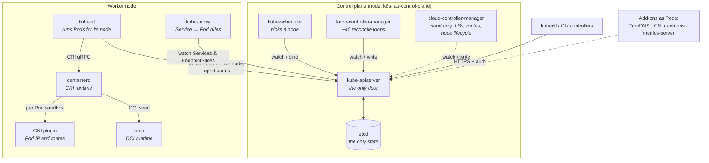
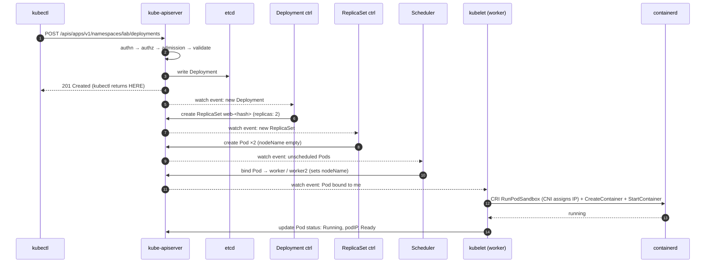

# 00-03 — Cluster architecture: every component, and what happens on `kubectl apply`

> **Module type:** Foundation — the most load-bearing module in the course. Do not skim it.
> **Time:** ~2 hours (60 reading, 60 lab)
> **Prerequisites:** `00-01`, `00-02` (a running `k8s-lab` cluster)
> **Maps to:** CKA (Certified Kubernetes Administrator) *Cluster architecture, installation & configuration* (25%) and *Troubleshooting* (30%) — every "the control plane is broken, fix it" task assumes this module

---

## 1. Why this module exists

Kubernetes troubleshooting is a single skill: **knowing which component is responsible for the
step that did not happen.** A Pod stuck in `Pending` with no events is a scheduler problem. A
Deployment with no ReplicaSet is a controller-manager problem. A Pod scheduled but never started is
a kubelet or runtime problem. A Service that resolves but does not connect is kube-proxy or CNI.

If you know the chain of responsibility, you know where to look. That chain is this module.

---

## 2. The object model — the components



**The one rule that explains the picture: every component talks only to the API server.** No
component talks to another directly, and nothing except the API server touches etcd. Components
coordinate by **writing objects** and **watching objects**.

Inside a node there is one more chain, and it is local plumbing, not cluster coordination: the
**kubelet** drives the **container runtime** over **CRI** (Container Runtime Interface); the
runtime calls the **CNI** (Container Network Interface) **plugin** to give each Pod sandbox its
network, and **runc** — the OCI (Open Container Initiative) runtime — to start each container
process. The kubelet never calls CNI itself — that changed when dockershim was removed in v1.24
(`00-01` §3.6).

### 2.1 Vocabulary — the objects this module talks about

Section 3 explains each **component** (a program that makes up the cluster). These are the
**objects** (records stored in etcd through the API server) that those components read and write:

| Object | What it is |
|---|---|
| **Pod** | The smallest thing Kubernetes runs: one or more containers that share a network namespace (one IP address) and volumes, and are always placed on the same node |
| **Pod sandbox** | The empty "shell" the runtime creates first for each Pod — its network namespace and IP — before any of the Pod's containers start inside it |
| **Node** | The API's record of a machine (physical or VM — Virtual Machine) that runs Pods: its capacity, conditions (`Ready`), taints and addresses |
| **Namespace** | A named folder that groups objects and scopes their names, permissions and quotas (e.g. `kube-system`, `lab-00-03`) |
| **Deployment** | Declares "run N identical Pods from this template" and manages rolling updates by creating a new ReplicaSet per version |
| **ReplicaSet** | Keeps exactly `replicas` Pods matching its selector alive; normally created and owned by a Deployment |
| **DaemonSet** | Runs one copy of a Pod on every node (or every matching node) — used for node agents like kube-proxy and CNI daemons |
| **Job / CronJob** | A Job runs Pods until a task completes successfully; a CronJob creates Jobs on a schedule |
| **Service** | A stable virtual IP (Internet Protocol) address and DNS (Domain Name System) name in front of a changing set of Pods, selected by labels |
| **EndpointSlice** | The list of ready Pod IPs and ports currently behind a Service; kube-proxy reads it to program routing |
| **ConfigMap** | Non-secret configuration data (key/value pairs or whole files) that Pods or components read |
| **Secret** | Like a ConfigMap but for sensitive data (passwords, tokens, keys); base64-encoded, not encrypted by default |
| **ServiceAccount** | An identity for processes running inside Pods, used to authenticate to the API server with a token |
| **Lease** | A tiny object used as a heartbeat (one per node, in `kube-node-lease`) or as a lock for leader election (scheduler, controller manager) |
| **Event** | A short, time-stamped report written by a component about something that happened to an object (`Scheduled`, `Pulled`, `FailedScheduling`…) |
| **Binding** | The subresource the scheduler writes to assign a Pod to a node (it sets `spec.nodeName`) |
| **CertificateSigningRequest (CSR)** | A request for the cluster CA (Certificate Authority) to sign a client certificate, e.g. for a joining kubelet or a new user |

And the abbreviations you will meet:

| Abbreviation | Full meaning | In one line |
|---|---|---|
| **API** | Application Programming Interface | The set of HTTP endpoints through which everything reads and writes cluster objects |
| **CKA** | Certified Kubernetes Administrator | The hands-on exam this course prepares for |
| **CRI** | Container Runtime Interface | The gRPC API the kubelet uses to ask a runtime (containerd, CRI-O) to create sandboxes and containers |
| **CNI** | Container Network Interface | The standard for plugins that give Pods network interfaces, IPs and routes |
| **OCI** | Open Container Initiative | The standards body defining image and runtime formats; runc is its reference runtime |
| **runc** | "run container" | The low-level OCI runtime that actually creates the container process with namespaces and cgroups |
| **gRPC** | gRPC Remote Procedure Call (originally Google RPC) | A binary, HTTP/2-based way for programs to call functions in each other — the transport of CRI |
| **REST** | Representational State Transfer | API style where resources are URLs and you act on them with HTTP verbs (`GET`, `POST`, `PUT`, `DELETE`) |
| **HTTP / HTTPS** | Hypertext Transfer Protocol / HTTP Secure | The web protocol; HTTPS is HTTP encrypted with TLS |
| **TLS** | Transport Layer Security | Encryption and certificate-based identity for network connections |
| **CA** | Certificate Authority | The key pair that signs certificates; anyone trusting the CA trusts the certs it signed |
| **PKI** | Public Key Infrastructure | The set of CAs, certificates and keys a system uses — `/etc/kubernetes/pki/` |
| **CSR** | Certificate Signing Request | A request for a CA to sign a certificate |
| **RBAC** | Role-Based Access Control | Kubernetes' main authorization system: Roles grant verbs on resources, Bindings give Roles to users |
| **OIDC** | OpenID Connect | An identity-provider login standard (Google, Entra ID, Keycloak…) the API server can trust |
| **CEL** | Common Expression Language | A small expression language used for in-API validation and admission policies |
| **etcd** | "/etc distributed" | The cluster database — named after Unix's `/etc` config directory plus *d* for distributed |
| **DNS** | Domain Name System | Turns names (`web.lab.svc.cluster.local`) into IP addresses |
| **IP** | Internet Protocol | The addressing layer of the network; every Pod and Service gets an IP address |
| **CIDR** | Classless Inter-Domain Routing | Notation for an IP range, e.g. `10.244.0.0/16` |
| **TCP / UDP** | Transmission Control Protocol / User Datagram Protocol | Reliable connection-based vs. fire-and-forget network transport |
| **CPU** | Central Processing Unit | Processor capacity — one of the resources Pods request |
| **VM** | Virtual Machine | A software-emulated computer; most cloud nodes are VMs |
| **LB** | Load Balancer | A network device or service that spreads traffic across back ends |
| **HPA** | Horizontal Pod Autoscaler | Scales a Deployment's replica count based on metrics such as CPU |
| **IPVS** | IP Virtual Server | A Linux kernel load balancer; one of kube-proxy's modes |
| **eBPF** | extended Berkeley Packet Filter | Small sandboxed programs loaded into the Linux kernel; Cilium uses it for networking |
| **HA** | High Availability | Running several copies (e.g. 3 control-plane nodes) so one failure does not stop the cluster |
| **CLI** | Command-Line Interface | A tool you drive by typing commands (`kubectl`, `crictl`, `etcdctl`) |
| **crictl** | CRI control | The CLI that talks CRI directly to the runtime — works even when the API server is down |
| **kubeadm** | Kubernetes admin | The official tool that bootstraps clusters; sets all the default paths in this module |
| **kind** | Kubernetes IN Docker | Runs each Kubernetes node as a Docker container — your lab cluster |
| **CI** | Continuous Integration | Automated pipelines (build, test, deploy) — another kind of API client |

---

## 3. Concepts — the components one at a time

### 3.1 kube-apiserver — the front door and the only gate to state

**What it is:** the program that serves the Kubernetes API (Application Programming Interface) over
HTTPS (HTTP Secure — HTTP encrypted with TLS, Transport Layer Security). It is the single entry
point for `kubectl`, for every other component and for every controller, and the only program that
reads or writes etcd.

A stateless REST (Representational State Transfer) server (horizontally scalable — you can run
several copies behind a load balancer). Every request passes the same pipeline:

```
request ─► Authentication ─► Authorization ─► Mutating admission ─► Schema validation ─► Validating admission ─► etcd
            "who are you?"    "may you?"        (defaults, inject)     (is it a valid Pod?)   (policy: allowed?)     persist
             certs, tokens,    RBAC, Node        e.g. ServiceAccount,                         e.g. PodSecurity,
             OIDC              authorizer        LimitRanger, webhooks                        ResourceQuota, CEL policies
```

- **Authentication** — proves *who* sent the request: client certificates, ServiceAccount tokens,
  or OIDC (OpenID Connect) tokens from an external identity provider.
- **Authorization** — decides whether that identity *may* do this verb on this resource: RBAC
  (Role-Based Access Control) for users and Pods, the Node authorizer for kubelets.
- **Admission** — plugins and webhooks that can *change* (mutating) or *reject* (validating) an
  object before it is stored. CEL (Common Expression Language) policies are validating rules
  written inline in the API.

| Fact | Detail |
|---|---|
| Port | **6443** by default (kind maps it to a random port on 127.0.0.1) |
| State | **None** of its own — everything is in etcd |
| Watches | Clients can `GET ?watch=true` and receive a stream of changes. This is how every controller learns about work |
| Optimistic concurrency | Every object has a `resourceVersion`; an update based on a stale version is rejected with **409 Conflict** (`00-04`) |
| Health | `/livez`, `/readyz` (`kubectl get --raw='/readyz?verbose'`) |
| Steps 1–3 | Each one is a full module in Domain 6 |

### 3.2 etcd — the database

**What it is:** the cluster's database — the only place cluster state is stored. The name means
"/etc distributed": Unix's `/etc` configuration directory plus *d* for distributed. If an object is
not in etcd, as far as Kubernetes is concerned it does not exist.

A distributed, strongly consistent key-value store using the **Raft** consensus algorithm (a
protocol that lets several members agree on the same ordered list of writes, even if some fail).
Every object lives at a key such as `/registry/pods/<namespace>/<name>`.

| Fact | Detail |
|---|---|
| Port | **2379** (clients), **2380** (peers) |
| Quorum | A write commits when a **majority** (`⌊n/2⌋+1`) of members agree |
| Tolerated failures | 1 member: 0 · **3 members: 1** · **5 members: 2** · 4 members: still only 1 |
| Why odd numbers | An even count adds a member without adding failure tolerance |
| Lost etcd without backup | The cluster's **entire state is gone**. Running containers keep running, but nothing can be managed |
| Back up with | `etcdctl snapshot save` — Domain 7, `07-03` |

### 3.3 kube-scheduler — picks a node, and nothing else

**What it is:** the control-plane component that decides **which node** each new Pod runs on. It
is a placement decision-maker only — it writes one field and never touches a node.

Watches for Pods with an **empty `spec.nodeName`**. For each one:

1. **Filter** — remove nodes that cannot run it (insufficient CPU (Central Processing Unit)/memory *requests*, taints not
   tolerated, `nodeSelector`/affinity not matched, ports in use, volume zone mismatch…).
2. **Score** — rank the survivors (spread, resource balance, image already present…).
3. **Bind** — write the winner into the Pod's `spec.nodeName` via the `binding` subresource.

That is all. The scheduler **does not start containers** and never contacts the node. If no node
passes the filter, the Pod stays `Pending` with a `FailedScheduling` event explaining why.

> If the **scheduler itself is down**, Pods stay `Pending` with **no events at all** — nobody is
> there to write one. "Pending + no events" is the signature. You will produce it in the lab.

### 3.4 kube-controller-manager — the reconcile loops

**What it is:** a single program that bundles the built-in **controllers** — the automation that
turns what you asked for (a Deployment with 3 replicas) into the objects that make it happen
(a ReplicaSet, then Pods). A **controller** is a loop that compares the desired state of some
objects with the actual state and acts to close the gap.

One binary running many **controllers**. Each controller is a loop:

```
forever:
    desired  := read the spec of objects I own (from my watch cache)
    actual   := observe the world (other objects, nodes, …)
    if actual != desired:
        take ONE step toward desired (create/delete/update an object via the API server)
```

| Controller (a few of ~40) | Watches | Acts by |
|---|---|---|
| **Deployment** | Deployments | Creating/scaling **ReplicaSets** |
| **ReplicaSet** | ReplicaSets, Pods | Creating/deleting **Pods** to match `replicas` |
| **Node lifecycle** | Node heartbeats (Leases) | Marking nodes `NotReady`, adding taints → Pods evicted |
| **Job / CronJob** | Jobs, CronJobs | Creating Pods / Jobs |
| **EndpointSlice** | Services, Pods | Listing the ready Pod IPs behind each Service |
| **ServiceAccount / token** | Namespaces | Creating the `default` ServiceAccount in every namespace |
| **Namespace** | Terminating namespaces | Deleting everything inside before the namespace goes |
| **Garbage collector** | `ownerReferences` | Deleting dependents whose owner is gone (`00-04`) |

Two properties to internalise:

- **Level-triggered, not edge-triggered.** A controller does not react to "a Pod was deleted"
  (an event it might miss); it reacts to "there are 2 Pods and there should be 3" (a state it
  can always recompute). This is why Kubernetes self-heals after crashes, restarts and missed
  messages.
- **Controllers chain through the API.** The Deployment controller never creates Pods. It creates
  a ReplicaSet; the ReplicaSet controller sees *that* and creates Pods; the scheduler sees
  *those*; kubelets see *their* bound Pods. No component calls another.

### 3.5 cloud-controller-manager

**What it is:** the cloud-specific half of the controller manager, shipped by the cloud provider
(AWS — Amazon Web Services, Azure, GCP — Google Cloud Platform…). It is the bridge between
Kubernetes objects and the provider's own resources.

Runs the controllers that need a cloud API: create a cloud **load balancer** for
`type: LoadBalancer` Services, set up **routes**, delete Node objects when the VM (Virtual Machine)
is gone. Not
present on kind (which is why LoadBalancer Services stay `<pending>` there until Domain 3 adds a
substitute).

### 3.6 kubelet — the node agent

**What it is:** the Kubernetes agent on each node — the component that turns "this Pod is assigned
to this node" into real running containers, and reports back what is actually happening there.
(**systemd** is the Linux service manager that starts and supervises background programs.)

A **systemd service on every node** (not a Pod). It:

1. Watches the API server for Pods **bound to its node**.
2. Prepares volumes (including Secrets/ConfigMaps), then asks the runtime over **CRI** (Container
   Runtime Interface) to create the Pod sandbox and the containers. The **runtime**, not the
   kubelet, calls the **CNI** (Container Network Interface) plugin to set up the sandbox's network
   namespace and Pod IP (Internet Protocol address).
3. Runs **probes** (liveness, readiness, startup) and applies the `restartPolicy`.
4. Reports Pod **status** and Node **status** back to the API server, and renews its **Lease**
   in the `kube-node-lease` namespace every ~10 s as a heartbeat.
5. Evicts Pods when the node runs low on memory/disk.
6. Runs **static Pods** — see 3.9.

> If the kubelet stops, the node goes `NotReady` after the node-monitor grace period
> (~40–50 s). After a further **300 s** (the default toleration for the `not-ready`/`unreachable`
> taints) its Pods are evicted and recreated elsewhere — *if* they are owned by a controller. A
> bare Pod is simply lost.

### 3.7 kube-proxy — Service routing on each node

**What it is:** the per-node component that makes **Services** work — it turns "send traffic to
this Service" into "send it to one of these Pods" by writing packet-rewriting rules into the Linux
kernel. It does not carry traffic itself; the kernel does.

Usually a **DaemonSet** (one Pod per node). Watches Services and EndpointSlices and programs the
node's kernel so that traffic to a Service's virtual IP is rewritten to one of its Pod IPs. Modes:
**iptables** (Linux's classic packet-filtering rule tables; default on most clusters),
**nftables** (its modern replacement), **IPVS** (IP Virtual Server, the kernel's built-in load
balancer). Some CNIs (Cilium) replace kube-proxy entirely with eBPF (extended Berkeley Packet
Filter — small programs loaded into the kernel). Deep dive in `03-03`.

### 3.8 Add-ons that are "just Pods"

**What they are:** an **add-on** is a cluster feature that is not part of the core Kubernetes
binaries but runs *on* the cluster as ordinary Pods (Deployments or DaemonSets), usually in
`kube-system`. The cluster can technically start without them, but is not usable in practice.

| Add-on | What it is / its job | Runs as |
|---|---|---|
| **CNI** (Container Network Interface) **plugin** (kindnet here; Calico, Cilium, Flannel elsewhere) | The Pod network: gives each Pod an IP, routes Pod↔Pod across nodes, sometimes enforces NetworkPolicy | DaemonSet + a binary in `/opt/cni/bin` that the runtime calls |
| **CoreDNS** | The cluster's DNS (Domain Name System) server: `my-svc.my-ns.svc.cluster.local` → Service IP | Deployment (2 replicas) behind the `kube-dns` Service |
| **metrics-server** | Collects live CPU/memory usage from kubelets for `kubectl top` and the HPA (Horizontal Pod Autoscaler) | Deployment — *not* installed on kind by default (Domain 5) |

### 3.9 Static Pods — how the control plane runs itself

**What they are:** a **static Pod** is a Pod defined by a manifest file on a node's disk and run
by that node's kubelet directly, without the API server or scheduler. A **mirror Pod** is the
read-only copy the kubelet publishes to the API server so `kubectl` can see the static Pod.

Chicken-and-egg: the API server runs as a Pod, but Pods need the API server. Answer: the kubelet
can run Pods **directly from files** in its `staticPodPath` (with kubeadm and kind:
**`/etc/kubernetes/manifests/`**), without any API server.

| Fact | Detail |
|---|---|
| Created by | Dropping a manifest file into the directory. The kubelet checks it about every 20 s |
| Deleted by | **Removing the file.** `kubectl delete pod` only deletes the *mirror* — it comes straight back |
| Visible in the API as | A **mirror Pod** named `<name>-<node-name>`, e.g. `kube-scheduler-k8s-lab-control-plane` |
| Edited by | Editing the file; the kubelet recreates the Pod |
| Used for | `kube-apiserver`, `etcd`, `kube-scheduler`, `kube-controller-manager` on kubeadm clusters |

This is the single most important CKA troubleshooting fact: **a broken control plane is usually a
broken file in `/etc/kubernetes/manifests/`**, and you fix it on the node, not with `kubectl`.

### 3.10 Component reference cards

Sections 3.1–3.9 explain what each component *does*. These cards are the lookup you need during a
troubleshooting task: **how it runs, where its configuration lives, how it authenticates, where its
logs are, and how to restart it.** All paths are **kubeadm defaults**, which kind and the CKA
clusters both use (kubeadm — "Kubernetes admin" — is the official cluster bootstrap tool). Lab
step 9.8 has you verify every card on your own cluster.

Abbreviations used in the cards: **PKI** (Public Key Infrastructure — the CAs, certificates and keys
in `/etc/kubernetes/pki/`), **CA** (Certificate Authority — the key pair that signs certificates),
**CSR** (Certificate Signing Request), **TLS** (Transport Layer Security), **CIDR** (Classless
Inter-Domain Routing — an IP range like `10.244.0.0/16`), **TCP/UDP** (Transmission Control
Protocol / User Datagram Protocol), **CLI** (Command-Line Interface).

The first thing to know about any component is **how it runs**, because that decides every other
answer:

| Runs as | Components | Configured by | Logs | Restarted by |
|---|---|---|---|---|
| **Static Pod** | kube-apiserver, etcd, kube-scheduler, kube-controller-manager | Flags in `/etc/kubernetes/manifests/<name>.yaml` | `kubectl logs`, or `crictl logs` when the API server is down | Editing (or moving out and back) the manifest |
| **systemd service** | kubelet, containerd | Config file + unit file on the node | `journalctl -u <unit>` | `systemctl restart <unit>` |
| **DaemonSet / Deployment** | kube-proxy, CNI agent, CoreDNS | A ConfigMap in `kube-system` | `kubectl logs` | `kubectl rollout restart` |

#### kube-apiserver

| | |
|---|---|
| **What it is** | The HTTPS (HTTP Secure) API (Application Programming Interface) server — the only door to cluster state |
| **Runs as** | Static Pod on every control-plane node — `/etc/kubernetes/manifests/kube-apiserver.yaml` |
| **Port** | **6443** (HTTPS) |
| **Key flags** | `--advertise-address`, `--etcd-servers=https://127.0.0.1:2379`, `--service-cluster-ip-range`, `--authorization-mode=Node,RBAC`, `--enable-admission-plugins`, `--client-ca-file`, `--tls-cert-file`/`--tls-private-key-file`, `--service-account-key-file` |
| **Certificates** (`/etc/kubernetes/pki/`) | Serving: `apiserver.crt/.key`. To etcd: `apiserver-etcd-client.crt/.key` + `etcd/ca.crt`. To kubelets: `apiserver-kubelet-client.crt/.key`. Trusts clients signed by `ca.crt` |
| **Health** | `curl -k https://127.0.0.1:6443/livez` on the node, or `kubectl get --raw='/readyz?verbose'` |
| **Logs** | `kubectl -n kube-system logs kube-apiserver-<node>`. When it is down: `crictl ps -a --name kube-apiserver` → `crictl logs <id>`; files in `/var/log/pods/kube-system_kube-apiserver-*/` |
| **Restart** | Edit the manifest; the kubelet recreates the Pod (takes ~30–60 s to come back) |
| **Typical CKA break** | Wrong `--etcd-servers` port, a mistyped cert path, an invalid flag → `kubectl` gets *connection refused* |

#### etcd

| | |
|---|---|
| **What it is** | The cluster's key-value database ("/etc distributed") — holds every object |
| **Runs as** | Static Pod — `/etc/kubernetes/manifests/etcd.yaml` |
| **Ports** | **2379** clients, **2380** peers, 2381 metrics/health (localhost, HTTP) |
| **Data** | `--data-dir=/var/lib/etcd`, mounted from the node with a `hostPath` volume |
| **Certificates** (`/etc/kubernetes/pki/etcd/`) | `ca.crt/.key` (etcd's **own** CA), `server.crt/.key`, `peer.crt/.key`, `healthcheck-client.crt/.key` |
| **etcdctl flags** | `--endpoints=https://127.0.0.1:2379 --cacert=/etc/kubernetes/pki/etcd/ca.crt --cert=/etc/kubernetes/pki/etcd/server.crt --key=/etc/kubernetes/pki/etcd/server.key` — copy them from the manifest |
| **Health** | `etcdctl <flags> endpoint health` |
| **Logs** | `kubectl -n kube-system logs etcd-<node>`, or `crictl logs` |
| **Restart** | Edit the manifest |
| **Typical CKA break** | Backup and restore (`07-03`): restore to a new directory, then change the `hostPath` of the data volume in this manifest |

#### kube-scheduler

| | |
|---|---|
| **What it is** | Chooses a node for each unscheduled Pod and records it in `spec.nodeName` |
| **Runs as** | Static Pod — `/etc/kubernetes/manifests/kube-scheduler.yaml` |
| **Port** | **10259** (HTTPS: health and metrics only) |
| **Authenticates with** | kubeconfig `/etc/kubernetes/scheduler.conf` (a client cert for user `system:kube-scheduler`) |
| **Key flags** | `--kubeconfig`, `--leader-elect=true`, `--config` (scheduler profiles, Domain 5) |
| **Leader election** | Lease `kube-system/kube-scheduler` — `kubectl -n kube-system get lease kube-scheduler` shows the active instance |
| **Logs** | `kubectl -n kube-system logs -l component=kube-scheduler` |
| **Restart** | Edit the manifest |
| **Typical CKA break** | Wrong kubeconfig path or a bad flag → every new Pod `Pending` with no events |

#### kube-controller-manager

| | |
|---|---|
| **What it is** | One process running the built-in reconcile loops (Deployment, ReplicaSet, Node, Job, certificate signing…) |
| **Runs as** | Static Pod — `/etc/kubernetes/manifests/kube-controller-manager.yaml` |
| **Port** | **10257** (HTTPS: health and metrics only) |
| **Authenticates with** | kubeconfig `/etc/kubernetes/controller-manager.conf` (user `system:kube-controller-manager`) |
| **Key flags** | `--cluster-cidr` and `--allocate-node-cidrs` (Pod IP ranges in CIDR — Classless Inter-Domain Routing — notation), `--service-cluster-ip-range`, `--cluster-signing-cert-file=/etc/kubernetes/pki/ca.crt` and `--cluster-signing-key-file=…/ca.key` (signs approved CSRs — Certificate Signing Requests), `--service-account-private-key-file=/etc/kubernetes/pki/sa.key` (signs ServiceAccount tokens), `--root-ca-file`, `--controllers` |
| **Leader election** | Lease `kube-system/kube-controller-manager` |
| **Logs** | `kubectl -n kube-system logs -l component=kube-controller-manager` |
| **Restart** | Edit the manifest |
| **Typical CKA break** | Bad flag or kubeconfig → Deployments with no ReplicaSets, no scaling, approved CSRs never signed |

#### kubelet

| | |
|---|---|
| **What it is** | The node agent: runs the Pods bound to its node through the runtime and reports their status |
| **Runs as** | systemd service `kubelet` on **every** node, control plane included |
| **Ports** | **10250** (kubelet API: logs, exec, port-forward go through it), 10248 (`/healthz`, localhost) |
| **Config file** | `/var/lib/kubelet/config.yaml` (a `KubeletConfiguration`: `staticPodPath`, `clusterDNS`, `cgroupDriver`, eviction thresholds, `authentication`/`authorization`) |
| **Unit and flags** | `systemctl cat kubelet` shows the unit and its kubeadm drop-in (`10-kubeadm.conf`); extra flags in `/var/lib/kubelet/kubeadm-flags.env` (e.g. `--container-runtime-endpoint`) |
| **Authenticates with** | kubeconfig `/etc/kubernetes/kubelet.conf` → client cert `/var/lib/kubelet/pki/kubelet-client-current.pem` (rotated automatically). Bootstrap: `/etc/kubernetes/bootstrap-kubelet.conf` on joining nodes |
| **Logs** | `journalctl -u kubelet --no-pager -n 100` (add `-f` to follow) |
| **Restart** | `systemctl restart kubelet` (after editing the unit: `systemctl daemon-reload` first) |
| **Typical CKA break** | Service stopped/disabled, wrong path to the CA or config, wrong runtime endpoint → node `NotReady`. Fix, then `systemctl enable --now kubelet` |

#### containerd (the container runtime)

| | |
|---|---|
| **What it is** | The container runtime: pulls images and creates Pod sandboxes and containers on request, using runc (the OCI — Open Container Initiative — runtime) underneath |
| **Runs as** | systemd service `containerd` on every node |
| **Socket** | `unix:///run/containerd/containerd.sock` (the CRI — Container Runtime Interface — endpoint the kubelet and `crictl` use) |
| **Config** | `/etc/containerd/config.toml` — notably `SystemdCgroup = true`, which must match the kubelet's `cgroupDriver: systemd` |
| **CLI** (Command-Line Interface) | `crictl` ("CRI control", configured by `/etc/crictl.yaml`): `ps`, `pods`, `images`, `logs`, `inspect` |
| **Logs** | `journalctl -u containerd` |
| **Restart** | `systemctl restart containerd` — running containers survive it |
| **Typical CKA break** | Runtime stopped → node `NotReady` with *container runtime is down* in the kubelet log |

#### kube-proxy

| | |
|---|---|
| **What it is** | Programs each node's kernel so Service virtual IPs reach the Pods behind them |
| **Runs as** | DaemonSet `kube-system/kube-proxy`, `hostNetwork: true` |
| **Ports** | 10256 (`/healthz`), 10249 (metrics, localhost) |
| **Config** | ConfigMap `kube-system/kube-proxy` (key `config.conf`: `mode`, `clusterCIDR`) |
| **Authenticates with** | Its ServiceAccount `kube-proxy` |
| **Logs** | `kubectl -n kube-system logs ds/kube-proxy` (one Pod) or `-l k8s-app=kube-proxy` |
| **Restart** | `kubectl -n kube-system rollout restart ds kube-proxy` (needed after editing the ConfigMap) |
| **Typical CKA break** | DaemonSet missing/broken → Services stop routing on affected nodes, though DNS still resolves |

#### CoreDNS

| | |
|---|---|
| **What it is** | The cluster DNS (Domain Name System) server: resolves Service and Pod names to IPs |
| **Runs as** | Deployment `kube-system/coredns` (2 replicas), behind Service **`kube-dns`** — usually `10.96.0.10` with kubeadm's default Service range |
| **Ports** | 53 UDP/TCP (User Datagram Protocol / Transmission Control Protocol) for DNS, 9153 (metrics), 8080 (`/health`), 8181 (`/ready`) |
| **Config** | ConfigMap `kube-system/coredns`, key `Corefile` |
| **How Pods find it** | The kubelet's `clusterDNS` setting is written into each Pod's `/etc/resolv.conf` |
| **Logs** | `kubectl -n kube-system logs -l k8s-app=kube-dns` |
| **Restart** | `kubectl -n kube-system rollout restart deploy coredns` |
| **Typical CKA break** | Scaled to 0, a broken Corefile, or a `kube-dns` Service selector mismatch → name lookups fail |

#### CNI (Container Network Interface) plugin (kindnet on this cluster; Calico, Cilium or Flannel elsewhere)

| | |
|---|---|
| **What it is** | The Pod network: gives each Pod sandbox an interface and IP, and routes traffic between Pods across nodes |
| **Runs as** | A DaemonSet (agent) **plus** binaries the runtime executes for each Pod |
| **Files on the node** | Binaries in `/opt/cni/bin/`, config in `/etc/cni/net.d/` (the first file alphabetically wins) |
| **Logs** | The DaemonSet's Pod logs; the kubelet log for *failed to set up sandbox* errors |
| **Typical CKA break** | No CNI installed or broken config → nodes `NotReady` (*network plugin not ready*), Pods stuck in `ContainerCreating` |

#### The files you will look for most often

```
/etc/kubernetes/
├── manifests/                     static Pods: kube-apiserver, etcd, kube-scheduler, kube-controller-manager
├── admin.conf                     kubeconfig for cluster admins (kubeadm also creates super-admin.conf)
├── kubelet.conf                   kubelet → API server
├── controller-manager.conf        controller manager → API server
├── scheduler.conf                 scheduler → API server
└── pki/                           PKI (Public Key Infrastructure): CAs, certificates, keys
    ├── ca.crt / ca.key            cluster CA (Certificate Authority): signs component and user client certs
    ├── apiserver.crt / .key       API server serving cert
    ├── apiserver-kubelet-client.* API server → kubelets
    ├── apiserver-etcd-client.*    API server → etcd
    ├── front-proxy-ca.* / front-proxy-client.*   API aggregation (09-05)
    ├── sa.key / sa.pub            signs / verifies ServiceAccount tokens
    └── etcd/                      etcd's own CA and its server / peer / healthcheck certs
/var/lib/kubelet/config.yaml       kubelet configuration (staticPodPath, clusterDNS, cgroupDriver)
/var/lib/etcd/                     etcd data
/etc/containerd/config.toml        container runtime configuration
/etc/cni/net.d/ · /opt/cni/bin/    CNI config · CNI binaries
/var/log/pods/ · /var/log/containers/   container log files
```

**When a path is not where you expect** (a non-kubeadm cluster, or a deliberately changed exam
cluster), do not guess. Ask the running process:

```bash
ps -ef | grep [k]ube-apiserver | tr ' ' '\n' | grep -- '--'   # every flag the API server was started with
systemctl cat kubelet                                          # unit + drop-ins → where kubelet config lives
grep staticPodPath /var/lib/kubelet/config.yaml                # where static Pod manifests are
kubectl -n kube-system get pod kube-apiserver-<node> -o yaml   # the manifest as the API sees it
```

---

## 4. Declarative form — a control-plane static Pod, read properly

Excerpt of `/etc/kubernetes/manifests/kube-scheduler.yaml` on the control-plane node:

```yaml
apiVersion: v1
kind: Pod
metadata:
  name: kube-scheduler                 # mirror Pod becomes kube-scheduler-<node-name>
  namespace: kube-system
  labels:
    component: kube-scheduler
    tier: control-plane
spec:
  hostNetwork: true                    # uses the node's network — no CNI needed to start
  priorityClassName: system-node-critical
  containers:
  - name: kube-scheduler
    image: registry.k8s.io/kube-scheduler:v1.xx.y
    command:                           # configuration is FLAGS — a typo here = scheduler down
    - kube-scheduler
    - --kubeconfig=/etc/kubernetes/scheduler.conf    # how it authenticates to the API server
    - --leader-elect=true                            # only one active scheduler in an HA control plane
    livenessProbe:
      httpGet: { host: 127.0.0.1, path: /livez, port: 10259, scheme: HTTPS }
    volumeMounts:
    - { name: kubeconfig, mountPath: /etc/kubernetes/scheduler.conf, readOnly: true }
  volumes:
  - name: kubeconfig
    hostPath: { path: /etc/kubernetes/scheduler.conf, type: FileOrCreate }
```

Note `hostNetwork: true`: the control plane cannot depend on the Pod network, because the Pod
network (CNI) itself depends on the control plane.

---

## 5. Imperative — inspecting the architecture with kubectl

```bash
kubectl get nodes -o wide                                # nodes, roles, internal IPs, runtime
kubectl get pods -n kube-system -o wide                  # control plane + add-ons, and where they run
kubectl get --raw='/readyz?verbose'                      # API server health, check by check
kubectl get leases -n kube-node-lease                    # one heartbeat lease per node
kubectl get leases -n kube-system                        # leader-election leases: scheduler, controller-manager
kubectl get ds,deploy -n kube-system                     # kube-proxy & kindnet = DaemonSets; coredns = Deployment
kubectl api-resources | grep -i binding                 # bindings subresource the scheduler uses
kubectl get events -A --sort-by=.lastTimestamp          # who did what, recently
kubectl run x --image=nginx -v=6                        # -v=6 prints every HTTP call kubectl makes
```

On the node (`docker exec -it k8s-lab-control-plane bash`):

```bash
ls /etc/kubernetes/manifests/                 # the four static Pod manifests
ls /etc/kubernetes/pki/                       # the cluster CA and component certificates
cat /var/lib/kubelet/config.yaml | grep -i staticPodPath
systemctl status kubelet --no-pager
journalctl -u kubelet --no-pager | tail -50   # kubelet logs — first stop for node problems
crictl ps                                      # containers, including the control plane
crictl logs <container-id>                     # logs when the API server is down and kubectl can't help
```

---

## 6. Under the hood — what happens on `kubectl create deployment web --image=nginx --replicas=2`



Things worth noticing:

- **`kubectl` returns at step 4.** "Created" means *stored*, not *running*. Everything after is
  asynchronous. That is why you `kubectl get -w` or `kubectl rollout status`.
- **Six independent actors**, none calling another. Kill any one and the chain stops at that
  step — *and resumes by itself* when it comes back, because each is level-triggered.
- **Each step leaves evidence**: the ReplicaSet object, Pod objects, the `nodeName` field, events
  (`Scheduled`, `Pulling`, `Pulled`, `Created`, `Started`). Troubleshooting = finding the first
  missing piece of evidence.

| Symptom | First missing evidence | Responsible component |
|---|---|---|
| Deployment exists, no ReplicaSet | ReplicaSet object | **controller-manager** |
| ReplicaSet exists, no Pods | Pod objects | controller-manager — or **admission** rejected them (check `kubectl describe rs`: quota, Pod Security) |
| Pod `Pending`, `FailedScheduling` event | `nodeName` | **scheduler** says no node fits — read the reason |
| Pod `Pending`, **no events** | `nodeName` | **scheduler is down** |
| Pod has `nodeName`, stuck `ContainerCreating` | `Started` event | **kubelet / CNI / volume** on that node — read the events |
| Pod `Running`, Service unreachable | Rules on the node | **kube-proxy / CNI / selector mismatch** (Domain 3) |
| `kubectl` itself: `connection refused` | Any response | **API server** down → go to the node, `crictl ps -a`, `crictl logs` |

---

## 7. Decision table — where do I look first?

| Situation | First place to look |
|---|---|
| `kubectl` cannot connect | kubeconfig/context (`00-05`), then API server static Pod on the control plane node: `crictl ps -a`, `crictl logs` |
| A control plane Pod is crash-looping | `/etc/kubernetes/manifests/<component>.yaml` — a bad flag, path or image |
| Node `NotReady` | On that node: `systemctl status kubelet`, `journalctl -u kubelet` |
| Pod `Pending` | `kubectl describe pod` → Events |
| Pod not starting on a node | `kubectl describe pod` → Events; then the kubelet log on that node |
| Data seems to have "reverted" or vanished | etcd — and your backups (`07-03`) |

---

## 8. Gotchas and exam traps

1. **The scheduler only sets `nodeName`.** The kubelet starts containers.
2. **Setting `spec.nodeName` yourself bypasses the scheduler entirely** — no filtering, no
   taints check. Useful when the scheduler is down; dangerous otherwise.
3. **You cannot `kubectl delete` a static Pod.** Its mirror comes back. Move/remove the file.
4. **The kubelet is not a Pod.** `systemctl`, not `kubectl`, restarts it.
5. **Only the API server talks to etcd.** Any answer where the scheduler or kubelet reads etcd is wrong.
6. **etcd with 4 members tolerates 1 failure — same as 3.**
7. **`kubectl apply` succeeding means stored, not running.**
8. **Bare Pods are not rescheduled** when their node dies. Only controller-owned Pods are replaced.
9. **When the API server is down, `kubectl` is useless.** Use `crictl` and logs on the node.
10. **When editing a static Pod manifest, never leave a backup copy in the manifests directory** —
    the kubelet runs *every* file there (`kube-apiserver.yaml.bak` would start a second API server
    fighting for the same port). Back up to `/tmp` or elsewhere.

---

## 9. Lab — dismantle the control plane, one piece at a time

**Cost:** €0. **Needs:** the `k8s-lab` cluster. Keep a second terminal open running
`kubectl get pods -w` where indicated.

```bash
./labs/new-lab.sh lab-00-03
```

### 9.1 Map the cluster

```bash
kubectl get pods -n kube-system -o wide
docker exec k8s-lab-control-plane ls /etc/kubernetes/manifests
docker exec k8s-lab-control-plane crictl ps
```

✅ **Verify:** write down, for each Pod in `kube-system`: which component it is, whether it is a
**static Pod** (name ends in `-k8s-lab-control-plane`), a **DaemonSet** Pod or a **Deployment** Pod,
and which node it runs on. Check with `kubectl get pod <name> -n kube-system -o jsonpath='{.metadata.ownerReferences[0].kind}'` —
static mirror Pods are owned by a `Node`.

### 9.2 Look inside etcd

```bash
ETCD=etcd-k8s-lab-control-plane
TLS="--cacert=/etc/kubernetes/pki/etcd/ca.crt --cert=/etc/kubernetes/pki/etcd/server.crt --key=/etc/kubernetes/pki/etcd/server.key"
kubectl -n kube-system exec $ETCD -- etcdctl $TLS member list -w table
kubectl -n kube-system exec $ETCD -- etcdctl $TLS get /registry/namespaces --prefix --keys-only
kubectl -n kube-system exec $ETCD -- etcdctl $TLS get /registry/namespaces/lab-00-03 --print-value-only | strings
```

✅ **Verify:** you see your namespace's key. The value is **protobuf**, mostly unreadable — but
notice that `course` and `k8s` appear in plain text. Anything in etcd is readable by whoever can
read etcd, which is why Secrets need encryption at rest (`06-07`).

### 9.3 Watch the chain of controllers

Terminal 2: `kubectl get deploy,rs,pods -w`

Terminal 1:

```bash
kubectl create deployment web --image=nginx:1.27 --replicas=2
kubectl get events --sort-by=.lastTimestamp
```

✅ **Verify:** in the events, find who emitted each step — `deployment-controller`
(`ScalingReplicaSet`), `replicaset-controller` (`SuccessfulCreate`), `default-scheduler`
(`Scheduled`), `kubelet` (`Pulling`, `Created`, `Started`). Map each to the sequence diagram in §6.

### 9.4 Break it: kill the controller manager

```bash
docker exec k8s-lab-control-plane mv /etc/kubernetes/manifests/kube-controller-manager.yaml /tmp/
# wait ~20–30 s, then:
kubectl get pods -n kube-system | grep controller-manager             # gone
kubectl create deployment api --image=nginx:1.27 --replicas=2
kubectl get deploy,rs,pods -l app=api
kubectl scale deployment web --replicas=4
kubectl get deploy web
```

**Before reading on, predict:** does `api` get a ReplicaSet? Does `web` get 4 Pods?

✅ **Verify:** `api` exists with `READY 0/2` and **no ReplicaSet**. `web` stays at 2 Pods although
`spec.replicas` is 4. The API accepted your desired state; nobody is reconciling it.

Now kill one of `web`'s Pods — `kubectl delete pod <one-web-pod>` — and observe: it is **not**
replaced.

Fix it:

```bash
docker exec k8s-lab-control-plane mv /tmp/kube-controller-manager.yaml /etc/kubernetes/manifests/
kubectl get deploy,rs,pods -w      # Ctrl+C when api is 2/2 and web is 4/4
```

✅ **Verify:** everything converges on its own — nothing re-submitted. That is level-triggered
reconciliation.

### 9.5 Break it: kill the scheduler

```bash
docker exec k8s-lab-control-plane mv /etc/kubernetes/manifests/kube-scheduler.yaml /tmp/
# wait ~20–30 s
kubectl run lonely --image=nginx:1.27
kubectl get pod lonely -o wide          # Pending, NODE <none>
kubectl describe pod lonely             # Events: <none>  ← the signature of a dead scheduler
```

Now schedule it **by hand**, as the scheduler would. `spec.nodeName` cannot be changed on an
existing Pod, so recreate it with the field set:

```bash
kubectl run manual --image=nginx:1.27 --overrides='{"spec":{"nodeName":"k8s-lab-worker2"}}'
kubectl get pod manual -o wide          # Running on worker2 — no scheduler involved
```

Restore the scheduler:

```bash
docker exec k8s-lab-control-plane mv /tmp/kube-scheduler.yaml /etc/kubernetes/manifests/
kubectl get pod lonely -o wide -w       # gets a node within seconds
```

### 9.6 Break it: a typo in a static Pod manifest (the classic CKA task)

```bash
docker exec k8s-lab-control-plane sh -c "cp /etc/kubernetes/manifests/kube-scheduler.yaml /tmp/kube-scheduler.yaml.good && sed -i 's/--leader-elect=true/--leader-elekt=true/' /etc/kubernetes/manifests/kube-scheduler.yaml"
```

Now pretend you did not see that. Diagnose it the way you would on an exam:

```bash
kubectl get pods -n kube-system -l component=kube-scheduler     # CrashLoopBackOff or Error
kubectl logs -n kube-system -l component=kube-scheduler        # read the error
docker exec k8s-lab-control-plane crictl ps -a --name kube-scheduler
```

✅ **Verify:** you found the unknown-flag error in the logs. Fix the file with
`docker exec -it k8s-lab-control-plane bash` → edit `/etc/kubernetes/manifests/kube-scheduler.yaml`
(or restore `/tmp/kube-scheduler.yaml.good`) and confirm the scheduler returns to `Running`.

### 9.7 Break it: stop a kubelet

```bash
docker exec k8s-lab-worker2 systemctl stop kubelet
kubectl get nodes -w                    # worker2 → NotReady after ~40–50 s. Ctrl+C
kubectl describe node k8s-lab-worker2 | grep -E 'Taints|Ready'
kubectl get pod manual -o wide          # still shows Running — status is now stale, not live
docker exec k8s-lab-worker2 systemctl start kubelet
kubectl get nodes -w                    # Ready again
```

✅ **Verify:** you saw the `node.kubernetes.io/unreachable` taint added to the node. Explain why
`manual` still says `Running` (the kubelet is the only thing that reports its status, and it was
stopped — the container itself never stopped).

### 9.8 Verify the component cards (§3.10)

Do not trust the cards: confirm every row on your own cluster. On the control-plane node:

```bash
docker exec -it k8s-lab-control-plane bash

# static Pods: flags, ports, certificates
ls /etc/kubernetes/manifests/
grep -E -- '--(etcd-servers|authorization-mode|service-cluster-ip-range|secure-port)' /etc/kubernetes/manifests/kube-apiserver.yaml
grep -E -- '--(kubeconfig|leader-elect)' /etc/kubernetes/manifests/kube-scheduler.yaml
grep -E -- '--(cluster-signing|service-account-private-key|cluster-cidr)' /etc/kubernetes/manifests/kube-controller-manager.yaml
grep -E -- '--(data-dir|listen-client-urls|cert-file)' /etc/kubernetes/manifests/etcd.yaml
ls /etc/kubernetes/ /etc/kubernetes/pki/ /etc/kubernetes/pki/etcd/
kubeadm certs check-expiration                       # every cert from §3.10, its CA and its expiry date
curl -sk https://127.0.0.1:6443/livez; echo         # ok

# the API server's real flags, from the running process
ps -ef | grep [k]ube-apiserver | tr ' ' '\n' | grep -- '--' | sort

# kubelet: unit, config, credentials
systemctl cat kubelet
cat /var/lib/kubelet/kubeadm-flags.env
grep -E 'staticPodPath|clusterDNS|cgroupDriver' -A1 /var/lib/kubelet/config.yaml
ls -l /var/lib/kubelet/pki/
journalctl -u kubelet --no-pager -n 20

# runtime and CNI
grep -n SystemdCgroup /etc/containerd/config.toml
cat /etc/crictl.yaml
ls /etc/cni/net.d/ /opt/cni/bin/
exit
```

And the in-cluster components:

```bash
kubectl -n kube-system get lease kube-scheduler kube-controller-manager -o custom-columns=NAME:.metadata.name,HOLDER:.spec.holderIdentity
kubectl -n kube-system get cm kube-proxy -o jsonpath='{.data.config\.conf}' | grep -E '^(mode|clusterCIDR)'
kubectl -n kube-system get svc kube-dns
kubectl -n kube-system get cm coredns -o jsonpath='{.data.Corefile}'
```

✅ **Verify:** for each component card you can point to the file or command that proves every
row. Write down anything that differs on your kind version. Then, closed-book, answer: *which file
would you open first if* (a) `kubectl` says *connection refused*, (b) one node is `NotReady`,
(c) Services resolve but do not connect?

### 9.9 Clean up

```bash
./labs/clean-labs.sh
docker exec k8s-lab-control-plane ls /etc/kubernetes/manifests   # must list all four .yaml files
kubectl get pods -n kube-system                                  # everything Running
```

If anything in `kube-system` is not healthy and you cannot fix it: `./labs/cluster-down.sh && ./labs/cluster-up.sh`.

---

## 10. Self-check

1. Which component is the only one that talks to etcd?
2. What exactly does the scheduler write, and where?
3. A Pod is `Pending` and `kubectl describe` shows `Events: <none>`. Most likely cause?
4. A Deployment shows `READY 0/3` and `kubectl get rs` returns nothing for it. Most likely cause?
5. You `kubectl delete pod kube-apiserver-cp1 -n kube-system`. What happens, and why?
6. Where do static Pod manifests live on a kubeadm (and kind) node, and how do you find the path if it is different?
7. An etcd cluster has 5 members. How many can fail before writes stop? What about 6 members?
8. The node `w3` loses power. Describe what happens to (a) the Node object, (b) a Pod owned by a ReplicaSet, (c) a bare Pod — with approximate timings.
9. What does "level-triggered" mean for a controller, and why does it make the system self-healing?
10. `kubectl apply` returned `deployment.apps/web created`. Is the application running?
11. The API server is down. Name two ways to get information on the control plane node.
12. Why do control plane static Pods use `hostNetwork: true`?
13. For each component, say how it runs (static Pod, systemd service, DaemonSet or Deployment) and how you restart it: kube-apiserver, kubelet, containerd, kube-proxy, CoreDNS, etcd.
14. Which kubeconfig file does the scheduler use, and which one does the kubelet use?
15. Which two files under `/etc/kubernetes/pki/` let the controller manager sign certificates and ServiceAccount tokens?
16. A node is `NotReady`. List, in order, the first three commands you run on that node.

<details>
<summary>Answers</summary>

1. The **kube-apiserver**.
2. The chosen node name into the Pod's **`spec.nodeName`**, through the Pod's `binding` subresource.
3. The **scheduler is not running** — no component exists to emit a `FailedScheduling` or `Scheduled` event. (A scheduler that runs but cannot place the Pod *does* emit `FailedScheduling`.)
4. The **controller-manager** is not running (the Deployment controller creates ReplicaSets). Check `kube-controller-manager-*` in `kube-system` and its static Pod manifest.
5. It disappears briefly and comes back. It is a **mirror Pod** of a **static Pod**; the kubelet recreates it from the file in `/etc/kubernetes/manifests/`. To stop it you remove the file.
6. **`/etc/kubernetes/manifests/`**. Confirm with `staticPodPath` in the kubelet config (`/var/lib/kubelet/config.yaml`), or the kubelet's `--pod-manifest-path` flag (`ps aux | grep kubelet`).
7. Quorum of 5 is 3 → **2** can fail. With 6, quorum is 4 → still only **2**.
8. (a) The kubelet stops renewing its Lease; after the grace period (~40–50 s) the node lifecycle controller marks it **NotReady/Unknown** and adds the `unreachable` taint. (b) After the default toleration of **300 s** the Pod is evicted; the ReplicaSet sees it is short and creates a replacement, which the scheduler puts on a healthy node. (c) A bare Pod is evicted too, but **nothing recreates it**.
9. The controller acts on the **difference between desired and current state**, recomputed each time, not on individual change events. Missed events, crashes and restarts do not matter — on the next pass it sees the difference and fixes it.
10. **Not necessarily.** It means the object was **stored in etcd**. Scheduling, image pulls and starts happen asynchronously afterward. Check `kubectl rollout status deploy/web`.
11. `crictl ps -a` and `crictl logs <id>` on the node; `journalctl -u kubelet`; the static Pod manifests in `/etc/kubernetes/manifests/`; container logs under `/var/log/pods/` or `/var/log/containers/`.
12. The Pod network (CNI) depends on the control plane being up. Control plane components must start **before** Pod networking exists, so they use the node's network directly.
13. **kube-apiserver** and **etcd**: static Pods → edit (or move out and back) the manifest in `/etc/kubernetes/manifests/`. **kubelet** and **containerd**: systemd services → `systemctl restart kubelet|containerd`. **kube-proxy**: DaemonSet → `kubectl -n kube-system rollout restart ds kube-proxy`. **CoreDNS**: Deployment → `kubectl -n kube-system rollout restart deploy coredns`.
14. Scheduler: **`/etc/kubernetes/scheduler.conf`**. Kubelet: **`/etc/kubernetes/kubelet.conf`** (pointing at its rotating client cert in `/var/lib/kubelet/pki/`).
15. **`ca.crt` + `ca.key`** (signing approved CSRs, via `--cluster-signing-cert-file`/`--cluster-signing-key-file`) and **`sa.key`** (signing ServiceAccount tokens, via `--service-account-private-key-file`). The API server verifies tokens with `sa.pub`.
16. `systemctl status kubelet` → `journalctl -u kubelet --no-pager -n 50` → depending on what the log says, `systemctl status containerd` / `crictl ps`, or check `/var/lib/kubelet/config.yaml` and `/etc/kubernetes/kubelet.conf` for the path or setting it complains about. Fix, then `systemctl restart kubelet` (and `enable` it if it was disabled).

</details>

---

**Previous:** [`00-02` — Lab environment](00-02-lab-environment-kind.md)
**Next:** [`00-04` — The API and the object model](00-04-api-and-object-model.md)
