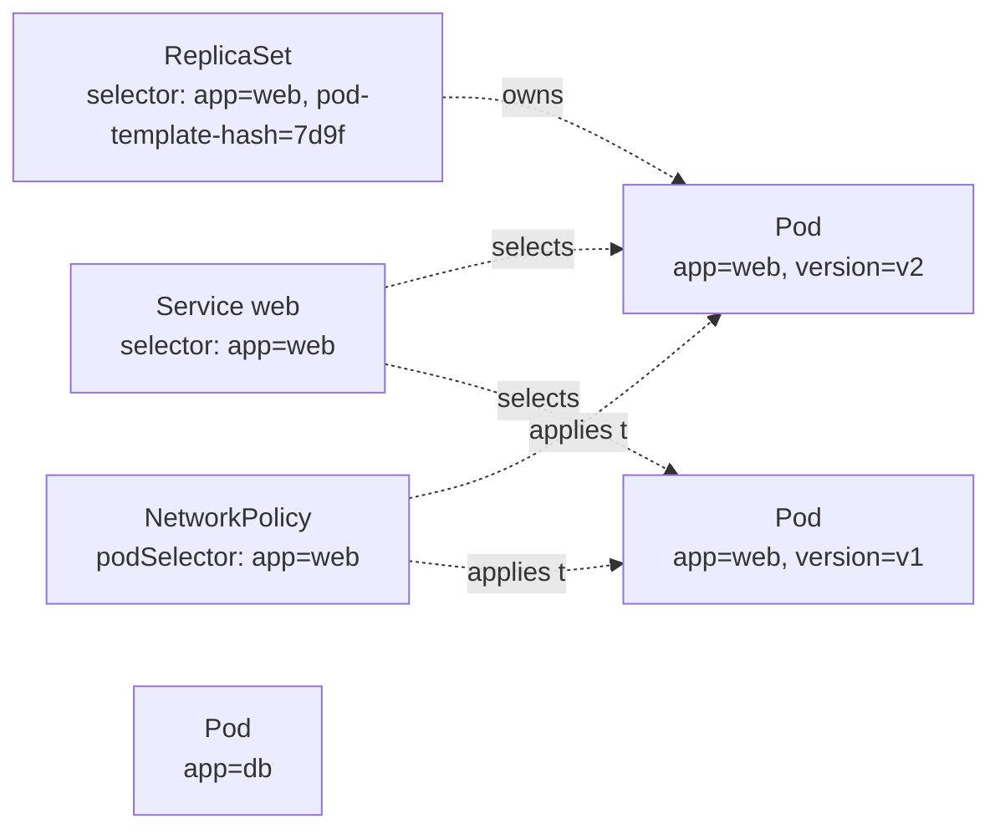

# 00-04 — The API and the object model

> **Module type:** Foundation
> **Time:** ~90 minutes (50 reading, 40 lab)
> **Prerequisites:** `00-03`
> **Maps to:** everything. Every manifest you write, every `kubectl` output you read, and every CRD in Domain 9 is this structure

---

## 1. Why this module exists

Kubernetes has more than 50 built-in object types, and clusters add dozens more through CRDs. You
cannot memorise them all — and you do not need to, because **they all have the same shape**. Once
you can read *any* object as `apiVersion` / `kind` / `metadata` / `spec` / `status`, and you know
what labels, owners and finalizers do, every new object is just "a new `spec` to learn".

This module also covers YAML itself. A surprising share of real-world and exam failures are YAML
failures, not Kubernetes failures.

---

## 2. The object model — the shape of every object

```yaml
apiVersion: apps/v1          # ① API group "apps", version "v1"
kind: Deployment             # ② the type
metadata:                    # ③ identity and bookkeeping — same fields for every kind
  name: web
  namespace: shop
  labels: { app: web, tier: frontend }       # identifying, selectable
  annotations: { owner: "team-a" }           # non-identifying, arbitrary data
  # set by the system:
  uid: 3f6c…                                 # unique forever, across delete/recreate
  resourceVersion: "184522"                  # changes on every write — concurrency control
  generation: 4                              # increments when spec changes
  creationTimestamp: "2026-10-13T09:00:00Z"
  ownerReferences: [...]                     # who owns me → garbage collection
  finalizers: [...]                          # what must happen before I can be deleted
spec:                        # ④ DESIRED state — written by you
  replicas: 3
  ...
status:                      # ⑤ OBSERVED state — written by controllers; you never write it
  replicas: 3
  readyReplicas: 2
  observedGeneration: 4                      # "I have acted on generation 4 of the spec"
  conditions: [...]
```

**The contract:** you write `spec`; controllers write `status`; reconciliation is the act of
making `status` converge on `spec`. When `status.observedGeneration == metadata.generation`, the
controller has *seen* your latest change (not necessarily finished acting on it — check
`conditions` for that).

A few objects break the spec/status pattern because they are pure data: **ConfigMap** and
**Secret** (`data`), **Role/ClusterRole** (`rules`), **RoleBinding** (`subjects`, `roleRef`),
**Event**.

---

## 3. Concepts

### 3.1 Groups, versions, kinds, resources

| Term | Example | Meaning |
|---|---|---|
| **Group** | `apps`, `batch`, `networking.k8s.io`, `""` (core) | A family of related types |
| **Version** | `v1`, `v1beta1`, `v2` | API maturity: `alpha` (off by default, may vanish) → `beta` → `v1` (stable) |
| **apiVersion** | `apps/v1`; core group is just `v1` | `group/version`, written in every manifest |
| **Kind** | `Deployment` | The type name, CamelCase, singular |
| **Resource** | `deployments` | The URL name, lowercase plural |
| **GVK / GVR** | `apps/v1, Kind=Deployment` | Group-Version-Kind / Group-Version-Resource — you will see these in errors and in Domain 9 |

Every object is a REST URL:

```
/api/v1/namespaces/shop/pods/web-7d9f-abc12                  ← core group: /api/v1
/apis/apps/v1/namespaces/shop/deployments/web                ← named group: /apis/<group>/<version>
/apis/rbac.authorization.k8s.io/v1/clusterroles/view         ← cluster-scoped: no /namespaces/…
/api/v1/namespaces/shop/pods/web-7d9f-abc12/log              ← a subresource
```

Common apiVersions to know cold:

| apiVersion | Kinds |
|---|---|
| `v1` | Pod, Service, ConfigMap, Secret, Namespace, Node, PersistentVolume(Claim), ServiceAccount, Event |
| `apps/v1` | Deployment, ReplicaSet, StatefulSet, DaemonSet |
| `batch/v1` | Job, CronJob |
| `networking.k8s.io/v1` | Ingress, IngressClass, NetworkPolicy |
| `rbac.authorization.k8s.io/v1` | Role, ClusterRole, RoleBinding, ClusterRoleBinding |
| `storage.k8s.io/v1` | StorageClass, CSIDriver, VolumeAttachment |
| `autoscaling/v2` | HorizontalPodAutoscaler |
| `policy/v1` | PodDisruptionBudget |
| `gateway.networking.k8s.io/v1` | Gateway, HTTPRoute (a CRD set, installed separately) |

When in doubt: `kubectl api-resources` (lists kind, short name, apiVersion, namespaced) and
`kubectl explain <kind>` (shows the apiVersion and every field).

### 3.2 Namespaced vs cluster-scoped

| Namespaced (live inside a namespace) | Cluster-scoped (no namespace) |
|---|---|
| Pod, Deployment, Service, ConfigMap, Secret, PVC, Role, RoleBinding, ServiceAccount, Ingress, NetworkPolicy, Job | **Node**, **Namespace**, **PersistentVolume**, StorageClass, ClusterRole, ClusterRoleBinding, CRD, IngressClass, PriorityClass |

```bash
kubectl api-resources --namespaced=true
kubectl api-resources --namespaced=false
```

> **Classic trap:** a PVC is namespaced; the PV it binds to is not. A Role is namespaced; a
> ClusterRole is not — but a ClusterRole can be bound **inside one namespace** with a RoleBinding.

### 3.3 Namespaces

A **namespace** is a scope for names: two `web` Deployments can coexist in `shop` and `blog`.

| Built-in namespace | Contains |
|---|---|
| `default` | Whatever you create without specifying a namespace |
| `kube-system` | Control plane and system add-ons |
| `kube-public` | Readable by everyone, including unauthenticated users (rarely used) |
| `kube-node-lease` | Node heartbeat Leases |

**A namespace on its own is not a security boundary.** By default, Pods in different namespaces
can reach each other over the network, and a ClusterRole binding can grant access across all of
them. Namespaces become boundaries when combined with RBAC, NetworkPolicy, ResourceQuota and Pod
Security — Domains 5 and 6.

Deleting a namespace **deletes everything in it** (asynchronously — it goes `Terminating` until
the namespace controller has removed every object). This is why the labs use it for cleanup.

### 3.4 Labels, selectors and annotations

**Labels** are key/value pairs used to **select** objects. They are how Kubernetes objects find
each other — there are almost no hard references by name.



| Selector type | Syntax (kubectl) | Used by |
|---|---|---|
| Equality | `app=web`, `tier!=db` | Service `selector`, `nodeSelector` |
| Set-based | `env in (prod,stage)`, `tier notin (db)`, `team` (exists), `!team` | `matchExpressions` in Deployments, Jobs, NetworkPolicy, affinity |

```yaml
selector:
  matchLabels:            # all of these AND
    app: web
  matchExpressions:       # AND these
  - { key: env, operator: In, values: [prod, stage] }
  - { key: canary, operator: DoesNotExist }
```

Label rules: keys `prefix/name` (prefix optional, a DNS subdomain; `kubernetes.io/` and
`k8s.io/` reserved), name ≤ 63 chars; values ≤ 63 chars, may be empty.

**Annotations** are key/value pairs that are **not** selectable — arbitrary metadata for tools and
humans: build info, `kubectl.kubernetes.io/last-applied-configuration`, ingress-controller
settings, `deployment.kubernetes.io/revision`. Values can be large.

| Use a… | When |
|---|---|
| **Label** | Something must *select* or *group* by it (Services, controllers, `kubectl get -l`, policies) |
| **Annotation** | It is information *about* the object that nothing selects on |

### 3.5 Owners and garbage collection

When a controller creates an object, it sets an **`ownerReference`** on it:

```yaml
# on a Pod created by a ReplicaSet
metadata:
  ownerReferences:
  - apiVersion: apps/v1
    kind: ReplicaSet
    name: web-7d9f8c6b5
    uid: 9a1e…
    controller: true            # this owner is THE managing controller
    blockOwnerDeletion: true
```

The **garbage collector** deletes dependents whose owner no longer exists. Deleting a Deployment
therefore deletes its ReplicaSets, which deletes their Pods — the **cascade**.

| `kubectl delete --cascade=` | Behaviour |
|---|---|
| `background` (default) | Owner deleted immediately; GC deletes dependents afterwards |
| `foreground` | Owner stays (with a `foregroundDeletion` finalizer) until all dependents are gone |
| `orphan` | Owner deleted; dependents **kept** and their ownerReference removed |

Ownership also explains "adoption": a ReplicaSet whose selector matches **existing orphan Pods**
will adopt them and count them toward `replicas`.

### 3.6 Finalizers

A **finalizer** is a string in `metadata.finalizers`. When you delete an object that has
finalizers, the API server does **not** remove it; it sets `metadata.deletionTimestamp` and the
object shows as `Terminating`. Some controller must do its cleanup and then **remove its
finalizer**. When the list is empty, the object is actually deleted.

| Common finalizer | Protects |
|---|---|
| `kubernetes.io/pvc-protection` | A PVC still used by a Pod |
| `kubernetes.io/pv-protection` | A PV still bound |
| `kubernetes` (in `spec.finalizers` of a Namespace) | The namespace until all its content is gone |
| `foregroundDeletion` | An owner during foreground cascade |
| CRD/operator finalizers | External resources (cloud disks, DNS records…) |

**Stuck `Terminating`** = a finalizer whose controller is gone or failing. The fix is to make the
controller work. Removing the finalizer by hand (`kubectl patch … --type=merge -p '{"metadata":{"finalizers":null}}'`)
works, but skips the cleanup it was guarding — a last resort.

### 3.7 resourceVersion and optimistic concurrency

Every write changes `metadata.resourceVersion`. An update must carry the version it was based on;
if someone else wrote in between, the API server answers **409 Conflict: the object has been
modified; please apply your changes to the latest version and try again**. There are no locks.
Controllers handle 409 by re-reading and retrying. You will see it when `kubectl edit` races a
controller, and you will produce it in the lab.

### 3.8 YAML — the traps that cost marks

Manifests are YAML (JSON also works — YAML is a superset).

```yaml
# Maps: key: value       Lists: "- " items        Indentation: SPACES only, consistent
containers:
- name: app                     # a list item that is a map
  image: nginx:1.27
  args: ["--port", "8080"]      # flow-style list
  env:
  - name: ENABLED
    value: "true"               # env values MUST be strings → quote it
  - name: RETRIES
    value: "3"                  # unquoted 3 is an integer → API error
  - name: COUNTRY
    value: "NO"                 # unquoted NO may be read as boolean false ("Norway problem")
  - name: VERSION
    value: "1.10"               # unquoted 1.10 is the float 1.1
  - name: MULTILINE
    value: |                    # literal block: newlines kept
      line one
      line two
  - name: FOLDED
    value: >                    # folded block: newlines become spaces
      one long
      sentence
---                             # document separator: several objects in one file
apiVersion: v1
kind: Service
```

| Error | Usual cause |
|---|---|
| `error converting YAML to JSON: yaml: line N: mapping values are not allowed in this context` | Bad indentation, or a `:` inside an unquoted value |
| `cannot unmarshal number into Go struct field EnvVar.value of type string` | Unquoted number/boolean where a string is required |
| `unknown field "spec.containers[0].imagee"` | Typo — the API server's strict field validation reports it (`kubectl apply` warns or fails depending on `--validate`) |
| Tabs | YAML forbids tabs for indentation |

---

## 4. Declarative form — the anatomy, applied to a Pod

```yaml
apiVersion: v1                       # core group → no "group/" prefix
kind: Pod
metadata:
  name: anatomy
  labels:
    app: anatomy
    course: k8s
  annotations:
    purpose: "00-04 lab"
spec:                                # desired
  containers:
  - name: app
    image: nginx:1.27
    ports:
    - containerPort: 80
# status: is never written in a manifest — the kubelet fills it in
```

---

## 5. Imperative — exploring the API from the terminal

```bash
kubectl api-versions                              # every group/version this server serves
kubectl api-resources -o wide                     # kinds, short names, verbs, namespaced?
kubectl api-resources --api-group=apps
kubectl explain deployment                        # top-level fields + the apiVersion
kubectl explain deployment.spec.strategy          # drill into a field
kubectl explain pod.spec --recursive | less       # the whole tree — fastest offline reference

kubectl get pod anatomy -o yaml                   # full object, including status and managedFields
kubectl get pod anatomy -o yaml --show-managed-fields=false

kubectl label pod anatomy env=dev                 # add
kubectl label pod anatomy env=prod --overwrite    # change
kubectl label pod anatomy env-                    # remove (trailing minus)
kubectl annotate pod anatomy note="hello"
kubectl get pods -l 'app=anatomy,env in (dev,prod)' --show-labels
kubectl get pods -L app,env                       # labels as columns

kubectl get --raw /apis/apps/v1 | jq -r '.resources[] | [.name, .namespaced, .kind] | @tsv'
kubectl proxy --port=8001                         # then: curl http://127.0.0.1:8001/api/v1/namespaces
```

---

## 6. Under the hood — what `kubectl get pod x -o yaml` really returns

1. `kubectl` resolves `pod` → GVR `v1/pods` using **discovery** (`/api`, `/apis` — cached in
   `~/.kube/cache/discovery`).
2. Sends `GET /api/v1/namespaces/<ns>/pods/x` with your credentials.
3. The API server authenticates, authorises (`get` on `pods`), reads the object from its **watch
   cache** (or etcd), converts it from the **storage version** to the requested version, and
   serialises it as JSON.
4. `kubectl` converts to YAML for display.

Two consequences:

- **One object, several versions.** The same stored object can be read as `autoscaling/v1` or
  `autoscaling/v2`; the API server converts. That is how API versions are deprecated without data
  migrations.
- **`managedFields`** records which **field manager** (kubectl, a controller, Helm…) last set each
  field. It is the bookkeeping behind **server-side apply** and its conflict detection (`00-05`).

---

## 7. Decision table

| I need to… | Use |
|---|---|
| Find all Pods of an app across ReplicaSets and versions | A **label selector** (`-l app=web`) |
| Attach a build SHA or a ticket number to an object | An **annotation** |
| Delete a controller but keep its running Pods | `kubectl delete … --cascade=orphan` |
| Block deletion until an external resource is cleaned up | A **finalizer** + a controller that removes it |
| Group a team's resources for quota, RBAC and cleanup | A **namespace** |
| Isolate teams from each other | Namespace **+** RBAC **+** NetworkPolicy **+** quota **+** Pod Security |
| Find a field name or valid values without a browser | `kubectl explain <kind>.<path>` |

---

## 8. Gotchas and exam traps

1. **The core group has no name.** `apiVersion: v1`, never `core/v1`. And Deployments are `apps/v1`, never `v1`.
2. **`kind` is singular CamelCase; resources are lowercase plural.** `kind: NetworkPolicy`, `kubectl get networkpolicies` (or `netpol`).
3. **Changing a Deployment's `spec.selector` is not allowed** after creation (it is immutable in `apps/v1`).
4. **The selector must match the template labels**, or the API rejects the Deployment: `selector does not match template labels`.
5. **Deleting a namespace deletes everything in it** — and it can hang in `Terminating` on a finalizer.
6. **Env values must be strings.** Quote numbers and booleans.
7. **Labels are for selecting, annotations are not selectable.** A Service selector on an annotation never matches.
8. **Editing `status` has no effect** — the controller overwrites it.
9. **A namespace is not a security boundary by itself.**
10. **`kubectl explain` is allowed and fast in exams** and works offline; use it before the docs.

---

## 9. Lab — read, own, conflict and finalize

```bash
./labs/new-lab.sh lab-00-04
```

### 9.1 Explore the API

```bash
kubectl api-resources --namespaced=false
kubectl api-resources --api-group=apps
kubectl explain pod.spec.containers.resources
kubectl explain deployment.spec.strategy.rollingUpdate.maxSurge
```

✅ **Verify:** without the docs, answer: what is the apiVersion of `CronJob`? Is `StorageClass`
namespaced? What are the short names of `deployments`, `services` and `persistentvolumeclaims`?

### 9.2 Talk to the API directly

```bash
# terminal 2:
kubectl proxy --port=8001
# terminal 1:
curl -s http://127.0.0.1:8001/api/v1/namespaces/lab-00-04 | jq .metadata
curl -s "http://127.0.0.1:8001/api/v1/namespaces/kube-system/pods?labelSelector=component%3Detcd" | jq -r '.items[].metadata.name'
kubectl get pods -n kube-system -l component=etcd -v=8 2>&1 | grep 'GET https'
```

✅ **Verify:** the URL `kubectl` used in the last command matches the one you built by hand.

### 9.3 Spec, status, generation

```bash
kubectl create deployment gen --image=nginx:1.27
kubectl get deploy gen -o jsonpath='{.metadata.generation} {.status.observedGeneration}{"\n"}'
kubectl scale deploy gen --replicas=3
kubectl get deploy gen -o jsonpath='{.metadata.generation} {.status.observedGeneration}{"\n"}'
kubectl label deploy gen touched=yes
kubectl get deploy gen -o jsonpath='{.metadata.generation} {.metadata.resourceVersion}{"\n"}'
```

✅ **Verify:** `generation` went up on the scale (a **spec** change) but **not** on the label (a
**metadata** change), while `resourceVersion` changed on both. Explain why.

### 9.4 Owners and the cascade

```bash
kubectl get rs,pods -l app=gen
kubectl get pod -l app=gen -o jsonpath='{.items[0].metadata.ownerReferences[0].kind}/{.items[0].metadata.ownerReferences[0].name}{"\n"}'
kubectl get rs  -l app=gen -o jsonpath='{.items[0].metadata.ownerReferences[0].kind}/{.items[0].metadata.ownerReferences[0].name}{"\n"}'

kubectl delete deploy gen --cascade=orphan
kubectl get deploy,rs,pods -l app=gen         # Deployment gone; ReplicaSet and Pods still running
```

**Break it / adoption:** recreate the Deployment with the *same* template and watch it adopt the
orphaned ReplicaSet instead of creating new Pods:

```bash
kubectl create deployment gen --image=nginx:1.27 --replicas=3
kubectl get rs -l app=gen                      # still ONE ReplicaSet, same name, same Pods' AGE
kubectl delete deploy gen                      # default cascade: everything goes
kubectl get rs,pods -l app=gen
```

✅ **Verify:** the Pods' `AGE` did not reset after re-creation — adoption, not replacement.

### 9.5 Break it: a 409 conflict

```bash
kubectl create configmap race --from-literal=k=v1
kubectl get cm race -o yaml > race.yaml       # snapshot including resourceVersion
kubectl patch cm race --type=merge -p '{"data":{"k":"v2"}}'     # someone else writes
kubectl replace -f race.yaml                  # your stale copy
```

✅ **Verify:** `replace` fails with *the object has been modified*. `kubectl apply` would not have
failed — it computes a patch rather than sending a whole object with a version. Remove
`race.yaml` afterwards.

### 9.6 Break it: stuck in Terminating

```bash
kubectl create configmap stuck --from-literal=a=b
kubectl patch cm stuck --type=merge -p '{"metadata":{"finalizers":["course.k8s/demo"]}}'
kubectl delete cm stuck --wait=false
kubectl get cm stuck -o jsonpath='{.metadata.deletionTimestamp}{"  "}{.metadata.finalizers}{"\n"}'
kubectl get cm stuck                           # still there — nothing will ever remove that finalizer
kubectl patch cm stuck --type=merge -p '{"metadata":{"finalizers":null}}'
kubectl get cm stuck                           # NotFound — deleted the moment the list emptied
```

✅ **Verify:** you can state who normally removes a finalizer (the controller that added it) and
why removing one by hand is a last resort.

### 9.7 YAML traps

Save as `traps.yaml` and apply it with `kubectl apply -f traps.yaml`. Fix each error until it applies.

```yaml
apiVersion: v1
kind: pod
metadata:
  name: traps
spec:
  containers:
  - name: app
    image: busybox:1.37
    command: ["sh", "-c", "env | sort; sleep 3600"]
    env:
    - name: RETRIES
      value: 3
    - name: DEBUG
      value: true
	- name: TABBED
      value: "x"
```

✅ **Verify:** you found four problems (`kind: pod` → `Pod`; two unquoted values; a tab). Then
`kubectl logs traps` shows `RETRIES=3` and `DEBUG=true`.

### 9.8 Clean up

```bash
rm -f race.yaml traps.yaml
./labs/clean-labs.sh
```

---

## 10. Self-check

1. Write the apiVersion for: Pod, Deployment, CronJob, Ingress, ClusterRole, HorizontalPodAutoscaler.
2. What is the difference between `kind` and `resource`? Give the pair for NetworkPolicy.
3. Which writes `spec` and which writes `status`? What does `observedGeneration` tell you?
4. Name four cluster-scoped kinds.
5. When should data be a label, and when an annotation?
6. You delete a Deployment with `--cascade=orphan`. What remains, and what happens to it if you create a new Deployment whose selector matches?
7. A namespace has been `Terminating` for an hour. What is the mechanism holding it, and what is the correct first step?
8. What is the HTTP status and meaning of an optimistic-concurrency failure?
9. Why does `generation` not change when you add a label?
10. Which of these env entries will be rejected and why: `value: 8080`, `value: "8080"`, `value: yes`, `value: 'yes'`?
11. Is a namespace a security boundary? What turns it into one?

<details>
<summary>Answers</summary>

1. `v1`, `apps/v1`, `batch/v1`, `networking.k8s.io/v1`, `rbac.authorization.k8s.io/v1`, `autoscaling/v2`.
2. `kind` is the type name in manifests (singular, CamelCase); `resource` is the URL/CLI name (lowercase plural). `NetworkPolicy` / `networkpolicies`.
3. You (or your tooling) write **spec**; **controllers/kubelet write status**. `status.observedGeneration` is the `metadata.generation` the controller last processed — if it is lower, the controller has not yet seen your latest spec change.
4. Any four of: Node, Namespace, PersistentVolume, StorageClass, ClusterRole, ClusterRoleBinding, CustomResourceDefinition, IngressClass, PriorityClass.
5. **Label** if anything needs to select or group by it; **annotation** for descriptive or tool-specific data nothing selects on (and for larger values).
6. The ReplicaSet and its Pods remain, with no ownerReference. A new Deployment with a matching selector (and matching template) **adopts** the existing ReplicaSet and Pods rather than creating new ones.
7. A **finalizer** — on the namespace itself, or on objects inside it that cannot be deleted (often a CRD's controller is gone, or an API service is unavailable). First step: find *what* is left (`kubectl api-resources --verbs=list --namespaced -o name | xargs -n1 kubectl get -n <ns> --ignore-not-found`, and `kubectl get ns <ns> -o yaml` → `status.conditions`) and fix the responsible controller. Force-removing finalizers is the last resort.
8. **409 Conflict** — the object's `resourceVersion` changed since you read it; re-read and retry.
9. `generation` tracks changes to **spec** only. Labels are metadata.
10. `value: 8080` — **rejected** (integer, must be string). `value: yes` — **rejected**: kubectl's YAML parser follows YAML 1.1, where `yes` is the boolean `true`. `"8080"` and `'yes'` are fine.
11. **No.** It scopes names. It becomes a boundary when combined with **RBAC** (who can act in it), **NetworkPolicy** (who can talk to it), **ResourceQuota/LimitRange** (what it can consume) and **Pod Security admission** (what its Pods may do).

</details>

---

**Previous:** [`00-03` — Cluster architecture](00-03-cluster-architecture.md)
**Next:** [`00-05` — kubectl fluency](00-05-kubectl-fluency.md)
