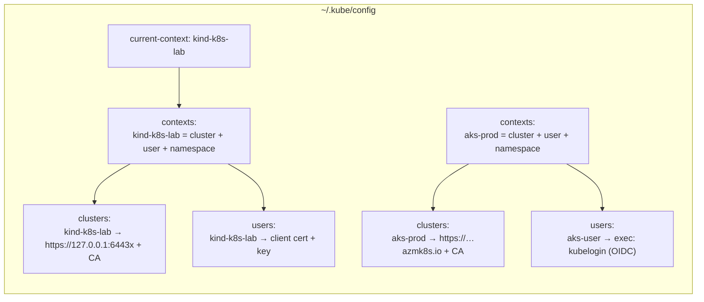

# 00-05 — kubectl fluency

> **Module type:** Foundation — skills
> **Time:** ~90 minutes, then 10 minutes of drills per day for the rest of the course
> **Prerequisites:** `00-04`
> **Maps to:** all three CNCF exams are timed hands-on exams. Most people who fail them knew the material and ran out of time

---

## 1. Why this module exists

`kubectl` is how you read and change cluster state. In real work, fluency means fast diagnosis.
In an exam, it means finishing: ~17 tasks in 120 minutes is about **7 minutes per task**, including
reading it. Writing YAML from memory is too slow; **generating** it is the skill.

---

## 2. The object model — kubeconfig



| Section | Holds |
|---|---|
| `clusters` | API server URL + the CA certificate to trust it |
| `users` | Credentials: client certificate/key, a bearer token, or an **exec plugin** that fetches a token (AKS, EKS, GKE, OIDC) |
| `contexts` | A name for a *cluster + user + default namespace* triple |
| `current-context` | Which context `kubectl` uses when you do not say |

**`KUBECONFIG`** can list several files separated by `:`; kubectl merges them (`KUBECONFIG=~/.kube/config:~/other.yaml kubectl config view --flatten` merges into one).
`--kubeconfig`, `--context`, `-n` override per command.

---

## 3. Concepts

### 3.1 The command grammar

```
kubectl  <verb>   <resource>[/<name>]   [flags]
kubectl  get      pods                  -n kube-system -o wide
kubectl  describe deploy/web
kubectl  logs     deploy/web            -c app --since=10m
```

Resource names accept **short names**: `po`, `deploy`, `rs`, `ds`, `sts`, `svc`, `ep`, `cm`, `ns`,
`no`, `pv`, `pvc`, `sa`, `ing`, `netpol`, `cj`, `hpa`, `pdb`, `sc`, `crd`.

### 3.2 The verbs, grouped

| Group | Verbs |
|---|---|
| **Read** | `get`, `describe`, `explain`, `logs`, `events`, `top`, `api-resources`, `auth can-i`, `diff` |
| **Create** | `create`, `run`, `expose`, `apply` |
| **Change** | `apply`, `edit`, `patch`, `replace`, `set image/env/resources`, `scale`, `label`, `annotate`, `rollout` |
| **Delete** | `delete` |
| **Interact** | `exec`, `cp`, `port-forward`, `attach`, `debug`, `proxy` |
| **Wait** | `wait`, `rollout status`, `get -w` |
| **Nodes** | `cordon`, `uncordon`, `drain`, `taint` |
| **Config** | `config get-contexts`, `use-context`, `set-context`, `view` |

### 3.3 Imperative commands vs imperative object config vs declarative

| Style | Example | When |
|---|---|---|
| **Imperative commands** | `kubectl create deployment web --image=nginx` | Exams, quick experiments |
| **Imperative object config** | `kubectl create -f web.yaml`, `kubectl replace -f web.yaml` | Rare — one-off with files |
| **Declarative** | `kubectl apply -f dir/` | Real work: files in Git, re-applied repeatedly |

### 3.4 `create` vs `apply` vs `replace`

| | Object absent | Object present | How it changes the object |
|---|---|---|---|
| `create` | Creates | **Error: AlreadyExists** | — |
| `replace` | **Error: NotFound** | Replaces the whole object | Sends full object; fields you omit are **removed** |
| `apply` | Creates | Updates | **Merges**: changes what your file says, leaves fields set by others alone |

**How `apply` decides what to remove** (client-side apply, the default): it stores your last
applied file in the annotation `kubectl.kubernetes.io/last-applied-configuration`, then does a
**three-way merge** between *last applied*, *your new file* and *the live object*. A field that
was in the last applied file and is gone from the new one is deleted; a field you never managed
(e.g. one a controller set) is left alone.

**Server-side apply** (`kubectl apply --server-side`) moves that logic into the API server using
`managedFields`: each field has an owner (field manager). If you try to set a field another
manager owns, you get a **conflict** instead of silently overwriting it (`--force-conflicts` to
take ownership). It is what controllers and GitOps tools use.

### 3.5 The three patch types

```bash
# strategic merge (default for built-in kinds): knows that containers merge by "name"
kubectl patch deploy web -p '{"spec":{"template":{"spec":{"containers":[{"name":"nginx","image":"nginx:1.28"}]}}}}'

# JSON merge patch (RFC 7386): lists are REPLACED wholesale; null deletes a key
kubectl patch deploy web --type=merge -p '{"spec":{"replicas":5}}'

# JSON patch (RFC 6902): explicit operations on paths — precise for list items by index
kubectl patch deploy web --type=json -p '[{"op":"replace","path":"/spec/template/spec/containers/0/image","value":"nginx:1.28"}]'
```

> On custom resources (CRDs), strategic merge is not available — use `--type=merge` or `json`.

### 3.6 Output formats

| Flag | Gives |
|---|---|
| `-o wide` | Extra columns (Pod IP, node) |
| `-o yaml` / `-o json` | The full object |
| `-o name` | `pod/web-abc` — perfect for piping |
| `-o jsonpath='{…}'` | Specific fields |
| `-o custom-columns=NAME:.metadata.name,NODE:.spec.nodeName` | Your own table |
| `--show-labels`, `-L key1,key2` | Labels |
| `--sort-by=.metadata.creationTimestamp` | Sorted |
| `--field-selector status.phase=Running,spec.nodeName=k8s-lab-worker` | Server-side filter on some fields |
| `-w` / `--watch` | Stream changes |
| `-A` | All namespaces |

**JSONPath** essentials:

```bash
kubectl get pods -o jsonpath='{.items[*].metadata.name}'
kubectl get pods -o jsonpath='{range .items[*]}{.metadata.name}{"\t"}{.status.podIP}{"\n"}{end}'
kubectl get pod web -o jsonpath='{.spec.containers[?(@.name=="app")].image}'
kubectl get nodes -o jsonpath='{.items[*].status.addresses[?(@.type=="InternalIP")].address}'
kubectl get secret s -o jsonpath='{.data.password}'        # base64 — decode it (00-06, Domain 2)
```

---

## 4. Declarative form — generating YAML instead of writing it

**The single most valuable habit in this course:**

```bash
kubectl create deployment web --image=nginx:1.27 --replicas=3 --port=80 --dry-run=client -o yaml > web.yaml
```

`--dry-run=client` builds the object locally and prints it without sending it. You then edit the
file for whatever the generator cannot express and `kubectl apply -f web.yaml`.

| Generator | Produces |
|---|---|
| `kubectl run NAME --image=IMG [--port] [--env K=V] [--labels k=v] [--command -- cmd args]` | Pod |
| `kubectl create deployment NAME --image=IMG [--replicas] [--port]` | Deployment |
| `kubectl create job NAME --image=IMG -- cmd` / `--from=cronjob/X` | Job |
| `kubectl create cronjob NAME --image=IMG --schedule="*/5 * * * *" -- cmd` | CronJob |
| `kubectl expose deploy NAME --port=80 --target-port=8080 [--type=NodePort]` | Service (selector copied from the Deployment) |
| `kubectl create service clusterip NAME --tcp=80:8080` | Service (selector `app=NAME` — check it!) |
| `kubectl create configmap NAME --from-literal=k=v --from-file=path` | ConfigMap |
| `kubectl create secret generic NAME --from-literal=k=v` | Secret |
| `kubectl create namespace / serviceaccount / quota / priorityclass / ingress / pdb` | … |
| `kubectl create role NAME --verb=get,list --resource=pods` / `rolebinding --role=X --user=Y` | RBAC (Domain 6) |

`--dry-run=server` sends the object through admission and validation **without persisting** — a
true "would this be accepted?" check.

`kubectl diff -f file.yaml` shows what `apply` would change against the live object.

---

## 5. Imperative — the daily toolkit

```bash
# context and namespace
kubectl config get-contexts
kubectl config use-context kind-k8s-lab
kubectl config set-context --current --namespace=lab-00-05
kubectl config view --minify                    # only the current context

# inspect
kubectl get all                                 # common workload kinds — NOT everything (no cm, secret, pvc, ing…)
kubectl describe pod web-xyz                    # human summary + EVENTS (read these first)
kubectl events --for pod/web-xyz                # events for one object
kubectl get events --sort-by=.lastTimestamp -A

# logs and exec
kubectl logs web-xyz                            # current container
kubectl logs web-xyz -c sidecar                 # a specific container
kubectl logs web-xyz --previous                 # the container that crashed — essential for CrashLoopBackOff
kubectl logs -l app=web --tail=20 -f --prefix   # all Pods of an app
kubectl exec -it web-xyz -- sh
kubectl exec web-xyz -- cat /etc/resolv.conf
kubectl port-forward svc/web 8080:80            # localhost:8080 → Service port 80
kubectl cp web-xyz:/etc/nginx/nginx.conf ./nginx.conf

# change
kubectl edit deploy web                         # opens $KUBE_EDITOR; saved → applied
kubectl set image deploy/web nginx=nginx:1.28
kubectl set env deploy/web LOG_LEVEL=debug
kubectl scale deploy web --replicas=5

# delete
kubectl delete pod web-xyz
kubectl delete pod web-xyz --grace-period=0 --force    # skip graceful shutdown (exam speed, not prod)
kubectl delete -f web.yaml

# wait (scripts and exams)
kubectl wait --for=condition=Ready pod -l app=web --timeout=60s
kubectl rollout status deploy/web

# permissions
kubectl auth can-i create deployments
kubectl auth can-i list secrets --as=system:serviceaccount:lab:default
kubectl auth whoami
```

**Seeing the HTTP**: `-v=6` prints each request URL and status; `-v=8` adds bodies. Use it once on
every new verb and you will understand what it really does.

---

## 6. Under the hood — `kubectl apply -f web.yaml`, step by step

1. Read the file; for each object, find its GVR via discovery.
2. `GET` the live object.
3. **Absent** → `POST` it, with your file stored in the `last-applied-configuration` annotation.
4. **Present** → compute a **strategic merge patch** from (last-applied, new file, live), then
   `PATCH`. Fields only the live object has (set by controllers or `kubectl scale`) are not
   touched — **unless** your file also sets them.
5. The API server runs the patch through admission and validation and stores it.

Consequence worth remembering: if `web.yaml` contains `replicas: 3` and an HPA has scaled to 8,
every `kubectl apply` resets it to 3. Fields managed by something else should be **left out** of
your file.

---

## 7. Decision table

| I want to… | Use |
|---|---|
| Create something fast in an exam | `kubectl create … --dry-run=client -o yaml > f.yaml`, edit, `apply -f` |
| Change one field quickly | `kubectl set …`, `scale`, `label`, or `edit` |
| Change one field in a script | `kubectl patch` |
| Keep config in Git and re-apply | `kubectl apply -f` (or `-k`, Helm — Domain 2) |
| Check what an apply would change | `kubectl diff -f` |
| Check whether the API would accept it | `--dry-run=server` |
| Change an **immutable** field (e.g. Pod spec, Deployment selector) | Delete and recreate: `kubectl replace --force -f f.yaml` |
| Find a field's name or type | `kubectl explain` |

---

## 8. Gotchas and exam traps

1. **Wrong namespace or context is the #1 lost-mark cause.** Every exam task states its context —
   run the `kubectl config use-context` line it gives you, every time.
2. **`kubectl get all` is not all.** It skips ConfigMaps, Secrets, PVCs, Ingresses, ServiceAccounts, Roles…
3. **Most of a Pod's spec is immutable.** Only a few fields (`image`, `activeDeadlineSeconds`,
   tolerations additions) can be edited; anything else in `kubectl edit pod` is rejected and kubectl
   saves your edit to a temp file — apply it with `kubectl replace --force -f <that file>`.
   (CPU/memory can be changed in place only through the `resize` subresource — `01-09`.)
4. **`kubectl run` creates a Pod**, not a Deployment (it has not created Deployments for years).
5. **`--command --` in `kubectl run`** sets `command` (replaces ENTRYPOINT); without `--command`, the words after `--` become `args`.
6. **`kubectl create service clusterip web`** sets selector `app=web` regardless of what your Pods
   are labelled. `kubectl expose` copies the real selector — prefer it.
7. **`apply` after `create`** works but warns about the missing last-applied annotation. Use
   `create --save-config` or stick to one style per object.
8. **`--force --grace-period=0`** removes the object from the API immediately; the container may
   keep running on the node for a while. Fine in a lab, risky with StatefulSets.
9. **Quote JSONPath and JSON in single quotes** in bash, so the shell does not expand `$`, `*`, `[` or `{`.

---

## 9. Lab — drills (time yourself)

```bash
./labs/new-lab.sh lab-00-05
```

Do each drill **without looking at this module**, then check. Record your time; repeat the
whole set on three different days. Target: **under 60 seconds each** by the third round.

| # | Task | Time 1 | Time 2 | Time 3 |
|---|---|---|---|---|
| 1 | Create a Pod `d1` from `nginx:1.27` with label `tier=web` and container port 80 | | | |
| 2 | Generate YAML for a Deployment `d2`, 3 replicas, `httpd:2.4`, to `d2.yaml`; add `resources.requests.cpu: 50m`; apply it | | | |
| 3 | Expose `d2` as a NodePort Service on port 80 | | | |
| 4 | Print only the Pod names of `d2`, one per line, using JSONPath | | | |
| 5 | Print a table with columns `POD`, `NODE`, `IP` for all Pods in the namespace | | | |
| 6 | Change `d2`'s image to `httpd:2.4-alpine` without opening an editor; watch the rollout finish | | | |
| 7 | Create a ConfigMap `d7` with `color=blue` and `size=L` | | | |
| 8 | Run a one-off Pod `d8` from `busybox:1.37` that prints `date` and exits, and read its output | | | |
| 9 | Find which node runs CoreDNS Pods, in one command | | | |
| 10 | Scale `d2` to 0 with `patch` (merge type), then back to 2 with `scale` | | | |
| 11 | Show what would change if you re-applied the original `d2.yaml` | | | |
| 12 | Check whether the `default` ServiceAccount of this namespace may list Pods | | | |

<details>
<summary>Reference solutions</summary>

```bash
# 1
kubectl run d1 --image=nginx:1.27 --labels=tier=web --port=80
# 2
kubectl create deployment d2 --image=httpd:2.4 --replicas=3 --dry-run=client -o yaml > d2.yaml
#   edit d2.yaml: under the container add
#     resources:
#       requests:
#         cpu: 50m
kubectl apply -f d2.yaml
# 3
kubectl expose deployment d2 --port=80 --type=NodePort
# 4
kubectl get pods -l app=d2 -o jsonpath='{range .items[*]}{.metadata.name}{"\n"}{end}'
# 5
kubectl get pods -o custom-columns=POD:.metadata.name,NODE:.spec.nodeName,IP:.status.podIP
# 6
kubectl set image deployment/d2 httpd=httpd:2.4-alpine
kubectl rollout status deployment/d2
# 7
kubectl create configmap d7 --from-literal=color=blue --from-literal=size=L
# 8
kubectl run d8 --image=busybox:1.37 --restart=Never -- date
kubectl logs d8
#   (or interactively: kubectl run d8 --image=busybox:1.37 --restart=Never --rm -it -- date)
# 9
kubectl get pods -n kube-system -l k8s-app=kube-dns -o wide
# 10
kubectl patch deployment d2 --type=merge -p '{"spec":{"replicas":0}}'
kubectl scale deployment d2 --replicas=2
# 11
kubectl diff -f d2.yaml      # shows image and replicas would revert
# 12
kubectl auth can-i list pods --as=system:serviceaccount:lab-00-05:default     # no
```

</details>

### Break it

1. Create a context pointing at the lab cluster but a namespace that does not exist, switch to it,
   and run `kubectl get pods`. What does kubectl say? (Nothing alarming — `No resources found in
   nope namespace.` A wrong namespace fails **silently**. That is the trap.)

   ```bash
   kubectl config set-context broken --cluster=kind-k8s-lab --user=kind-k8s-lab --namespace=nope
   kubectl config use-context broken
   kubectl get pods
   kubectl config use-context kind-k8s-lab
   kubectl config delete-context broken
   ```

2. Run `kubectl edit pod d1` and change `image` → saved. Now change `resources.requests.cpu` →
   rejected. Read the error, find the temp file path it prints, and apply the change with
   `kubectl replace --force -f <path>`.

### Clean up

```bash
rm -f d2.yaml
./labs/clean-labs.sh
```

---

## 10. Self-check

1. What three things does a context bind together?
2. `kubectl create -f x.yaml` fails with `AlreadyExists`. Two commands that would succeed instead, and how they differ?
3. How does client-side `apply` know to delete a field you removed from your file?
4. What problem does server-side apply solve?
5. Write the command to generate a Job manifest running `busybox` with `echo hi`, without creating it.
6. What is the difference between `--dry-run=client` and `--dry-run=server`?
7. When is a JSON merge patch dangerous on a list field?
8. A Pod crash-loops. Which `kubectl logs` flag shows why the last instance died?
9. Your file sets `replicas: 3`; an HPA has scaled the Deployment to 10. What happens on `kubectl apply`, and how do you prevent it?
10. Why is `kubectl create service clusterip` riskier than `kubectl expose`?

<details>
<summary>Answers</summary>

1. A **cluster**, a **user** (credentials) and a default **namespace**.
2. `kubectl apply -f x.yaml` (merges changes into the live object) or `kubectl replace -f x.yaml` (replaces the whole object; fields not in the file are removed). (`replace --force` deletes and recreates.)
3. It compares the new file with the **`last-applied-configuration` annotation**: fields present there but absent now are deleted (three-way merge with the live object).
4. Field **ownership** across multiple writers. The server tracks a manager per field in `managedFields` and reports a **conflict** instead of silently overwriting another manager's field.
5. `kubectl create job hi --image=busybox:1.37 --dry-run=client -o yaml -- echo hi`
6. `client` builds the object locally — no validation by the server. `server` sends it through authentication, authorisation, admission and validation **without storing** it.
7. A merge patch **replaces the whole list**. Patching `containers` with one entry deletes the others. Use strategic merge (keyed by `name`) or JSON patch.
8. `--previous` (`-p`).
9. Replicas resets to **3**, then the HPA scales it back up — flapping. Remove `replicas` from the file when an HPA owns it.
10. It sets the selector to `app=<service-name>` regardless of your Pods' labels, so it may select nothing. `expose` copies the selector from the target object.

</details>

---

**Previous:** [`00-04` — The API and the object model](00-04-api-and-object-model.md)
**Next:** [`00-06` — Your first application, end to end](00-06-first-app-end-to-end.md)
