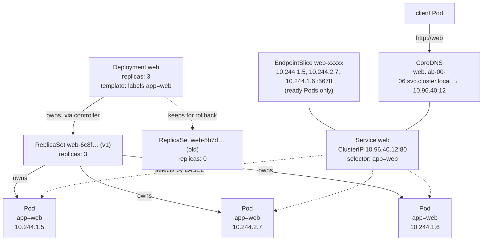

# 00-06 — Your first application, end to end

> **Module type:** Foundation — the capstone. Everything before this was parts; this is the machine.
> **Time:** ~2 hours
> **Prerequisites:** `00-01` → `00-05`; the `k8s-lab` cluster running
> **Cost:** €0

---

## 1. Why this module exists

Domain 0 gave you the parts: containers, the components, the object model, kubectl. This module
puts the three objects that **every** application uses — **Pod**, **Deployment**, **Service** —
together, and walks the full life of an app: deploy, reach, scale, heal, update, fail, roll back,
debug, delete.

Each object gets a full domain later (Pods and Deployments in Domain 1, Services in Domain 3).
Here you learn just enough to see how they fit, so that Domain 1 deepens a picture you already
have rather than building one from scratch.

---

## 2. The object model — the three objects and how they connect



| Object | Is | Contains | Attaches to | Reconciled by |
|---|---|---|---|---|
| **Pod** | The smallest deployable unit: one or more containers sharing network and volumes, scheduled together on one node | Containers, volumes, scheduling constraints | A node (`spec.nodeName`) | kubelet |
| **ReplicaSet** | "Keep N copies of this Pod template running" | A selector, a Pod template, `replicas` | Pods (via ownerReferences + selector) | ReplicaSet controller |
| **Deployment** | "Manage ReplicaSets so I can update Pods gradually and roll back" | A selector, a Pod template, `replicas`, a strategy | ReplicaSets (one per template version) | Deployment controller |
| **Service** | A stable virtual IP and DNS name in front of a changing set of Pods | A selector, ports, a type | Pods — **by label, not by owner** | EndpointSlice controller + kube-proxy + CoreDNS |

**The two links to remember:**

- Deployment → ReplicaSet → Pod is **ownership** (`ownerReferences`). You never manage the
  ReplicaSet directly.
- Service → Pod is a **label selector** only. A Service knows nothing about Deployments. Any Pod
  with matching labels — from any Deployment, or a bare Pod — receives traffic if it is **Ready**.

---

## 3. Concepts

### 3.1 Why not just Pods?

A bare Pod is bound to one node forever. If it is deleted, evicted, or its node dies, **nothing
recreates it**. Pod IPs change every time a Pod is recreated. So production never runs bare Pods:
a **controller** keeps the right number alive, and a **Service** gives clients one address that
survives Pod churn.

### 3.2 Pod phases and the status you see

| `kubectl get pods` STATUS | Meaning |
|---|---|
| `Pending` | Accepted, not yet running: waiting for scheduling, or for image pull/volume |
| `ContainerCreating` | Scheduled; the kubelet is setting it up (sandbox, network, volumes, pull) |
| `Running` | At least one container is running — **not** the same as *Ready* |
| `Completed` | All containers exited 0 and won't restart (Jobs) |
| `CrashLoopBackOff` | The container keeps exiting; the kubelet is waiting longer between restarts (10s, 20s, 40s … up to 5 min) |
| `ErrImagePull` / `ImagePullBackOff` | The image cannot be pulled — name, tag, registry, credentials |
| `CreateContainerConfigError` | A referenced ConfigMap/Secret/key is missing |
| `OOMKilled` | Killed for exceeding its memory limit (exit 137 — `00-01`) |
| `Terminating` | Deletion in progress (grace period, finalizers) |

The `READY` column (`1/1`) counts containers whose **readiness** check passes. **Only Ready Pods
are put into a Service's EndpointSlice.**

### 3.3 Rolling updates

Changing anything in a Deployment's **Pod template** (`spec.template`) — image, env, args,
labels — creates a **new ReplicaSet** and gradually shifts replicas from old to new:

```
replicas: 3, maxSurge: 25% (→1), maxUnavailable: 25% (→0)
old RS: 3 ─► 3 ─► 2 ─► 2 ─► 1 ─► 1 ─► 0
new RS: 0 ─► 1 ─► 1 ─► 2 ─► 2 ─► 3 ─► 3       (each step waits for the new Pod to be Ready)
```

Changing `replicas` alone is **not** a rollout (same template, same ReplicaSet). Old ReplicaSets
are kept at 0 replicas (`revisionHistoryLimit`, default 10) — that is what `rollout undo` uses.

If new Pods never become Ready (bad image, crash), the rollout **stalls**: old Pods keep serving
(the `maxUnavailable` budget protects them). After `progressDeadlineSeconds` (default 600 s) the
Deployment's `Progressing` condition becomes `False` — it does **not** roll back on its own.

### 3.4 Service types (just enough for now)

| Type | Reachable from | How |
|---|---|---|
| `ClusterIP` (default) | Inside the cluster | Virtual IP + DNS name |
| `NodePort` | Outside, via **any node's IP** on a port in **30000–32767** | ClusterIP + a port opened on every node |
| `LoadBalancer` | Outside, via a cloud load balancer | NodePort + cloud LB (needs a cloud controller — not on kind) |

Inside the cluster, a Service is reachable by DNS:
`<service>` (same namespace) → `<service>.<namespace>` → `<service>.<namespace>.svc.cluster.local`.

### 3.5 Three port numbers that get confused

```yaml
ports:
- port: 80          # the SERVICE's port — what clients connect to (web:80)
  targetPort: 5678  # the CONTAINER's port — where traffic is sent (can be a name, e.g. "http")
  nodePort: 30080   # NodePort only — the port opened on every node
```

---

## 4. Declarative YAML — the whole application

Save as `web.yaml`:

```yaml
apiVersion: apps/v1
kind: Deployment
metadata:
  name: web
  labels:
    app: web
spec:
  replicas: 3
  selector:
    matchLabels:
      app: web                      # MUST match template labels below
  template:                         # ← the Pod template: changes here trigger a rollout
    metadata:
      labels:
        app: web                    # what the ReplicaSet and the Service select on
    spec:
      containers:
      - name: echo
        image: hashicorp/http-echo:1.0
        args:
        - "-listen=:5678"
        - "-text=v1 served by $(POD_NAME)"     # $(VAR) expands env vars defined below
        env:
        - name: POD_NAME
          valueFrom:
            fieldRef:
              fieldPath: metadata.name          # the Downward API: the Pod's own name (02-03)
        ports:
        - name: http
          containerPort: 5678
        readinessProbe:                          # Ready only when this succeeds (01-08)
          httpGet:
            path: /
            port: http
          periodSeconds: 3
        resources:
          requests: { cpu: 10m, memory: 16Mi }
          limits:   { memory: 32Mi }
---
apiVersion: v1
kind: Service
metadata:
  name: web
spec:
  type: NodePort
  selector:
    app: web                         # selects Pods, not the Deployment
  ports:
  - name: http
    port: 80
    targetPort: http                 # the container port NAMED "http" (5678)
    nodePort: 30080                  # mapped to localhost:30080 by kind (00-02)
```

---

## 5. Imperative — the same app in four commands

```bash
kubectl create deployment web --image=hashicorp/http-echo:1.0 --replicas=3 --port=5678 \
  -- /http-echo -listen=:5678 -text="v1"
kubectl expose deployment web --port=80 --target-port=5678 --type=NodePort
kubectl scale deployment web --replicas=5
kubectl set image deployment/web http-echo=hashicorp/http-echo:1.0   # container name = image basename
```

The imperative version cannot express the probe, the Downward API env or a fixed `nodePort` —
the generate-then-edit pattern from `00-05` (`--dry-run=client -o yaml`) covers that gap.

> Note `create deployment … -- cmd args` sets the container **`command`**. The http-echo image's
> entrypoint is `/http-echo`, hence repeating it.

---

## 6. Under the hood — one HTTP request to `http://web`

1. The client Pod resolves `web` using its `/etc/resolv.conf`, which points at the **`kube-dns`
   Service** and has search domains `lab-00-06.svc.cluster.local svc.cluster.local cluster.local`.
2. **CoreDNS** answers `web.lab-00-06.svc.cluster.local` → the Service's **ClusterIP**
   (e.g. `10.96.40.12`). That IP is virtual: no interface anywhere has it.
3. The client sends a TCP SYN to `10.96.40.12:80`. In the client node's kernel, rules written by
   **kube-proxy** match that IP:port and **DNAT** it to one Ready Pod IP from the EndpointSlice,
   e.g. `10.244.2.7:5678`, chosen at random.
4. The **CNI** routes the packet to the node hosting `10.244.2.7` and into that Pod's network
   namespace via its veth interface.
5. The reply is un-NATed on the way back. Each **new connection** may land on a different Pod.

And the NodePort path from your browser: `localhost:30080` → (kind port mapping) → control-plane
node container `:30080` → kube-proxy NodePort rule → DNAT to a Pod on **any** node.

---

## 7. Decision table

| I want to… | Use |
|---|---|
| Run a stateless app with N copies and zero-downtime updates | **Deployment** |
| Give clients a stable address for a set of Pods | **Service** (ClusterIP inside, NodePort/LoadBalancer/Ingress outside) |
| Run a one-off debug container | `kubectl run tmp --rm -it --image=… --restart=Never -- sh` |
| Reach a Service from my laptop for testing | `kubectl port-forward svc/web 8080:80` |
| Expose a Service to real users | **Ingress** or **Gateway API** (Domain 3), not NodePort |
| Update the image | `kubectl set image` or edit the file and `apply` |
| Undo a bad rollout | `kubectl rollout undo deploy/web` (then fix the file in Git!) |

---

## 8. Gotchas and exam traps

1. **Deleting a Pod of a Deployment does not remove it** — it is replaced. Scale or delete the Deployment.
2. **A Service with no endpoints** = selector matches no **Ready** Pods. Check
   `kubectl get endpointslices -l kubernetes.io/service-name=web` and compare labels.
3. **`Running` ≠ `Ready`.** A Running Pod failing readiness gets no traffic.
4. **`targetPort` must match the container's port**, not the Service port. Mismatch → `connection refused`.
5. **`rollout undo` changes the cluster, not your YAML.** The next `apply` re-deploys the bad version.
6. **A stalled rollout never rolls back by itself.**
7. **`kubectl scale` is not a rollout** — no new ReplicaSet.
8. **NodePort range is 30000–32767** by default; other values are rejected.

---

## 9. Lab — the full life of an application

```bash
./labs/new-lab.sh lab-00-06
```

Keep a second terminal running throughout:

```bash
kubectl get deploy,rs,pods,endpointslices -o wide -w
```

### 9.1 Start with a bare Pod — and lose it

```bash
kubectl run solo --image=hashicorp/http-echo:1.0 -- -text=solo
kubectl get pod solo -o wide
kubectl delete pod solo
kubectl get pods                       # gone for good — nothing recreated it
```

### 9.2 Deploy the application

Create `web.yaml` from §4, then:

```bash
kubectl apply -f web.yaml
kubectl rollout status deploy/web
kubectl get deploy,rs,pods,svc -o wide
kubectl get pods --show-labels
```

✅ **Verify:** 3 Pods `1/1 Running`, spread across the workers; the Pod names begin with the
ReplicaSet name, which begins with the Deployment name.

### 9.3 Reach it — three ways

```bash
# a) from inside the cluster, by DNS
#    --command: the curl image's ENTRYPOINT is curl; we want sh to run the loop instead (00-01 §4)
kubectl run tmp --rm -it --image=curlimages/curl:8.10.1 --restart=Never --command -- sh -c 'for i in 1 2 3 4 5 6; do curl -s web; done'

# b) from the lab machine, through the NodePort (kind maps localhost:30080)
for i in {1..6}; do curl -s http://localhost:30080; done

# c) port-forward (a tunnel through the API server to ONE Pod — no load balancing)
#    terminal 3: kubectl port-forward svc/web 8080:80
for i in {1..6}; do curl -s http://localhost:8080; done
```

✅ **Verify:** (a) and (b) show **different Pod names** across requests; (c) shows the **same**
Pod every time. Explain why: port-forward picks one Pod when it starts.

### 9.4 Look under the hood

```bash
kubectl get svc web -o wide
kubectl get endpointslices -l kubernetes.io/service-name=web -o wide
kubectl run tmp --rm -it --image=busybox:1.37 --restart=Never -- sh -c 'cat /etc/resolv.conf; nslookup web'
docker exec k8s-lab-worker sh -c "iptables-save | grep -i 'lab-00-06/web' | head -20"
```

✅ **Verify:** the IPs in the EndpointSlice are the Pod IPs from `kubectl get pods -o wide`; DNS
returns the ClusterIP; the iptables rules on a node mention your Service. (If the grep is empty,
kube-proxy may be in nftables mode on your kind version — try `nft list ruleset | grep -i web`.)

### 9.5 Self-healing and scaling

```bash
kubectl delete pod -l app=web --wait=false          # delete ALL of them
kubectl get pods -l app=web                          # replacements are already being created
kubectl scale deploy web --replicas=6
kubectl get rs                                       # same ReplicaSet, now 6 — scaling is not a rollout
kubectl scale deploy web --replicas=3
```

### 9.6 Roll out v2

Edit `web.yaml`: change the text to `"-text=v2 served by $(POD_NAME)"`, then:

```bash
kubectl apply -f web.yaml
kubectl rollout status deploy/web
kubectl get rs                                       # two ReplicaSets: old at 0, new at 3
kubectl rollout history deploy/web
for i in {1..6}; do curl -s http://localhost:30080; done   # all v2
```

Record why you changed it (shows in history):

```bash
kubectl annotate deploy/web kubernetes.io/change-cause="v2 text" --overwrite
kubectl rollout history deploy/web
```

### 9.7 Break it: a bad release

```bash
kubectl set image deploy/web echo=hashicorp/http-echo:9.9.9-does-not-exist
kubectl rollout status deploy/web --timeout=30s      # times out
kubectl get pods -l app=web                          # 3 old Running + 1 new ImagePullBackOff
for i in {1..6}; do curl -s http://localhost:30080; done   # STILL serving v2 — no outage
kubectl describe deploy web | grep -E 'Replicas|Progressing|Available'
```

**Before reading on, explain:** why only one new Pod, and why is there no outage?

✅ **Verify:** `maxSurge` allowed **one** extra Pod; `maxUnavailable` (25% of 3, rounded **down**
= 0) forbade removing any old Pod until a new one was Ready — which never happened.

Roll back:

```bash
kubectl rollout undo deploy/web
kubectl rollout status deploy/web
kubectl rollout history deploy/web                   # the revision numbers moved — read them
```

### 9.8 Break it: a Service that selects nothing

```bash
kubectl patch svc web -p '{"spec":{"selector":{"app":"wbe"}}}'
curl -s -m 3 http://localhost:30080; echo "exit=$?"
kubectl get endpointslices -l kubernetes.io/service-name=web
kubectl describe svc web | grep -E 'Selector|Endpoints'
```

✅ **Verify:** the EndpointSlice has **no endpoints**; the Pods are perfectly healthy. Fix the
selector (`app: web`) by re-applying `web.yaml`, and confirm traffic returns.

### 9.9 Break it: a crash loop

```bash
kubectl create deployment crashy --image=busybox:1.37 -- sh -c 'echo starting; echo "fatal: config missing" >&2; exit 1'
kubectl get pods -l app=crashy -w                    # Error → CrashLoopBackOff, RESTARTS climbing. Ctrl+C
kubectl logs deploy/crashy                           # may be empty between restarts…
kubectl logs deploy/crashy --previous                # …the previous container's output is the evidence
kubectl describe pod -l app=crashy | grep -E 'Last State|Reason|Exit Code|Back-off'
kubectl delete deploy crashy
```

✅ **Verify:** you found `fatal: config missing` and `Exit Code: 1`. This 4-command sequence
(`get` → `describe` → `logs` → `logs --previous`) is the start of every Pod investigation for the
rest of the course.

### 9.10 Clean up

```bash
kubectl delete -f web.yaml               # the declarative way: delete what the file created
rm -f web.yaml
./labs/clean-labs.sh
```

---

## 10. Self-check

1. Draw (on paper) the objects created by applying `web.yaml`, with every ownership arrow and every selector arrow.
2. Why does deleting a Deployment's Pod not reduce the number of Pods?
3. A Service has a ClusterIP and DNS resolves, but `curl` hangs or is refused. Name three things to check, in order.
4. Which change triggers a rollout: `replicas: 5`, a new image, a new label in `metadata.labels` of the Deployment, a new label in `spec.template.metadata.labels`?
5. During a rollout new Pods are in `ImagePullBackOff`. Does the app have an outage? Does Kubernetes roll back by itself?
6. What is the difference between `port`, `targetPort` and `nodePort`?
7. Why did `port-forward` always hit the same Pod?
8. A Pod shows `CrashLoopBackOff`. Which command shows the error message from the run that crashed?
9. You ran `kubectl rollout undo`. Your teammate runs `kubectl apply -f web.yaml` from Git an hour later. What happens?
10. What full DNS name would a Pod in namespace `blog` use to reach Service `web` in namespace `lab-00-06`?

<details>
<summary>Answers</summary>

1. Deployment `web` —owns→ ReplicaSet `web-<hash>` —owns→ 3 Pods. (After 9.6, a second, older ReplicaSet at 0.) Service `web` —selects by `app=web`→ the Pods; EndpointSlice `web-xxxxx` (owned by the Service) lists Ready Pod IPs. CoreDNS maps the name to the ClusterIP.
2. The ReplicaSet controller reconciles: desired 3, observed 2 → it creates one. Reduce Pods by scaling the Deployment.
3. (1) **Endpoints**: does the EndpointSlice list any Pods? If not, compare Service selector to Pod labels, and check readiness. (2) **Ports**: is `targetPort` the port the container actually listens on? (`kubectl exec` and test `localhost:<port>`.) (3) **Network**: NetworkPolicy, kube-proxy/CNI health (Domain 3).
4. Only the **new image** and the **new label in `spec.template.metadata.labels`** — both change the Pod template. `replicas` and the Deployment's own metadata do not.
5. **No outage** as long as `maxUnavailable` keeps old Pods (default settings with ≥ 1 old Ready Pod). **No automatic rollback** — the rollout stalls and after `progressDeadlineSeconds` reports `Progressing=False`. You run `rollout undo` or fix the image.
6. `port`: the Service's own port clients connect to. `targetPort`: the container port traffic is forwarded to. `nodePort`: the port opened on every node for NodePort/LoadBalancer Services (30000–32767).
7. `kubectl port-forward svc/…` resolves the Service to **one Pod** when it starts and tunnels to it through the API server; it bypasses kube-proxy's load balancing.
8. `kubectl logs <pod> --previous`.
9. The Deployment is set back to whatever the file says — if the file still has the bad version, **the bad rollout happens again**. `undo` is an emergency action; the fix belongs in the source of truth.
10. `web.lab-00-06.svc.cluster.local` (or the shorter `web.lab-00-06`).

</details>

---

**Previous:** [`00-05` — kubectl fluency](00-05-kubectl-fluency.md)
**Next:** [`00-07` — The object catalogue](00-07-object-catalogue.md)
