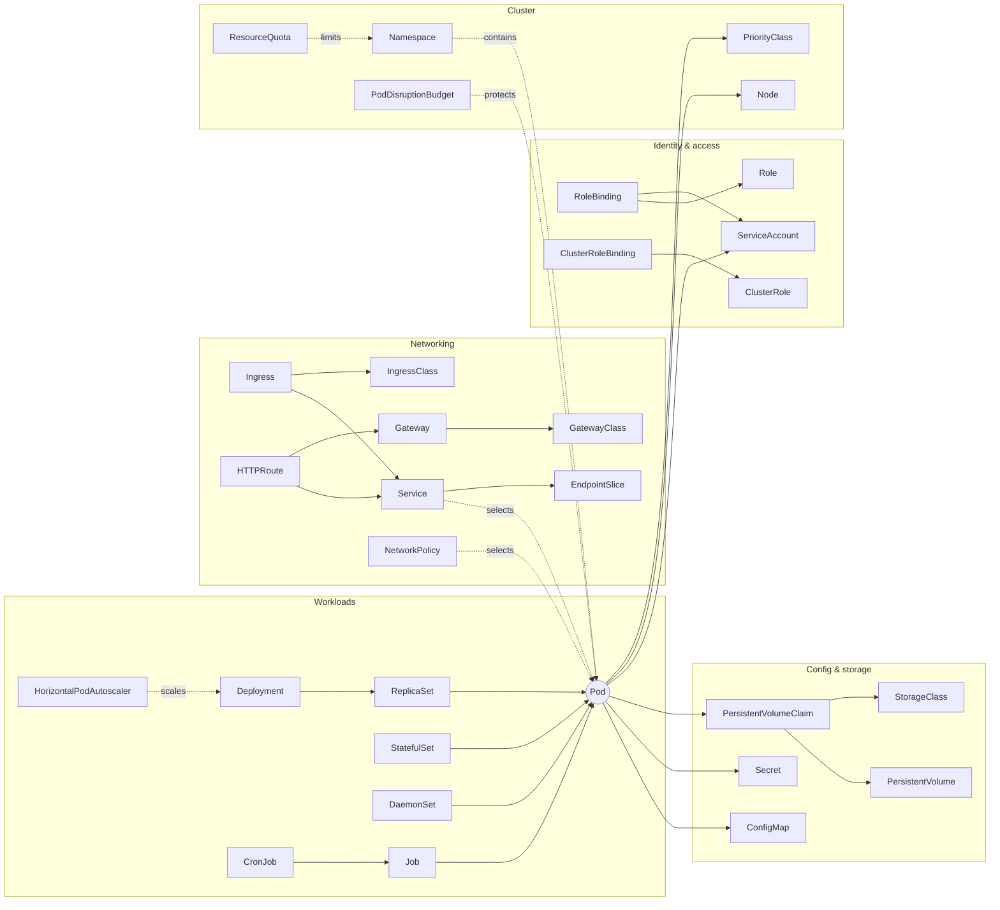

# 00-07 — The object catalogue: every Kubernetes object, what it is and how it connects

> **Module type:** Foundation — reference tour. Read once end to end, then use as a map for the rest of the course
> **Time:** ~2 hours (90 reading, 30 lab)
> **Prerequisites:** `00-04` (the object model), `00-06` (Pod, Deployment, Service in action)
> **Maps to:** CKA — every task names objects; this is the list of all of them, with their CKA weight

---

## 1. Why this module exists

`00-04` taught the shape every object shares. This module goes through **every built-in kind**,
grouped by job, and gives each one a card:

| Card field | Question it answers |
|---|---|
| **Is** | What is it, in one sentence? |
| **Contains** | The fields that matter |
| **Connects to** | What it points at or selects, and what points at it |
| **Acted on by** | Which component reads it and makes something happen. *No actor = it is just data* |
| **CKA** | ★★★ used constantly · ★★ appears regularly · ★ know what it is · — not on the exam |
| **Deep dive** | The module that covers it fully |

You do not need to memorise the cards now. The goal is that **no object in the rest of the course
is completely new**: when Domain 4 introduces StorageClasses, you already know where they sit.

How to read any object you have never seen, on any cluster:

```bash
kubectl api-resources | grep -i <name>      # group/version, short name, namespaced?
kubectl explain <kind>                      # description + top-level fields
kubectl explain <kind>.spec --recursive     # every field
kubectl get <kind> -A -o yaml | less        # real examples on this cluster
```

---

## 2. The object model — the whole map on one page



Two kinds of arrow carry almost all of Kubernetes:

- **References by name** (solid): a Pod names its ConfigMap, its ServiceAccount, its PVC; a PVC
  names its StorageClass; a RoleBinding names its Role. A typo → the referencing object fails
  (`CreateContainerConfigError`, `Pending`, "role not found").
- **Selection by label** (dotted): Services, NetworkPolicies, PDBs and controllers select Pods by
  labels. A typo → **nothing fails, it silently selects nothing.**

---

## 3. Workloads — things that run containers

### Pod · `v1` · namespaced · CKA ★★★
- **Is:** one or more containers that share a network namespace (one IP, `localhost`), volumes and a lifecycle, always scheduled together onto one node. The only object that actually runs anything.
- **Contains:** `containers[]` (image, command/args, env, ports, resources, probes, volumeMounts, securityContext), `initContainers[]`, `volumes[]`, `restartPolicy`, `serviceAccountName`, `nodeSelector`/`affinity`/`tolerations`, `nodeName`, `priorityClassName`.
- **Connects to:** a Node (`nodeName`); ConfigMaps, Secrets, PVCs, ServiceAccount by name; owned by a ReplicaSet/StatefulSet/DaemonSet/Job.
- **Acted on by:** scheduler (binds), kubelet (runs, probes, reports status).
- **Deep dive:** `01-01`, `01-02`, `01-08`, `01-09`

```yaml
apiVersion: v1
kind: Pod
metadata: { name: p }
spec:
  containers:
  - { name: app, image: nginx:1.27 }
```

### ReplicaSet · `apps/v1` · namespaced · CKA ★
- **Is:** "keep exactly N Pods matching this selector running."
- **Contains:** `replicas`, `selector`, `template` (a Pod spec).
- **Connects to:** owns Pods; owned by a Deployment.
- **Acted on by:** ReplicaSet controller.
- **Note:** you almost never create one directly — a Deployment does. **Deep dive:** `01-03`

### Deployment · `apps/v1` · namespaced · CKA ★★★
- **Is:** declarative, versioned management of stateless Pods: rolling updates, rollback, scaling.
- **Contains:** `replicas`, `selector`, `template`, `strategy` (`RollingUpdate` with `maxSurge`/`maxUnavailable`, or `Recreate`), `revisionHistoryLimit`, `progressDeadlineSeconds`.
- **Connects to:** owns one ReplicaSet per template version.
- **Acted on by:** Deployment controller.
- **Deep dive:** `01-03`, `01-04`

### StatefulSet · `apps/v1` · namespaced · CKA ★★
- **Is:** Pods with **stable identity**: fixed names (`db-0`, `db-1`), stable DNS through a headless Service, and one PVC per Pod that follows it across rescheduling. Ordered create/delete.
- **Contains:** `serviceName` (the headless Service), `replicas`, `template`, `volumeClaimTemplates`, `podManagementPolicy`, `updateStrategy` (with `partition`).
- **Connects to:** owns Pods directly (no ReplicaSet); creates PVCs from templates; requires a headless Service.
- **Acted on by:** StatefulSet controller.
- **Deep dive:** `01-06`, `04-05`

### DaemonSet · `apps/v1` · namespaced · CKA ★★
- **Is:** "one copy of this Pod on every (matching) node" — node agents: log shippers, CNI, kube-proxy, monitoring.
- **Contains:** `selector`, `template`, `updateStrategy`; node targeting through the template's `nodeSelector`/affinity/tolerations.
- **Acted on by:** DaemonSet controller (creates Pods with node affinity per node; the scheduler binds them).
- **Deep dive:** `01-05`

### Job · `batch/v1` · namespaced · CKA ★★
- **Is:** run Pods **to completion** — a batch task, retried on failure.
- **Contains:** `template` (with `restartPolicy: Never|OnFailure`), `completions`, `parallelism`, `backoffLimit`, `activeDeadlineSeconds`, `ttlSecondsAfterFinished`, `completionMode: Indexed`.
- **Acted on by:** Job controller.
- **Deep dive:** `01-07`

### CronJob · `batch/v1` · namespaced · CKA ★★
- **Is:** creates a Job on a cron schedule.
- **Contains:** `schedule`, `timeZone`, `jobTemplate`, `concurrencyPolicy` (`Allow|Forbid|Replace`), `successfulJobsHistoryLimit`, `failedJobsHistoryLimit`, `suspend`, `startingDeadlineSeconds`.
- **Acted on by:** CronJob controller. **Deep dive:** `01-07`

### HorizontalPodAutoscaler · `autoscaling/v2` · namespaced · CKA ★★
- **Is:** adjusts a workload's `replicas` from metrics (CPU/memory utilisation vs **requests**, or custom metrics).
- **Contains:** `scaleTargetRef`, `minReplicas`, `maxReplicas`, `metrics[]`, `behavior`.
- **Connects to:** a Deployment/StatefulSet (via its `scale` subresource); needs **metrics-server**.
- **Acted on by:** HPA controller (in kube-controller-manager). **Deep dive:** `05-06`

### ReplicationController · `v1` · CKA —
Legacy predecessor of ReplicaSet (equality-only selectors). Recognise it; never create it.

---

## 4. Networking — how traffic finds Pods

### Service · `v1` · namespaced · CKA ★★★
- **Is:** a stable virtual IP and DNS name that load-balances to the **Ready** Pods matching a label selector.
- **Contains:** `type` (`ClusterIP`, `NodePort`, `LoadBalancer`, `ExternalName`), `selector`, `ports[]` (`port`, `targetPort`, `nodePort`, `protocol`, `name`), `clusterIP` (`None` = headless), `sessionAffinity`, `externalTrafficPolicy`, `internalTrafficPolicy`.
- **Connects to:** Pods by label; owns EndpointSlices.
- **Acted on by:** EndpointSlice controller (fills endpoints), kube-proxy (node rules), CoreDNS (names), cloud-controller-manager (`LoadBalancer`).
- **Deep dive:** `03-02`, `03-03`

### EndpointSlice · `discovery.k8s.io/v1` · namespaced · CKA ★★
- **Is:** the list of Pod IPs + ports (with ready/serving/terminating conditions) behind a Service — up to 100 per slice.
- **Connects to:** its Service by the label `kubernetes.io/service-name`.
- **Acted on by:** written by the EndpointSlice controller; read by kube-proxy and ingress/gateway controllers.
- **Debugging rule:** *Service doesn't work → look at its EndpointSlices first.* **Deep dive:** `03-02`

### Endpoints · `v1` · CKA ★
The older single-object form of the same data. **Deprecated** in favour of EndpointSlice (still populated; `kubectl get endpoints` still works and still shows up in exam answers).

### Ingress · `networking.k8s.io/v1` · namespaced · CKA ★★
- **Is:** HTTP(S) routing rules — host and path → Service — for an ingress controller to implement.
- **Contains:** `ingressClassName`, `rules[]` (`host`, `http.paths[]` with `path`, `pathType: Prefix|Exact|ImplementationSpecific`, `backend.service`), `tls[]` (hosts + Secret name), `defaultBackend`.
- **Acted on by:** an **ingress controller** you install (none is built in). Without one, an Ingress does nothing.
- **Deep dive:** `03-05`

### IngressClass · `networking.k8s.io/v1` · cluster-scoped · CKA ★
Names an ingress controller implementation (`spec.controller`); one may be the cluster default. Ingresses pick one with `ingressClassName`.

### NetworkPolicy · `networking.k8s.io/v1` · namespaced · CKA ★★★
- **Is:** a firewall for Pods: which traffic may enter (`ingress`) and leave (`egress`) the selected Pods. Once a Pod is selected by any policy for a direction, everything not allowed in that direction is denied.
- **Contains:** `podSelector`, `policyTypes`, `ingress[].from[]` / `egress[].to[]` (`podSelector`, `namespaceSelector`, `ipBlock`) and `ports[]`.
- **Acted on by:** the **CNI plugin** — only if it supports policies (kindnet's support is basic; Calico/Cilium in Domain 3).
- **Deep dive:** `03-07`

### Gateway API: GatewayClass, Gateway, HTTPRoute, GRPCRoute, ReferenceGrant · `gateway.networking.k8s.io/v1` · CKA ★★
- **Is:** the successor to Ingress, split by role: **GatewayClass** (cluster-scoped; which implementation — the infra provider), **Gateway** (a listener: ports, hostnames, TLS — the cluster operator), **HTTPRoute/GRPCRoute** (routing rules to Services, including weighted traffic splits and header matching — the app team), **ReferenceGrant** (permission for a route to reference a Service in another namespace).
- **Note:** installed as **CRDs** plus a controller; not built in. In the current CKA curriculum. **Deep dive:** `03-06`

### ServiceCIDR, IPAddress · `networking.k8s.io/v1` · cluster-scoped · CKA —
The ranges Service ClusterIPs are allocated from, and one object per allocated IP. Lets admins extend the Service range at runtime. Know they exist.

---

## 5. Configuration — data for Pods

### ConfigMap · `v1` · namespaced · CKA ★★★
- **Is:** non-secret key/value configuration.
- **Contains:** `data` (strings), `binaryData`, `immutable`.
- **Connects to:** consumed by Pods as env (`env.valueFrom.configMapKeyRef`, `envFrom`) or as files (a `configMap` volume). Size limit 1 MiB.
- **Acted on by:** kubelet (projects it into Pods). Mounted files update eventually; env vars never do.
- **Deep dive:** `02-01`

### Secret · `v1` · namespaced · CKA ★★★
- **Is:** like a ConfigMap for sensitive values — **base64-encoded, not encrypted** (unless encryption at rest is configured), kept in tmpfs on nodes, and separable by RBAC.
- **Contains:** `type` (`Opaque`, `kubernetes.io/tls`, `kubernetes.io/dockerconfigjson`, `kubernetes.io/service-account-token`, `kubernetes.io/basic-auth`…), `data` (base64), `stringData` (write-only plain convenience).
- **Connects to:** Pods (env/volume), `imagePullSecrets`, Ingress/Gateway TLS.
- **Deep dive:** `02-02`, `06-07`

---

## 6. Storage — data that outlives containers

### PersistentVolumeClaim (PVC) · `v1` · namespaced · CKA ★★★
- **Is:** a **request** for storage by an application: "I need 10 Gi, ReadWriteOnce, of class `fast`."
- **Contains:** `accessModes`, `resources.requests.storage`, `storageClassName`, `volumeMode`, `selector`, `dataSource` (clone/snapshot).
- **Connects to:** binds 1:1 to a PV; referenced by Pods (`volumes[].persistentVolumeClaim.claimName`).
- **Acted on by:** PV controller (binding), external provisioner (dynamic creation). **Deep dive:** `04-02`

### PersistentVolume (PV) · `v1` · **cluster-scoped** · CKA ★★★
- **Is:** an actual piece of storage (a disk, an NFS export, a local path) represented in the cluster.
- **Contains:** `capacity`, `accessModes` (`RWO`, `ROX`, `RWX`, `RWOP`), `persistentVolumeReclaimPolicy` (`Retain`, `Delete`), `storageClassName`, `nodeAffinity`, the volume source (`csi`, `nfs`, `hostPath`, `local`…), `claimRef`.
- **Lifecycle:** `Available` → `Bound` → (PVC deleted) `Released` → deleted or kept by reclaim policy.
- **Deep dive:** `04-02`

### StorageClass · `storage.k8s.io/v1` · cluster-scoped · CKA ★★★
- **Is:** a template for **dynamically** creating PVs: which provisioner, which parameters.
- **Contains:** `provisioner`, `parameters`, `reclaimPolicy`, `volumeBindingMode` (`Immediate` | `WaitForFirstConsumer`), `allowVolumeExpansion`; annotation `storageclass.kubernetes.io/is-default-class`.
- **On this cluster:** kind ships `standard` (local-path provisioner). **Deep dive:** `04-03`

### CSIDriver, CSINode, VolumeAttachment, CSIStorageCapacity · `storage.k8s.io/v1` · CKA ★
Plumbing for **CSI** storage plugins: which drivers are installed, which nodes run them, which volume is attached to which node, and how much capacity is available where. You read them when debugging attach failures. **Deep dive:** `04-04`

### VolumeAttributesClass · `storage.k8s.io/v1` · cluster-scoped · CKA —
Changeable performance attributes (IOPS, throughput) for an existing volume without recreating it.

### VolumeSnapshot, VolumeSnapshotContent, VolumeSnapshotClass · `snapshot.storage.k8s.io/v1` · CKA ★
CRDs (from the external-snapshotter project) mirroring the PVC/PV/StorageClass pattern for **point-in-time snapshots**. **Deep dive:** `04-04`

---

## 7. Identity and access

### ServiceAccount · `v1` · namespaced · CKA ★★★
- **Is:** an **identity for Pods** (and for automation) to call the API. Every namespace gets a `default` one.
- **Contains:** `automountServiceAccountToken`, `imagePullSecrets`, `secrets` (legacy).
- **Connects to:** Pods (`serviceAccountName`); subject of RoleBindings. Pods get a short-lived **projected token** at `/var/run/secrets/kubernetes.io/serviceaccount/token`.
- **Deep dive:** `06-03`

### Role / ClusterRole · `rbac.authorization.k8s.io/v1` · namespaced / cluster-scoped · CKA ★★★
- **Is:** a list of permissions: `rules[]` of `apiGroups` × `resources` (optionally `resourceNames`) × `verbs` (`get`, `list`, `watch`, `create`, `update`, `patch`, `delete`…). Additive only — no deny.
- **ClusterRole extras:** cluster-scoped resources (nodes, PVs), non-resource URLs (`/healthz`), and **aggregation** (`aggregationRule`) — e.g. the built-in `admin`, `edit`, `view`.
- **Deep dive:** `06-02`

### RoleBinding / ClusterRoleBinding · `rbac.authorization.k8s.io/v1` · CKA ★★★
- **Is:** grants a Role or ClusterRole (`roleRef`, **immutable**) to `subjects[]` — `User`, `Group` or `ServiceAccount`.
- **The scope rule:** a **RoleBinding** grants within its namespace — even when it references a ClusterRole. A **ClusterRoleBinding** grants cluster-wide.
- **Acted on by:** the RBAC authorizer in the API server. **Deep dive:** `06-02`

### CertificateSigningRequest · `certificates.k8s.io/v1` · cluster-scoped · CKA ★★
- **Is:** a request to have the cluster CA sign a certificate — how you create a **user** (users are not objects; they are the CN/O of a certificate).
- **Contains:** `request` (base64 PEM CSR), `signerName` (e.g. `kubernetes.io/kube-apiserver-client`), `usages`, `expirationSeconds`.
- **Flow:** create → `kubectl certificate approve` → read `status.certificate`. **Deep dive:** `06-01`, `07-04`

### TokenReview, SubjectAccessReview, SelfSubjectAccessReview, SelfSubjectReview · CKA ★
"Virtual" objects you **create** to ask the API server a question ("is this token valid?", "may X do Y?") and read the answer in `status`; nothing is stored. `kubectl auth can-i` and `kubectl auth whoami` create them for you.

---

## 8. Policy, quotas and admission

### Namespace · `v1` · cluster-scoped · CKA ★★★
Scope for names, and the unit to which quotas, RBAC, Pod Security labels and NetworkPolicies are applied. Deleting it deletes its content. **Deep dive:** `00-04`

### ResourceQuota · `v1` · namespaced · CKA ★★
- **Is:** caps the **total** a namespace may consume: `requests.cpu`, `limits.memory`, `pods`, `services`, `persistentvolumeclaims`, `count/deployments.apps`…
- **Acted on by:** ResourceQuota admission plugin (rejects at creation) + quota controller (tracks usage).
- **Trap:** with a cpu/memory quota, Pods without requests/limits are **rejected**. **Deep dive:** `05-05`

### LimitRange · `v1` · namespaced · CKA ★★
Per-container/Pod **defaults and min/max** for requests and limits in a namespace (`default`, `defaultRequest`, `min`, `max`, `maxLimitRequestRatio`). Applied by the LimitRanger admission plugin at Pod creation only. **Deep dive:** `05-05`

### PriorityClass · `scheduling.k8s.io/v1` · cluster-scoped · CKA ★★
A named integer priority (`value`, `globalDefault`, `preemptionPolicy`). Higher-priority Pods are scheduled first and may **preempt** (evict) lower ones. Built-ins: `system-cluster-critical`, `system-node-critical`. **Deep dive:** `05-04`

### PodDisruptionBudget · `policy/v1` · namespaced · CKA ★★
"During **voluntary** disruptions (drain, upgrades), keep at least `minAvailable` / at most `maxUnavailable` of the Pods matching `selector`." Enforced by the **eviction API** — `kubectl drain` respects it, deleting a Pod directly does not. **Deep dive:** `05-07`

### RuntimeClass · `node.k8s.io/v1` · cluster-scoped · CKA ★
Selects a container runtime handler for a Pod (`runtimeClassName`) — e.g. gVisor or Kata for sandboxing. **Deep dive:** `06-09`

### ValidatingAdmissionPolicy + ValidatingAdmissionPolicyBinding · `admissionregistration.k8s.io/v1` · CKA ★
In-process admission rules written in **CEL** ("every Deployment must have ≤ 5 replicas"), bound to namespaces/resources; no webhook to run. **MutatingAdmissionPolicy** is the mutating counterpart (newer — check `kubectl api-resources` on your version). **Deep dive:** `06-06`

### ValidatingWebhookConfiguration / MutatingWebhookConfiguration · `admissionregistration.k8s.io/v1` · CKA ★
Register external HTTPS webhooks that the API server calls during admission (used by Kyverno, Gatekeeper, Istio injection, cert-manager…). A broken webhook with `failurePolicy: Fail` blocks matching requests. **Deep dive:** `06-06`, `09-04`

---

## 9. Cluster infrastructure and API machinery

### Node · `v1` · cluster-scoped · CKA ★★★
- **Is:** a machine registered by its kubelet.
- **Contains:** `spec.taints`, `spec.unschedulable` (cordon), `spec.podCIDR`; `status.capacity`/`allocatable`, `conditions` (`Ready`, `MemoryPressure`, `DiskPressure`, `PIDPressure`), `nodeInfo` (versions, runtime), `addresses`.
- **Acted on by:** kubelet (status), node lifecycle controller (taints, eviction), scheduler (reads).
- **Deep dive:** `05-03`, `07-05`, `08-05`

### Lease · `coordination.k8s.io/v1` · namespaced · CKA ★
A tiny "I'm alive, held by X until T" record. Node heartbeats (`kube-node-lease`) and leader election for the scheduler and controller-manager (`kube-system`). `00-03`

### Event · `v1` (also `events.k8s.io/v1`) · namespaced · CKA ★★★
A record that something happened to an object (`reason`, `message`, `type: Normal|Warning`, `involvedObject`, `count`). Your **first debugging source**; expires after ~1 hour. `00-03`, `08-01`

### CustomResourceDefinition · `apiextensions.k8s.io/v1` · cluster-scoped · CKA ★★
Adds a new kind to the API (with an OpenAPI schema, versions, scope). After creating a CRD, `kubectl get <newkind>` works. Operators = CRD + controller. In the current CKA curriculum at "install and use" level. **Deep dive:** `09-01`

### APIService · `apiregistration.k8s.io/v1` · cluster-scoped · CKA ★
Registers an API group/version — either served locally or **aggregated** from another service (e.g. `v1beta1.metrics.k8s.io` → metrics-server). An unavailable APIService breaks discovery and namespace deletion. **Deep dive:** `09-05`

### FlowSchema, PriorityLevelConfiguration · `flowcontrol.apiserver.k8s.io/v1` · CKA —
**API Priority and Fairness**: how the API server queues and limits requests so one noisy client cannot starve the rest.

### DeviceClass, ResourceClaim, ResourceClaimTemplate, ResourceSlice · `resource.k8s.io/v1` · CKA —
**Dynamic Resource Allocation** — requesting GPUs and other devices like storage. **Deep dive:** `09-06`

### ComponentStatus · `v1` · CKA —
Deprecated health view of scheduler/controller-manager/etcd. Use `kubectl get --raw='/readyz?verbose'` and the `kube-system` Pods instead.

---

## 10. Decision table — "I need to…" → the object

| I need to… | Object |
|---|---|
| Run a stateless app with rolling updates | Deployment |
| Run a database with stable names and its own disk per replica | StatefulSet (+ headless Service + PVCs) |
| Run an agent on every node | DaemonSet |
| Run a task once / on a schedule | Job / CronJob |
| Scale on CPU | HorizontalPodAutoscaler |
| Give Pods a stable name and IP | Service |
| Expose HTTP by host/path to the outside | Ingress, or Gateway + HTTPRoute |
| Firewall Pods | NetworkPolicy |
| Inject config / secrets | ConfigMap / Secret |
| Persistent disk | PVC (+ StorageClass, or a pre-made PV) |
| Identity for a Pod | ServiceAccount |
| Grant permissions | Role/ClusterRole + RoleBinding/ClusterRoleBinding |
| Add a human user | CertificateSigningRequest (or an external OIDC provider) |
| Cap a team's consumption | ResourceQuota (+ LimitRange for defaults) |
| Survive node drains with enough replicas | PodDisruptionBudget |
| Make critical Pods win scheduling | PriorityClass |
| Enforce a rule on every object of a kind | ValidatingAdmissionPolicy (or a webhook) |
| Add my own kind | CustomResourceDefinition |

---

## 11. Gotchas and exam traps

1. **Selection failures are silent.** A Service, NetworkPolicy or PDB with a wrong selector produces no error — just no effect.
2. **Reference failures are loud.** A Pod naming a missing ConfigMap/Secret/PVC/ServiceAccount fails (`CreateContainerConfigError`, `Pending`, or rejected at admission).
3. **Cluster-scoped vs namespaced pairs:** PV/PVC, ClusterRole/Role, ClusterRoleBinding/RoleBinding, IngressClass/Ingress, GatewayClass/Gateway, StorageClass/PVC.
4. **Several objects do nothing on their own:** Ingress (needs a controller), Gateway/HTTPRoute (CRDs + controller), NetworkPolicy (needs a CNI that enforces it), HPA (needs metrics-server), a CRD (needs a controller).
5. **`roleRef` in a binding is immutable** — delete and recreate the binding to change the role.
6. **There is no User kind.** Users exist only in certificates and tokens.
7. **PDBs are honoured by eviction (drain), not by `kubectl delete pod`.**
8. **Endpoints is deprecated; EndpointSlice is what kube-proxy reads.**

---

## 12. Lab — dissect what is already running

The cluster already contains most of these kinds. You will find them and trace their connections.

```bash
./labs/new-lab.sh lab-00-07
```

### 12.1 Inventory

```bash
kubectl api-resources --sort-by=name | wc -l                          # how many kinds this cluster serves
kubectl api-resources --namespaced=false -o name                      # the cluster-scoped ones
# which kinds actually have objects right now (cluster-wide):
for r in $(kubectl api-resources --verbs=list -o name); do
  n=$(kubectl get "$r" -A --no-headers 2>/dev/null | wc -l)
  [ "$n" -gt 0 ] && printf '%-60s %s\n' "$r" "$n"
done
```

✅ **Verify:** you can name the job of every kind in the output using the cards above.

### 12.2 Dissect CoreDNS — every object one application uses

CoreDNS is a normal application. Find all of its objects and draw the graph on paper.

```bash
kubectl -n kube-system get deploy coredns -o yaml | less          # template: serviceAccountName? volumes? priorityClassName? tolerations?
kubectl -n kube-system get rs,pods -l k8s-app=kube-dns -o wide     # owned objects
kubectl -n kube-system get svc kube-dns -o wide                    # the Service — and its name is NOT coredns
kubectl -n kube-system get endpointslices -l kubernetes.io/service-name=kube-dns
kubectl -n kube-system get configmap coredns -o yaml               # the Corefile
kubectl -n kube-system get serviceaccount coredns
kubectl get clusterrolebinding -o wide | grep -i coredns           # which ClusterRole is bound to that SA?
kubectl get clusterrole system:coredns -o yaml                     # what may CoreDNS do?
kubectl get priorityclass
```

✅ **Verify:** your drawing has at least: Deployment → ReplicaSet → Pods; Service → EndpointSlice
→ Pod IPs; Pod → ConfigMap (volume); Pod → ServiceAccount ← ClusterRoleBinding → ClusterRole;
Pod → PriorityClass. Answer: **why does CoreDNS need to list Services and EndpointSlices?**
(Answer in the self-check.)

### 12.3 Dissect kube-proxy and the storage class

```bash
kubectl -n kube-system get ds kube-proxy -o yaml | grep -E 'serviceAccountName|configMap|hostNetwork|tolerations' -A2
kubectl -n kube-system get cm kube-proxy -o yaml | grep -E 'mode:'           # iptables / nftables / ipvs
kubectl get storageclass
kubectl get storageclass standard -o yaml                                    # provisioner, volumeBindingMode
```

### 12.4 Break it: silent vs loud failures

```bash
# loud: a reference to something missing
kubectl run loud --image=nginx:1.27 --overrides='{"spec":{"containers":[{"name":"loud","image":"nginx:1.27","envFrom":[{"configMapRef":{"name":"nope"}}]}]}}'
kubectl get pod loud                         # CreateContainerConfigError
kubectl describe pod loud | tail -5

# silent: a selector matching nothing
kubectl create deployment quiet --image=nginx:1.27
kubectl create service clusterip quiet-svc --tcp=80:80     # selector becomes app=quiet-svc (00-05 trap)
kubectl get endpointslices -l kubernetes.io/service-name=quiet-svc     # no endpoints, no error anywhere
```

✅ **Verify:** fix both — create ConfigMap `nope` (watch `loud` start on its own), and point
`quiet-svc`'s selector at `app=quiet` (`kubectl set selector svc quiet-svc app=quiet`).

### 12.5 Ask the API questions (virtual objects)

```bash
kubectl auth can-i list secrets -n kube-system --as=system:serviceaccount:lab-00-07:default
kubectl auth can-i list endpointslices --as=system:serviceaccount:kube-system:coredns -A
kubectl auth whoami
```

✅ **Verify:** you can explain that each command created a review object whose `status` held the
answer, and that nothing was stored.

### 12.6 Clean up

```bash
./labs/clean-labs.sh
```

---

## 13. Self-check

1. Name the object you would use for each: a nightly backup; a log agent on every node; a 3-replica database with its own disk per replica; HTTP routing by hostname.
2. Which of these are cluster-scoped: PV, PVC, StorageClass, Role, ClusterRoleBinding, IngressClass, NetworkPolicy, PriorityClass, Lease?
3. Which objects do **nothing** unless an extra component is installed? Name the component for each.
4. Why does CoreDNS need `list`/`watch` on Services and EndpointSlices?
5. A RoleBinding in namespace `dev` references the ClusterRole `admin`. Where does the subject have admin rights?
6. How do you add a new human user to a kubeadm cluster, given that there is no User object?
7. What is the difference between a ResourceQuota and a LimitRange?
8. `kubectl drain` hangs on a node; `kubectl delete pod` on the same Pod works instantly. Which object explains the difference?
9. Which two objects tell you whether a Service has backends, and which one does kube-proxy read?
10. What is the relationship between a StorageClass, a PVC and a PV in dynamic provisioning?

<details>
<summary>Answers</summary>

1. **CronJob**; **DaemonSet**; **StatefulSet** (+ headless Service + `volumeClaimTemplates`); **Ingress** or **Gateway + HTTPRoute**.
2. **PV, StorageClass, ClusterRoleBinding, IngressClass, PriorityClass.** PVC, Role, NetworkPolicy and Lease are namespaced.
3. **Ingress** → an ingress controller; **Gateway/HTTPRoute** → the Gateway API CRDs + a gateway controller; **NetworkPolicy** → a CNI that enforces policy; **HPA** → metrics-server (or a metrics adapter); a **CRD's objects** → the operator/controller; **VolumeSnapshot** → the snapshot CRDs + controller + a CSI driver that supports snapshots.
4. To answer DNS queries it must know every Service's ClusterIP (A records for `svc.cluster.local` names) and, for **headless** Services, the individual Pod IPs from EndpointSlices. It watches them to stay current.
5. **Only in `dev`.** A RoleBinding always grants within its own namespace, whatever it references.
6. Create a key and CSR, submit a **CertificateSigningRequest** with signer `kubernetes.io/kube-apiserver-client`, approve it, give the user the issued certificate in a kubeconfig, and grant permissions with **RoleBindings** to the certificate's CN (user) or O (group).
7. **ResourceQuota** caps the namespace's **total** consumption (and object counts); **LimitRange** sets **per-container/Pod defaults and min/max**.
8. A **PodDisruptionBudget**. Drain uses the eviction API, which respects PDBs; a direct delete does not.
9. **EndpointSlice** (current) and **Endpoints** (deprecated). kube-proxy reads **EndpointSlices**.
10. The PVC names a **StorageClass**; the provisioner named in that class creates a **PV** matching the claim and the PV controller **binds** them 1:1. Without a class (or with a pre-created PV) binding is static.

</details>

---

## Domain 0 complete

Take [`practice/00-foundations-exam.md`](../practice/00-foundations-exam.md) closed-book. **Score
20+ in Part A and 4/5 in Part B before starting Domain 1.**

**Previous:** [`00-06` — Your first application, end to end](00-06-first-app-end-to-end.md)
**Next:** Domain 1 — [`01-workloads`](../01-workloads/)
